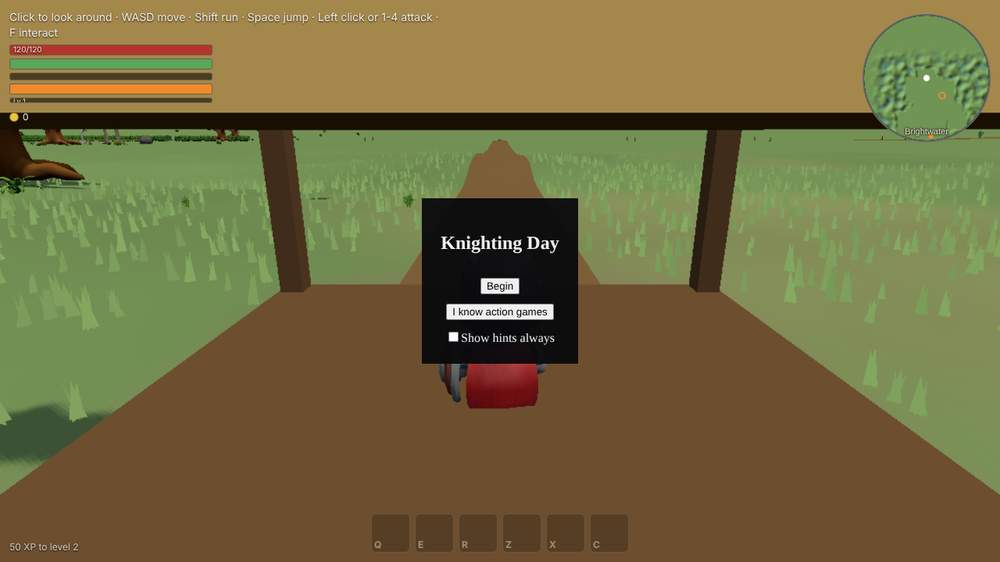

# Embers of Valdren: tester guide

A step-by-step walkthrough of the whole game for manual testers: every main quest (M01 to M56), every required region quest (R01 to R30), every Act 1 side job (J01 to J11), all ten story dungeons and bosses (D01 to D10), the M56 ending choice, both endings, the epilogue, the credits and the after-ending world.

Written against `main` at `a3a7511` (PR #202, 2026-11-12). Objective text, rewards and giver names in this guide are read from the game's own quest data, so they match what the journal shows.

| File | Covers |
| --- | --- |
| [README.md](README.md) | Setup, controls, saves, debug jumps (this page) |
| [act-1.md](act-1.md) | Tutorial, Act 1 "The Cracked Hearth": M01 to M10, R01 to R04, D01, D02, side jobs J01 to J11, Act 1 ending |
| [act-2.md](act-2.md) | Act 2 "Coin and Cinders": M11 to M22, R05 to R11, D03, D04, Act 2 ending |
| [act-3.md](act-3.md) | Act 3 "The Coal-Mother": M23 to M34, R12 to R18, D05, D06, Act 3 ending |
| [act-4.md](act-4.md) | Act 4 "The Council of Ash": M35 to M46, R19 to R25, D07, D08, Act 4 ending |
| [act-5.md](act-5.md) | Act 5 "The Sunforge": M47 to M56, R26 to R30, D09, D10, the ending choice, both endings, epilogue, credits, after-ending world |

Screenshots live under `images/<act>/`. Shots named `*-giver.jpg` and `*-journal.jpg` were captured for this guide on the build above. The other shots were captured by the build threads while the content was made (October and November 2026); the scene is the same, but small HUD details may differ. The pictures are JPEG copies (1000 px wide) of the original captures, to keep the repository light; the full-size originals and a printable PDF of this guide stay in the project files. `scripts/capture-tester-guide.mjs` re-shoots the journal pictures from a dev build.

---

## 1. Getting the build

### Live site
https://mostafafarouk90.github.io/OpenWorld/ is the production build. Use it for full playthroughs. **Debug jumps (`?act1=` to `?act5=`), `?siege=`, `?afterEnding=` and the `window.__game` console handle are compiled out of production**, so on the live site every quest has to be reached by playing. Pages deploys only after a merge to `main`, so as of 2026-11-12 the live site matches `a3a7511`; check the commit before filing a bug against a later fix.

### Local dev build (needed for jumps)
```sh
git clone https://github.com/MostafaFarouk90/OpenWorld.git
cd OpenWorld
npm ci
npm run dev          # Vite dev server, http://localhost:5173/
```
Open `http://localhost:5173/` plus any of the URL parameters below.

Chrome or Edge with hardware acceleration on is recommended. The first load of a dev server takes 30 to 60 s while Vite compiles.

---

## 2. Start screen and saves



- **Begin**: the full "Knighting Day" tutorial (beats T01 to T15, about 39 minutes).
- **I know action games**: collapses the sprint, jump, attack, block, dodge and lock-on beats into one short skirmish.
- **Show hints always**: keeps key prompts on screen for the whole game.
- **Skip to Kettlewick** (only after a save has finished the tutorial once): starts after T12 with the starter kit, one skill point and the waystone.
- On a later visit the **Welcome back** box offers **Continue** or **New Game**.

**Save slots** (browser storage, per site):

| Slot | Written when |
| --- | --- |
| `autosave` | Every save: timer, zone change, leaving the page, quest checkpoints, waystones, rests |
| `slot-0` (Continue) | Waystone use, resting, and the scripted saves (ending, after-ending) |
| `slot-0.backup` | The previous `slot-0`, kept as a fallback |

A "Game saved" toast confirms a save. A run with `&new` in the URL never writes to these slots, so jumping around does not damage a real playthrough. To start truly fresh, clear the site's storage (DevTools, Application, Clear site data).

**Death**: after the tutorial, a death returns you to the last waystone and drops 10% of carried gold as a recoverable ember pouch where you fell.

---

## 3. Controls (defaults, all rebindable)

| Action | Key |
| --- | --- |
| Move / camera | WASD (or arrows) / mouse (click the canvas to capture) |
| Sprint / jump | Shift / Space |
| Interact, talk, pick up; hold to kneel, rest, rekindle | F |
| Mercy (Spare, Calm, Release); hold 0.5 s | T |
| Attacks 1 to 4 | 1 to 4 (1 is also left mouse) |
| Block / dodge | Right mouse hold / Ctrl (or mouse button 4) |
| Lock-on | Tab |
| Heartshard Surge / Surge Leap | G / V (Leap from M03) |
| Sneak | Left Alt hold (from M06) |
| Mount or dismount the Ashmare | H (from M10) |
| Ability bar | Q, E, R, Z, X, C |
| Inventory, skills, journal, map, codex, party | I, K, J, M, L, P |
| Dialogue: next / choices | Space or F / 1 to 4 |
| Menu, close a screen; hold to skip a tutorial beat | Esc |

**Mercy verbs unlock in Act 1**: Release (M03, costs Burn), Spare (M04), Calm (D02, costs Hearth Bread or another offering).

---

## 4. URL parameters

All of these except `quality`, `env` and `tutorial` work on the dev build only.

| Parameter | What it does |
| --- | --- |
| `?tutorial=full` | Start the full tutorial at once (no start screen) |
| `?tutorial=veteran` | The "I know action games" tutorial (T06 to T11 collapsed into one skirmish) |
| `?tutorial=kettlewick` | The "Skip to Kettlewick" start: every beat before T15 is granted; you stand at the Kettlewick gate for the T15 wave, with M01 already active |
| `?tutorial=t09` (any beat id t01 to t15) | Start the full tutorial at that beat with all earlier rewards |
| `?quality=low\|medium\|high` | Force a graphics step (otherwise a frame probe picks one) |
| `?env=off` | Hide environment set dressing (performance comparison) |
| `?act1=<id>&new` | Jump a fresh game to the start of an Act 1 quest |
| `?act2=<id>&new[&class=<class>]` | Act 2 jump; class is `knight` (default), `warden`, `emberwright`, `pathfinder` or `ashblade` |
| `?act3=<id>&new[&order=greyfen\|spine][&class=...]` | Act 3 jump; `order` says which approach block was played first |
| `?act4=<id>&new[&class=...]` | Act 4 jump |
| `?act5=<id>&new[&favour=marshal\|keepers][&class=...]` | Act 5 jump; `favour` picks the Halvard-leaning or Oswin-leaning favour preset |
| `?act5=m52&new&favour=marshal&siege=m52` | Start straight into the M52 siege |
| `?act5=m56&new&afterEnding=rekindle\|let-it-die[&caelDied]` | Wake the after-ending world for an ending |
| `?debug` | F4 debug toggle |

**Jump ids** (all need `&new`; a jump with no entry for the id is refused with a console warning):

| Act | Ids |
| --- | --- |
| 1 | `m03 m04 m05 d01 r01 r02` (quest already started at the giver), `m06 m07 m08 m09 m10 r03 r04 d02` (you land beside the giver; accept the offer yourself) |
| 2 | `m11 m12 r06 r05 m13 r07 r11 m14 m15 d03 m16 m17 r08 r09 r10 m18 m19 m20 m21 d04 m22 ending` |
| 3 | `m23 m24 r12 m25 r14 r13 m26 m27 d05 m28 r15 m29 r16 m30 r17 r18 m31 m32 m33 m34 d06` |
| 4 | `m35 m36 r19 r20 r21 r22 r23 d07 m37 m38 m39 m40 m41 m42 m43 m44 r25 r24 m45 d08 m46` |
| 5 | `m47 m48 m49 r26 r29 m50 m51 m52 r27 r28 r30 m53 d09 m54 m55 d10 m56` |

M01 and M02 have no jump: use `?tutorial=kettlewick` for M01 (already active); M02 follows from Edda after M01.

### Dev console helpers (dev build only)
Open DevTools and use `const ctx = window.__game.game.ctx`:

| Need | Command |
| --- | --- |
| Which quests are active | `ctx.services.get('quests').active()` |
| Objectives of a quest | `ctx.services.get('quests').objectives('m04')` |
| Force-complete a quest (runs its rewards) | `ctx.services.get('quests').complete('m04')` |
| Read or set a flag | `ctx.state.getFlag('story.m04.ledger')`, `ctx.state.setFlag('story.d02.underwaysOpen', true)` |
| Where you stand | `ctx.player.feet` |

Use these only to get past a blocker so the rest can be tested, and log the blocker.

---

## 5. How to use the quest pages

Every quest section has the same parts:

- **Header line**: type, area, giver, what must be done first, the debug jump, the design's time estimate.
- **Steps**: the objectives in the order the journal shows them, with where to go and who to talk to. Objectives that are not ordered can be done in any order; the journal and the gold marker show the current one.
- **Rewards**: XP, items and gold as the quest data pays them. Kill XP is extra.
- **Verify**: checkboxes for the tester. Tick each one, or write the bug id beside it.
- **Choices and taste calls**: branches, the flags they set, and the invented details logged in `design/changes-applied.md` that Mostafa may still veto. Report anything that feels wrong there as "taste", not as a bug.

**General checks for every quest** (not repeated on each page):
- [ ] The offer appears only after the listed prerequisites, and the giver shows a marker on the minimap.
- [ ] The tracker (top right) and the journal (J) show the same current objective; counts (for example 2/4) go up as you act.
- [ ] Every talk target has an F prompt only while its objective is live.
- [ ] Rewards arrive once: XP toast, item in the inventory (I), gold counter.
- [ ] Saving at a waystone mid-quest and choosing Continue puts you back with the same progress.
- [ ] No console errors (DevTools) during the quest.

**Bug report template**: build or commit, URL used, quest id and objective id, steps, expected, actual, screenshot, console log.

---

## 6. Play order at a glance

| Act | Region and levels | Gate to the next act |
| --- | --- | --- |
| Tutorial | Brightwater Fields | T15 done: M01 active |
| 1 The Cracked Hearth | Brightwater Fields, Harrowmark; 1 to 9 | M10 and D02 done: card "Smoke Over Harrowmark", camp scene |
| 2 Coin and Cinders | Cinderreach Hills, Oldsmoke Mines; 8 to 19 | M22 and D04 done |
| 3 The Coal-Mother | Greyfen Marches, Dragonspine Peaks; 18 to 28 | M34 and D06 done |
| 4 The Council of Ash | Harrowmark, Ashen Waste; 28 to 35 | M46 and D08 done |
| 5 The Sunforge | Sunforge Caldera; 35 to 40 | M56 choice, ending, epilogue, credits, after-ending world |
