# Act 1: The Cracked Hearth

Brightwater Fields (Kettlewick, Brightwater Chapel, Hollin Ford, the Dead Road) and Harrowmark. Levels 1 to 9. Back to the [index](README.md).

**Act 1 count:** 2 tutorial quests (T03, T12), 10 main quests (M01 to M10), 4 region quests (R01 to R04), 2 dungeons (D01, D02), 11 side jobs (J01 to J11). The act ends when M10 and D02 are both complete.

**Recommended order** (the order the debug jumps assume): Tutorial, M01, M02, then M03, R01, R02 (any order), M04, M05, D01, then Harrowmark: M06, M07, then M08, R03, R04 (any order), M09, M10, D02. Side jobs J01 to J11 are optional and slot in as listed under each one.

| Id | Name | Giver | Opens after | Jump |
| --- | --- | --- | --- | --- |
| T03, T12 | Tutorial quests | Sir Gaut, Edda | New game | `?tutorial=full` |
| M01 | Ash on the Wind | Sir Gaut (auto) | Tutorial | `?tutorial=kettlewick` |
| M02 | A Mother's Bread | Edda Brannoc | M01 | none |
| M03 | Cold Embers | Sister Aelfreda | M01, M02 | `?act1=m03&new` |
| R01 | Wynn's Scarecrows | Wynn Tillman | M01, M02 | `?act1=r01&new` |
| R02 | The Marshal's Last Drill | Marshal Osric Stane | M01, M02 | `?act1=r02&new` |
| M04 | The Toll at Hollin Ford | Sir Gaut | M03 | `?act1=m04&new` |
| M05 | Wardstones for the Dead Road | Tobb Fenwick | M04 | `?act1=m05&new` |
| D01 | Prayers in the Vault | Sister Aelfreda | M05 | `?act1=d01&new` |
| M06 | Gates of Harrowmark | Captain Ealdred Rook | M05 | `?act1=m06&new` |
| M07 | The Tilted Anvil | Aldith Stonebrewer | M06 | `?act1=m07&new` |
| M08 | Kneel Before the Boy | Lord Wystan Halvard | M07 | `?act1=m08&new` |
| R03 | The Brewer's Debt | Aldith Stonebrewer | M07 | `?act1=r03&new` |
| R04 | The Archivist's Missing Pages | Whitlock the Archivist | M07 | `?act1=r04&new` |
| M09 | Oswin's Ledger | Lady Merrin Oswin | M08 | `?act1=m09&new` |
| M10 | Smoke Over the Rooftops | Gerta Quickfingers | M09 | `?act1=m10&new` |
| D02 | Hounds of the Underways | Captain Rook | every M and R quest of Act 1 | `?act1=d02&new` |
| J01 to J11 | Side jobs | various | see each job | none |

---

## Tutorial: Knighting Day (T01 to T15)

| Tutorial start, beat T01 | Journal (J) at the start |
| --- | --- |
|  | 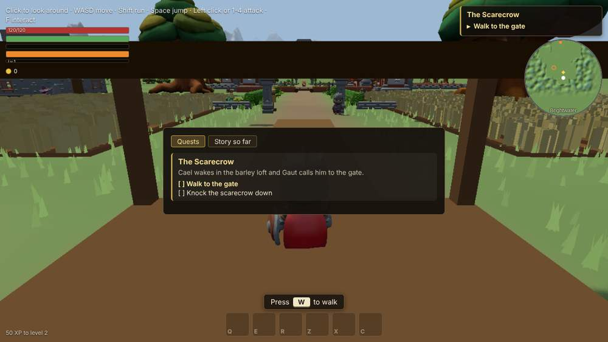 |

**Start:** New Game, then **Begin** (or `?tutorial=full`). Cael wakes in the barley loft; the tracker reads "The Scarecrow: Walk to the gate".

**Steps** (one mechanic per beat, prompts show the key):

| Beat | Do this | Passes when |
| --- | --- | --- |
| T01 | Walk to the gate (W) and knock the straw scarecrow down (1 or left click) | Scarecrow falls |
| T02 | Look at the three banners on the chapel roof (mouse) | All three looked at |
| T03 "A Warm Welcome" | Greet Marshal Stane at the Practice Yard, visit Edda at the bakery, read the notice board (F) | Three interactions |
| T04 | The Knighting at Brightwater Chapel: hold F to kneel, pick three vow lines | Vow complete |
| T05 | Defeat three ash wraiths with attack 1 only | Three wraiths down |
| T06 | Sprint (Shift) 40 m out of the burning yard | Done twice |
| T07 | Jump (Space) the burning cart and the low fence | Both cleared |
| T08 | Land attacks 2, 3 and 4 once each, then a 4-hit chain | Chain landed |
| T09 | Block (hold right mouse) three swings of the blighted soldier | Three blocks |
| T10 | Dodge (Ctrl) three red sweeps | Three dodges |
| T11 | Lock on (Tab), swap target once, defeat two locked wraiths | Done |
| T12 "Gear Up" | In Edda's bakery: open I, equip the sword and tabard, drink a flask; open the quest log (J) | Kit equipped, journal opened; **M01 starts** |
| T13 | Spend the skill point (K) and use the skill | Skill used or passive triggered |
| T14 | Touch the chapel waystone, open the map (M), fast travel and back | One fast travel |
| T15 | At the Kettlewick gate press G (Surge) on the wave, then rest at the waystone (hold F) | Surge used, rested |

**Rewards:** Squire's Arming Sword, Wooden Round Shield, tabard, three healing flasks, first skill point, Surge (G), first waystone.

**Verify**
- [ ] Playable within about 30 s of the page loading; first kill at about 90 s.
- [ ] Each prompt fades after two successes and comes back only after 90 s unused.
- [ ] Second Wind: dropping to 0 health in a crisis beat flares the shard and stands Cael back up at half health (no death screen during the tutorial).
- [ ] Holding Esc on a beat skips it and still pays its reward.
- [ ] "I know action games" replaces T06 to T11 with one skirmish.
- [ ] The three vow lines at T04 are remembered (later lines change tone).
- [ ] After T15, M01 is the active quest in the journal.

---

## M01 Ash on the Wind

**Main** · Kettlewick · Giver: Sir Gaut Halvard (starts by itself at the end of T12) · Jump: `?tutorial=kettlewick` (M01 is active beside the T15 wave) · Design time 40 min

| M01 start in Kettlewick | Journal (J) at the start |
| --- | --- |
|  | 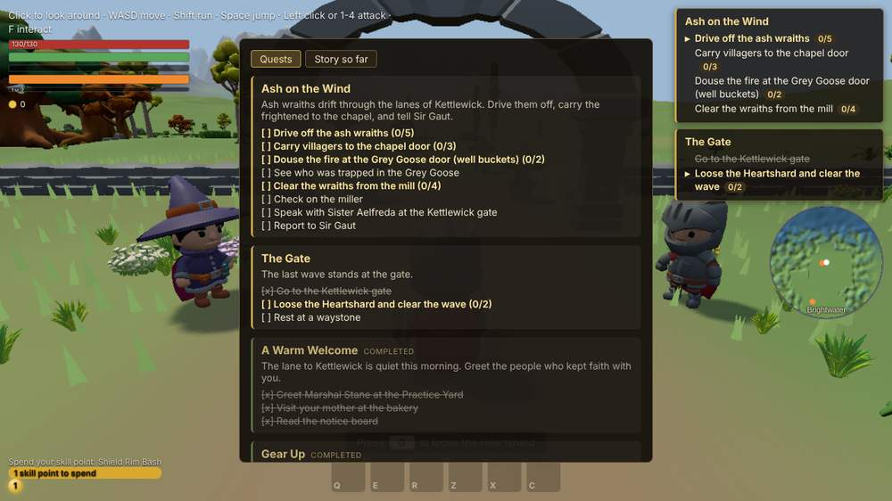 |

**Steps** (unordered; the later scenes open behind the ones they follow)
1. Drive off the ash wraiths in the lanes (0/5).
2. Carry three villagers to the chapel door (pick up with F, set down at the door) (0/3).
3. Douse the fire at the Grey Goose door: carry two well buckets from the well to the door (0/2).
4. Once the door is out, talk to **Tobb Fenwick**, who was trapped inside.
5. Clear the wraiths from the mill (0/4), then check on **Aldwin the Miller**.
6. After the three carries, speak with **Sister Aelfreda** at the Kettlewick gate.
7. Report to **Sir Gaut** (opens only when all the above are done).

| Grey Goose door | The mill |
| --- | --- |
| 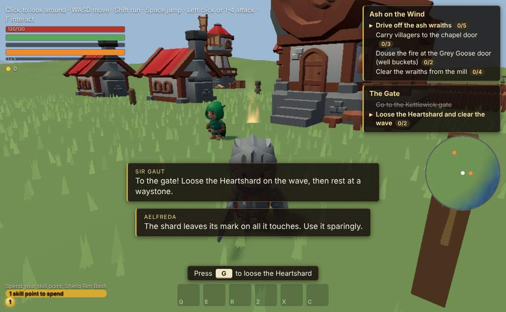 | 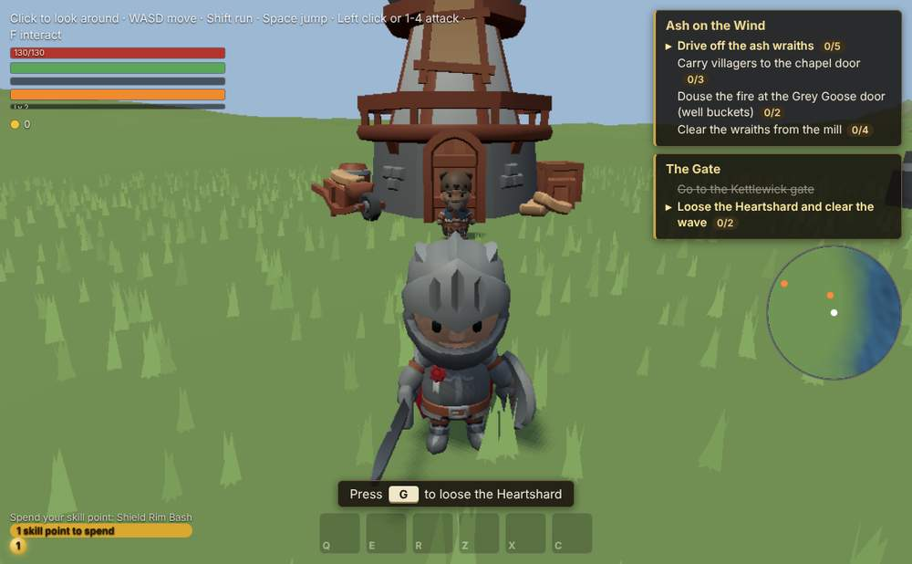 |

**Rewards:** 300 XP, Gaut's Spare Blade (weapon, attack +14).

**Verify**
- [ ] A carried villager drops if Cael is hit or rolls, and can be picked up again.
- [ ] Tobb stays inside the Grey Goose until the door is doused.
- [ ] Aldwin walks to the chapel after the mill is cleared.
- [ ] Gaut's report is not offered until every other objective is ticked.
- [ ] After M01, Edda offers M02.

---

## M02 A Mother's Bread

**Main** · Kettlewick · Giver: Edda Brannoc · Opens after M01 · No jump (play on from M01, or `?act1=m03&new` lands after it) · Design time 35 min

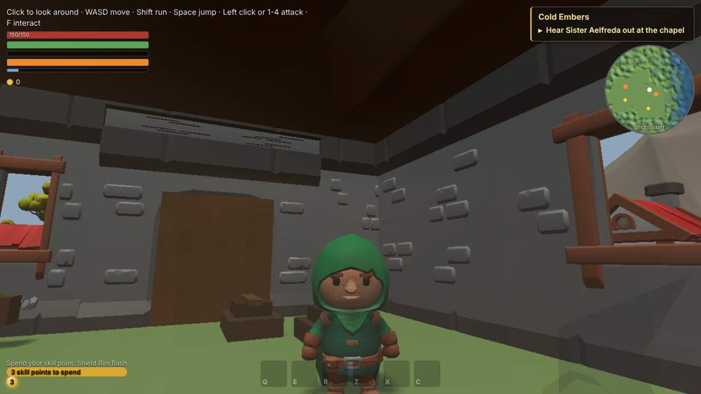

**Steps**
1. Douse the fire at the bakery door with two well buckets (0/2).
2. Go into the bakery.
3. Clear the fallen thatch from the hearth (interact twice).
4. Drive the wraiths from the oven yard (0/3).
5. Take the hearth-stone from the hearth.
6. Look in the family chest in the loft: Cael's broken squire's badge (codex "The Squire's Disgrace").
7. Find Edda at the granary and talk with **Garrick Thorne** (the villager who held Cael there two winters ago).
8. Talk with **Edda**.
9. Set the hearth-stone in the common hearth in the Grey Goose yard.

| Badge in the loft | Garrick and Edda at the granary | Common hearth |
| --- | --- | --- |
| 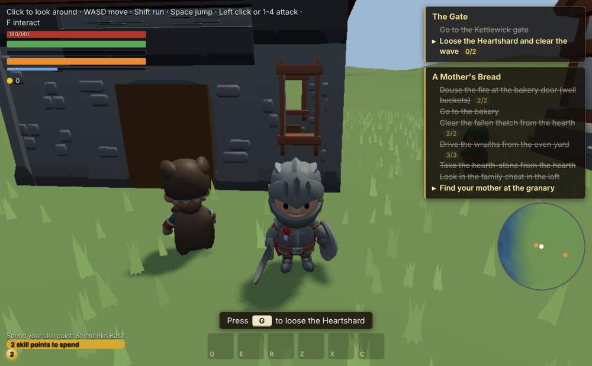 | 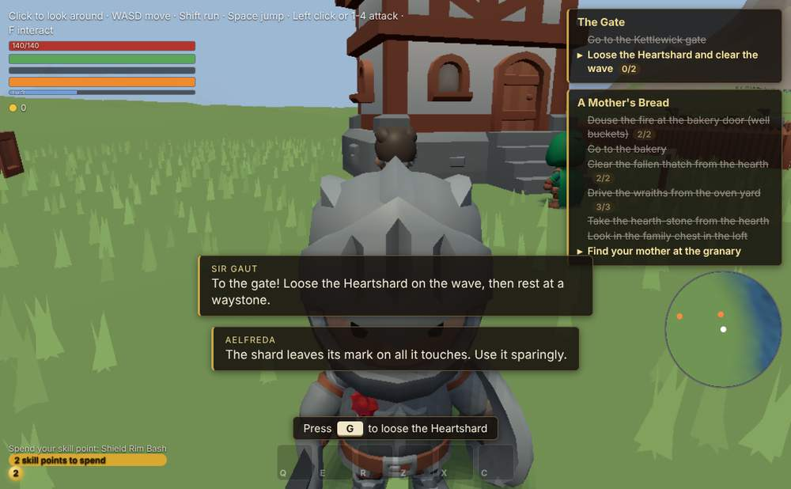 | 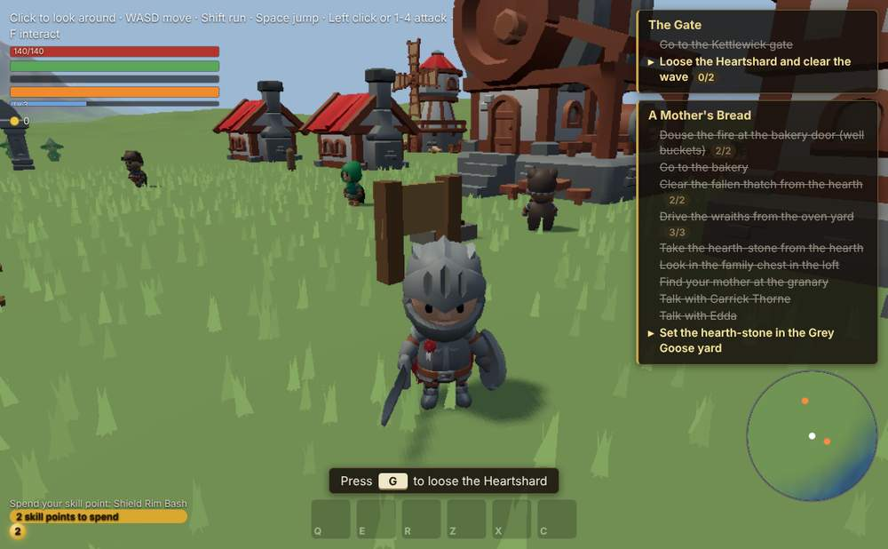 |

**Rewards:** 250 XP, Hearth-Stone Charm (trinket, defense).

**Choices:** Garrick: forgive, shame or say nothing (`story.m02.garrick`).

**Verify**
- [ ] The codex gains "The Squire's Disgrace" after the chest.
- [ ] Each Garrick answer gets its own reply; the flag is set.
- [ ] After M02: Aelfreda offers M03, Wynn offers R01, Stane offers R02, Hob offers J01, Edda offers J02 (after her farewell line).

**Taste calls:** Garrick Thorne, the granary with the Regent's order on its door, the common hearth in the Grey Goose yard (Act 1 density batch 1).

---

## M03 Cold Embers

**Main** · Brightwater Chapel · Giver: Sister Aelfreda · Opens after M01, M02 · Jump: `?act1=m03&new` (quest already started) · Design time 40 min

| Aelfreda at the chapel | Journal (J) at the start |
| --- | --- |
| 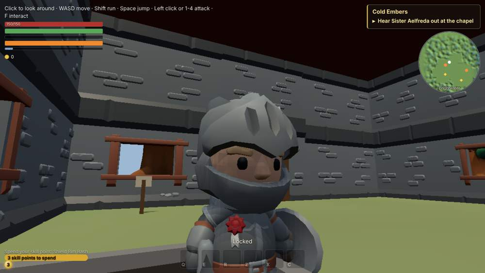 | 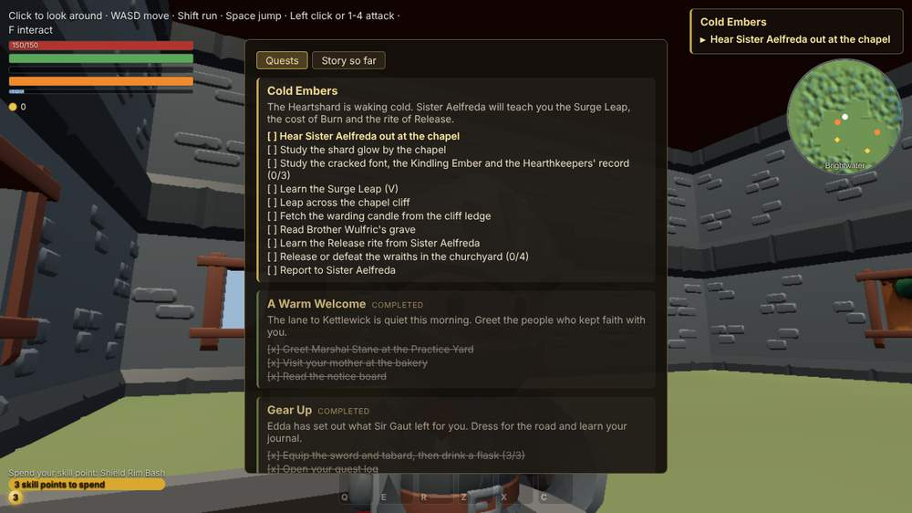 |

**Steps**
1. Hear Sister Aelfreda out at the chapel.
2. Study the shard glow by the chapel.
3. Study the cracked font, the Kindling Ember and the Hearthkeepers' record (0/3). At the record, choose how today's line ends.
4. Learn the Surge Leap (V).
5. Leap across the chapel cliff (V while running at the gap).
6. Fetch the warding candle from the cliff ledge.
7. Read Brother Wulfric's grave at the churchyard's west wall.
8. Learn the Release rite from Aelfreda.
9. Release or defeat the four wraiths in the churchyard (hold T for Release, costs Burn).
10. Report to Aelfreda.

| Candle ledge | Wulfric's grave |
| --- | --- |
| 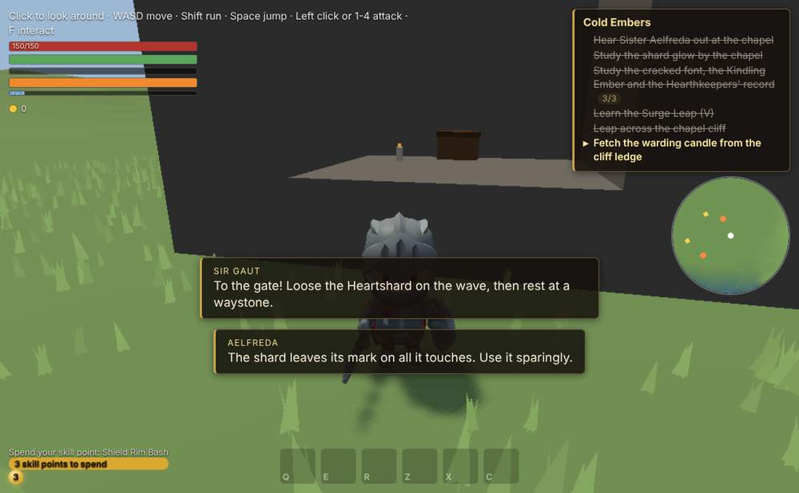 | 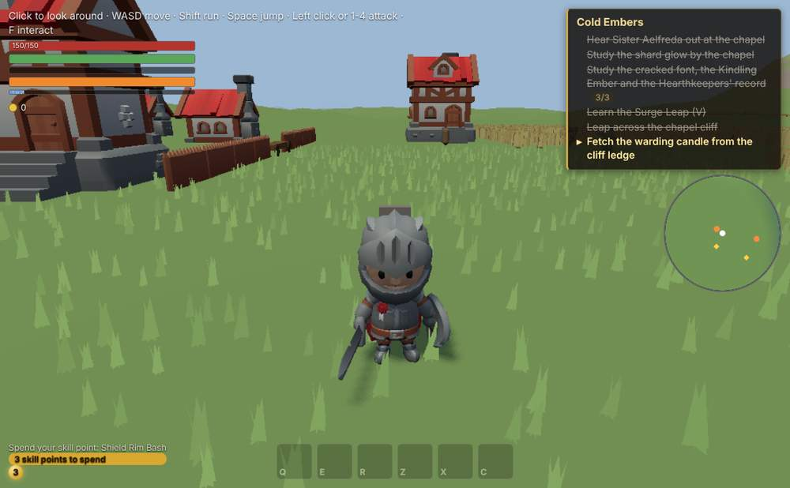 |

**Rewards:** 300 XP, 1 skill point, Surge Leap unlocked (V on the bar).

**Choices:** the record's line (`story.m03.record`: cold, warm or blank); how the first Release felt (`story.m03.firstRelease`); whether Aelfreda tells the village about Scars (`story.m03.scarsTold`).

**Verify**
- [ ] V appears on the ability bar after the lesson; the Leap clears the cliff gap.
- [ ] The churchyard wraiths rise only when Aelfreda's lesson ends, not mid-dialogue.
- [ ] Release shows "Hold T: Release (Burn)" and raises the Burn meter; all four wraiths count whether released or killed.

---

## R01 Wynn's Scarecrows

**Region** · Kettlewick barley fields · Giver: Wynn Tillman · Opens after M01, M02 · Jump: `?act1=r01&new` · Design time 35 min

| Wynn in the barley | Journal (J) at the start |
| --- | --- |
|  | 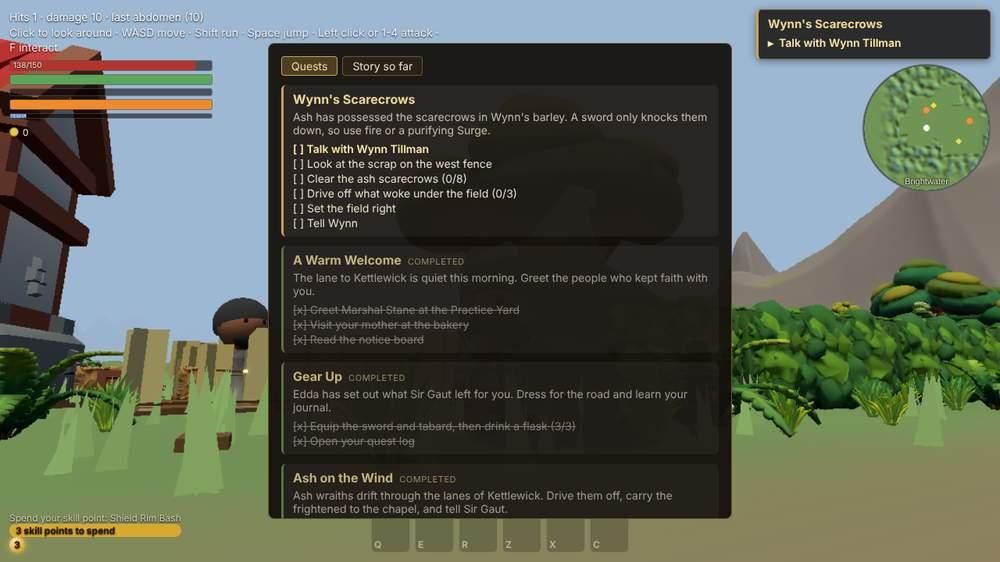 |

**Steps**
1. Talk with Wynn Tillman.
2. Look at the scrap on the west fence (the scarecrows stand only after this).
3. Clear the eight ash scarecrows over the two fields: a sword only knocks them down; finish them with fire (a torch) or a purifying Surge (G, costs Burn).
4. Drive off the three wraiths that wake under the field.
5. Set the field right: a saved field is re-staked (three stakes); a scorched one has a stubble fire to beat out with two buckets.
6. Tell Wynn.

| The shawl on the fence | The east field |
| --- | --- |
| 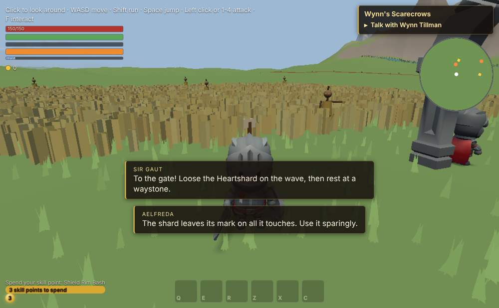 | 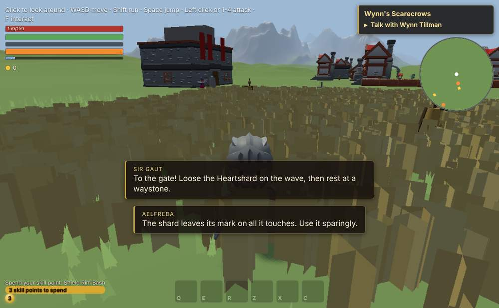 |

**Rewards:** 250 XP, Barley Cake x5 (heals a little; also a Calm offering later).

**Choices:** fire or Surge, by majority of clears (ties saved): the field ends scorched or saved. Wynn asks what becomes of the clothes (`story.r01.clothes`).

**Verify**
- [ ] A knocked-down scarecrow gets up again unless burned or purified.
- [ ] The aftermath step matches the field's outcome (stakes or stubble fire).

---

## R02 The Marshal's Last Drill

**Region** · Practice Yard (before M06) or Halvard Bastion yard (from M06) · Giver: Marshal Osric Stane · Opens after M01, M02 · Jump: `?act1=r02&new` · Design time 30 min

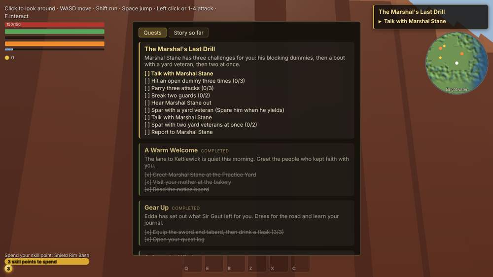

**Steps**
1. Talk with Marshal Stane.
2. Hit an open dummy three times.
3. Parry three attacks (block just as the swing lands).
4. Break two guards (heavy attack 3 on a blocking dummy).
5. Hear Stane out (his Hollin Ford stories).
6. Spar with a yard veteran; Spare him when he yields (hold T).
7. Talk with Stane.
8. Spar with two yard veterans at once.
9. Report to Stane.

| Bastion dummies | Bastion bout |
| --- | --- |
| 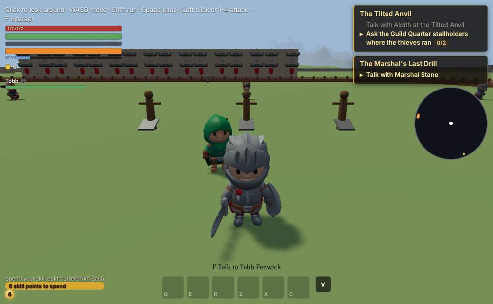 | 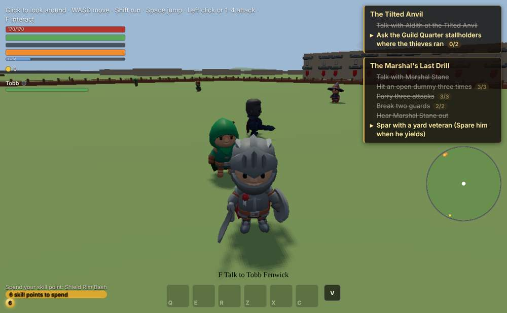 |

**Rewards:** 250 XP, Training Weights.

**Verify**
- [ ] A bout called in the Practice Yard is called off when M06 starts, and Stane calls it again in the Bastion.
- [ ] Yard veterans yield at low health and can be Spared; they give no favour.
- [ ] After R02 and once M06 has started, Stane offers J09.

**Taste calls:** the lock-on pole drill was dropped; the third challenge is the two-veteran bout.

---

## M04 The Toll at Hollin Ford

**Main** · Hollin Ford · Giver: Sir Gaut Halvard · Opens after M03 · Jump: `?act1=m04&new` · Design time 45 min

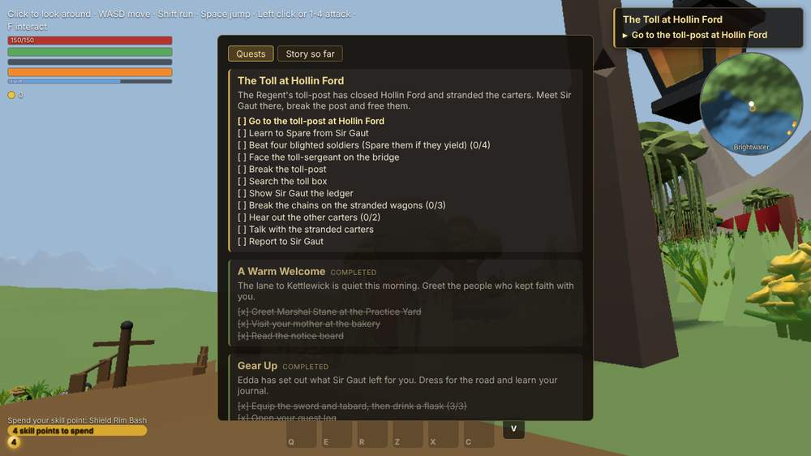

**Steps**
1. Go to the toll-post at Hollin Ford.
2. Learn to Spare from Sir Gaut (Spare unlocks: hold T on a yielding foe).
3. Beat four blighted soldiers; Spare them if they yield (0/4).
4. Face the toll-sergeant on the bridge (elite, 110 health).
5. Break the toll-post.
6. Search the toll box: the Regent's ledger.
7. Show Gaut the ledger.
8. Break the chains on the three stranded wagons (0/3).
9. Hear out the other carters (0/2), then talk with the stranded carters.
10. Report to Gaut.

| The sergeant on the bridge | Wagons and carters |
| --- | --- |
| 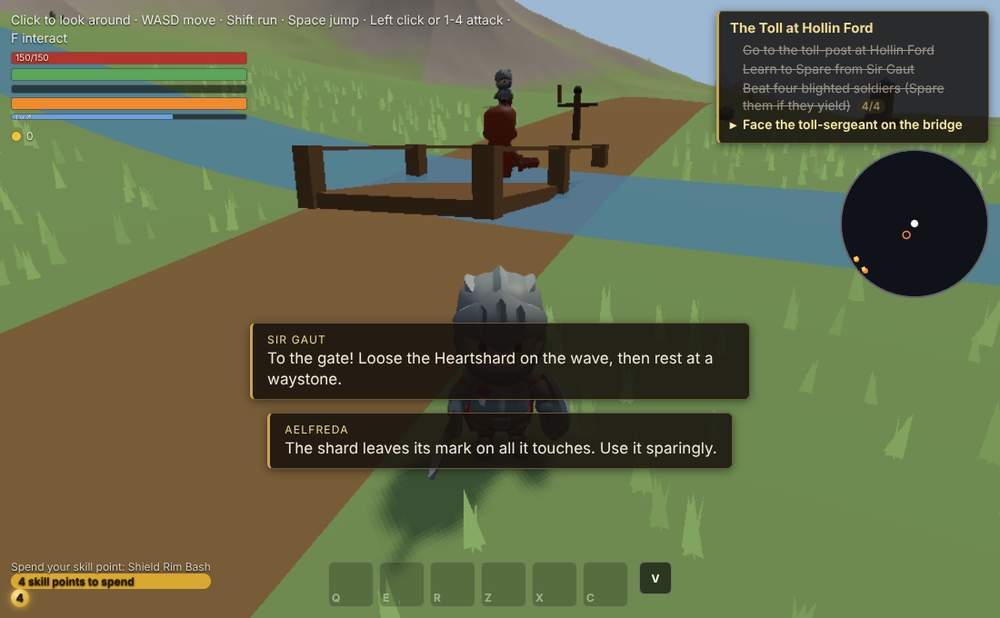 | 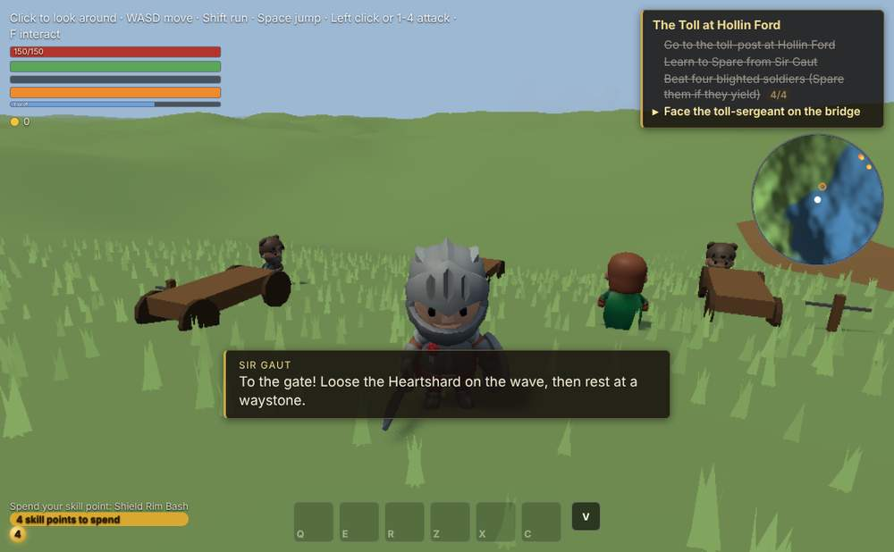 |

**Rewards:** 350 XP, Ford-Guard Shield.

**Choices:** spare or kill the toll-sergeant (spared gives +2 Halvard; Gaut's report differs). Who carries the ledger (`story.m04.ledger`).

**Verify**
- [ ] The ford pairs rise only when Gaut's lesson ends.
- [ ] A yielding soldier shows "Hold T: Spare"; a spared soldier counts toward 4/4.
- [ ] The ledger reads "levies for the Crown's forge" with every toll written twice.

**Taste calls:** the Toll Sergeant (new elite), the ledger in the toll box, the widow's seed cart as the third carter.

---

## M05 Wardstones for the Dead Road

**Main** · The Dead Road · Giver: Tobb Fenwick · Opens after M04 · Jump: `?act1=m05&new` · Design time 40 min

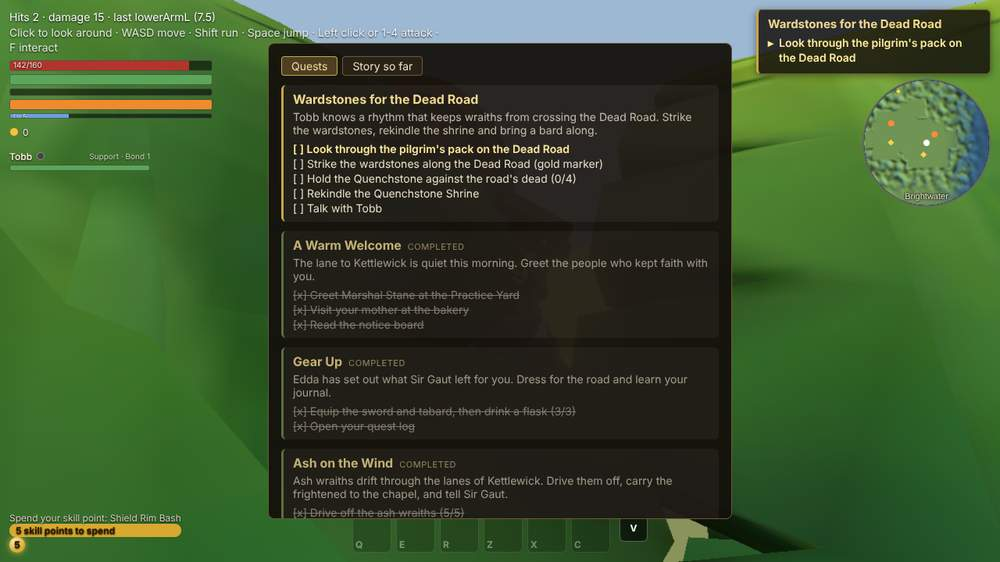

**Steps**
1. Look through the pilgrim's pack on the Dead Road (under a toppled milestone halfway; codex "A Pilgrim's Journal").
2. Strike the wardstones along the Dead Road in Tobb's rhythm (follow the gold marker; five stones).
3. Hold the Quenchstone against the road's dead (0/4 wraiths).
4. Rekindle the Quenchstone Shrine (hold F).
5. Talk with Tobb at the lit shrine. **Tobb joins the party.**

| Pilgrim's journal | Waymarker stone | The push at the shrine |
| --- | --- | --- |
| 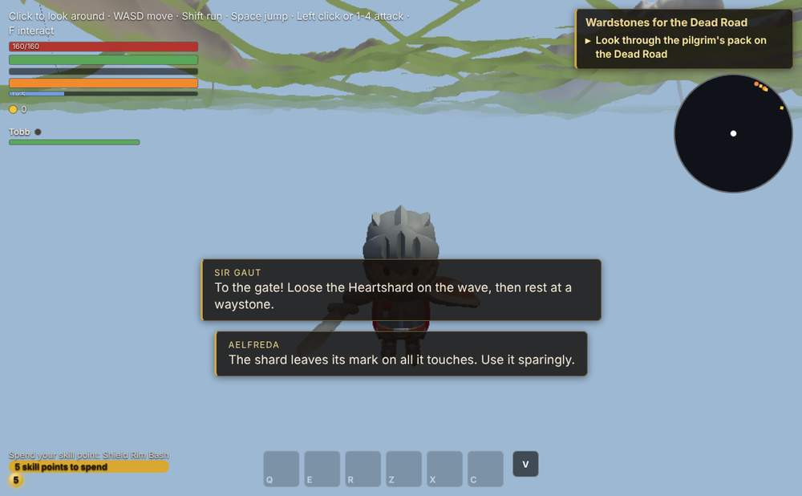 | 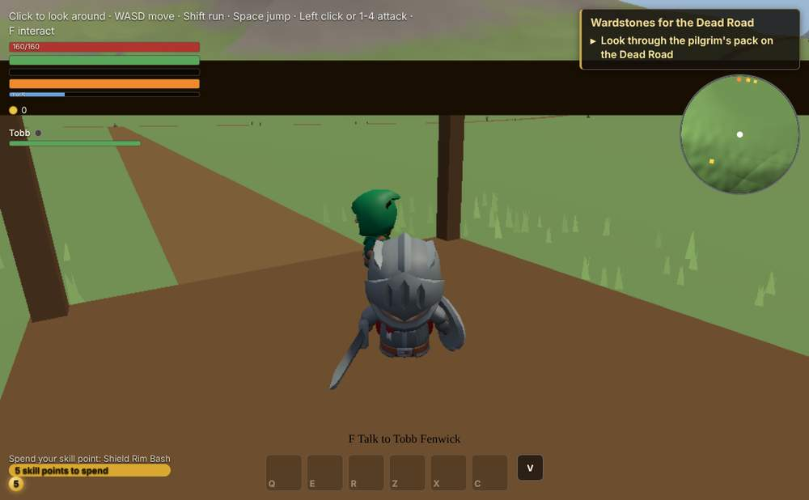 | 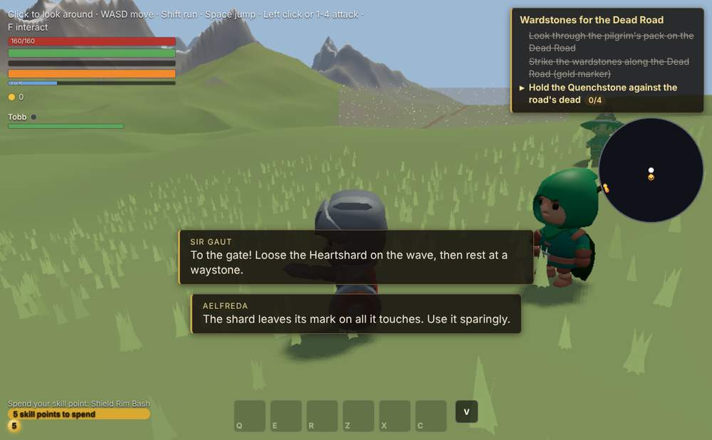 |

**Rewards:** 300 XP, Tobb's Lucky Whistle.

**Choices:** how the ballad should go (`story.m05.ballad`: plain, grand or names); sets `story.m05.tobbBond` (needed for J04).

**Verify**
- [ ] Tobb appears in the party panel (P) and follows.
- [ ] The off-road barrow and the two waymarker stones (one names Wat Fenwick) are reachable; the barrow wraiths never respawn.
- [ ] After M05: Rook's South Gate (M06) and the chapel vault (D01) are both offered.

---

## D01 Prayers in the Vault

**Dungeon** · Brightwater Chapel vault · Giver: Sister Aelfreda · Opens after M05 · Jump: `?act1=d01&new` · Design time 55 min · **Boss: the Ashen Prior (Prior Aldhelm)**

| Aelfreda offers D01 | Journal (J) at the start |
| --- | --- |
|  | 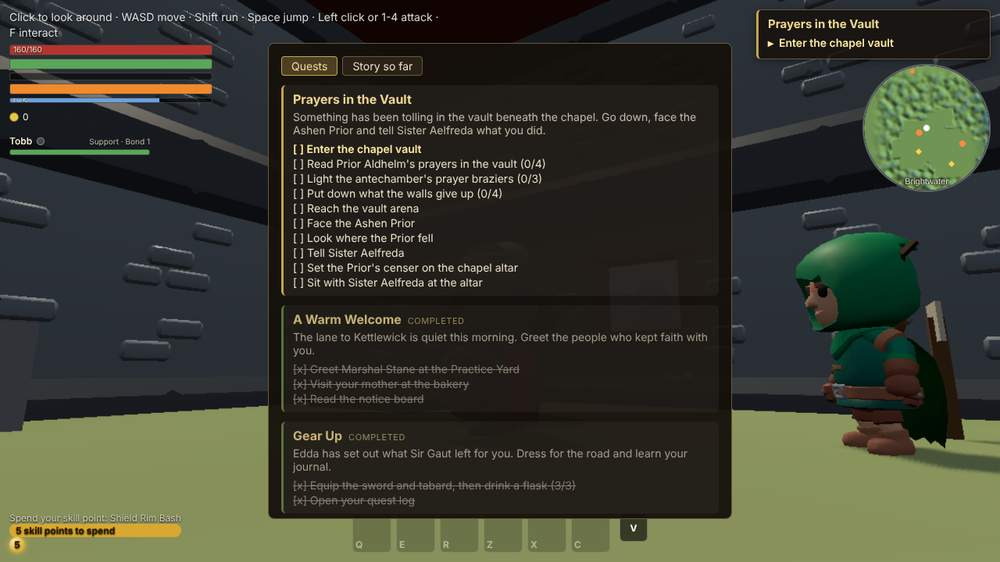 |

**Steps**
1. Enter the chapel vault (the door is locked until D01 is taken).
2. Read Prior Aldhelm's four prayer tablets (0/4).
3. Light the antechamber's three prayer braziers (0/3).
4. Put down the four wraiths the walls give up.
5. Reach the vault arena (the gate opens after steps 3 and 4).
6. Face the Ashen Prior: defeat him, or Release him at his last poise break (hold T).
7. Look where the Prior fell (his censer).
8. Tell Sister Aelfreda.
9. Set the Prior's censer on the chapel altar.
10. Sit with Aelfreda at the altar (the vigil).

| Vault corridor | Antechamber braziers | Walls give up their dead |
| --- | --- | --- |
| 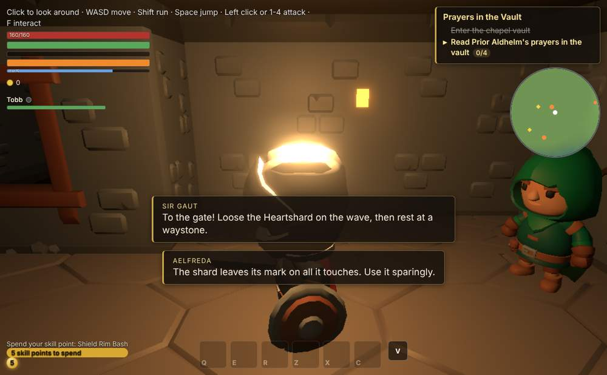 |  |  |

**Rewards:** 600 XP, Prior's Censer.

**Choices:** kill or Release the Prior; the vigil sets his line in the record (`story.d01.prior`: name, prayers or silence).

**Verify**
- [ ] The arena gate stays shut until the braziers are lit and the four wraiths are down.
- [ ] The Release prompt appears only at the Prior's last poise break.
- [ ] If Cael leaves without the censer, Aelfreda fetches it herself.
- [ ] Boss health bar, music change, and the arena gates lock and unlock.

---

## M06 Gates of Harrowmark

**Main** · Harrowmark South Gate · Giver: Captain Ealdred Rook · Opens after M05 · Jump: `?act1=m06&new` (you land beside Rook; accept the offer) · Design time 45 min

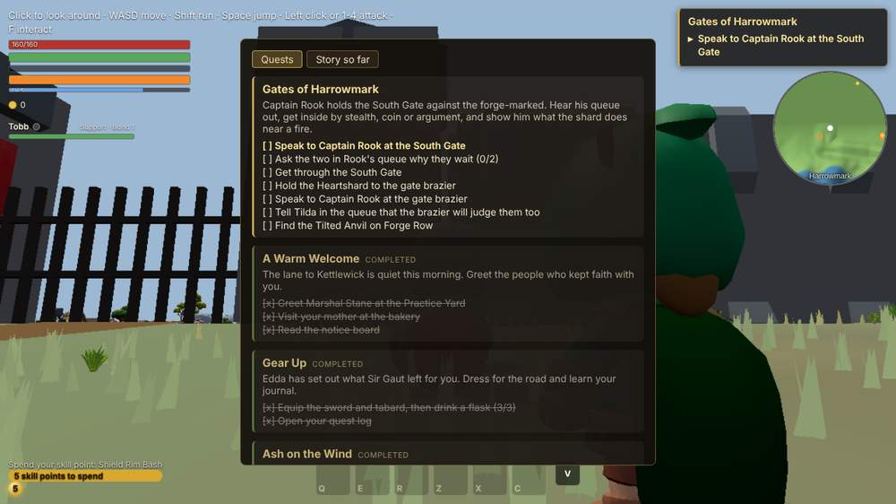

**Steps**
1. Speak to Captain Rook at the South Gate.
2. Ask the two in Rook's queue why they wait: Tilda the Charcoal-Burner and Old Beorn (0/2).
3. Get through the South Gate: by stealth (hold Alt, sneak in), by a bribe, or by argument. The portcullis rises only once the queue is heard.
4. Hold the Heartshard to the gate brazier inside.
5. Speak to Rook at the gate brazier.
6. Tell Tilda that the brazier will judge them too (the refugees then stand inside).
7. Find the Tilted Anvil on Forge Row (M06 ends at its sign; Aldith offers M07).

| The queue | Rook at the brazier |
| --- | --- |
| 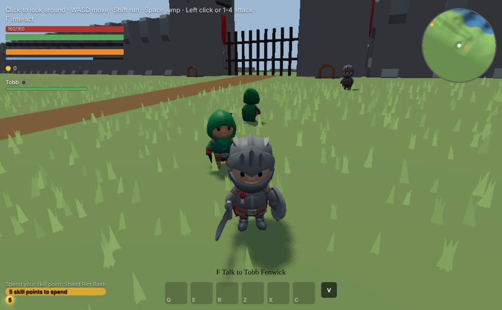 | 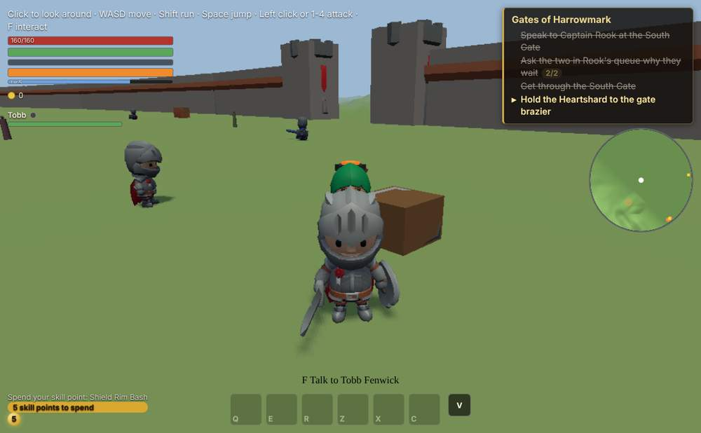 |

**Rewards:** 350 XP, Watch Pass.

**Verify**
- [ ] All three routes work: stealth (being caught sends you back to the section's checkpoint), bribe (gold spent), argument.
- [ ] The sneak prompt (Alt) is shown for the first time here.
- [ ] After M06: Rook's board notices (J05, J06), the Watch-Sergeant (J08) and Stane's open board (J09, after R02) appear.

---

## M07 The Tilted Anvil

**Main** · Forge Row, Guild Quarter, Halvard Bastion · Giver: Aldith Stonebrewer · Opens after M06 · Jump: `?act1=m07&new` · Design time 40 min

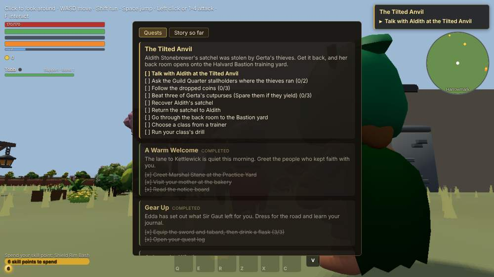

**Steps**
1. Talk with Aldith at the Tilted Anvil.
2. Ask the Guild Quarter stallholders (Godric the Pie-Man, Maera the Ribbon-Seller) where the thieves ran (0/2).
3. Follow the three dropped coins to the alley (0/3).
4. Beat three of Gerta's cutpurses; Spare them if they yield (0/3).
5. Recover Aldith's satchel.
6. Return the satchel to Aldith.
7. Go through the back room to the Bastion yard.
8. **Choose a class** from one of the five trainers: Knight, Warden, Emberwright, Ashblade, Pathfinder.
9. Run your class's drill.

| Stallholders | Coin trail |
| --- | --- |
| 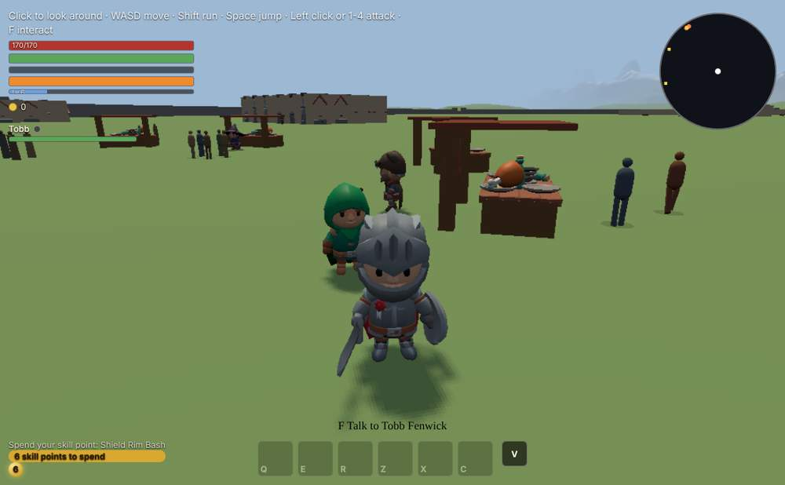 | 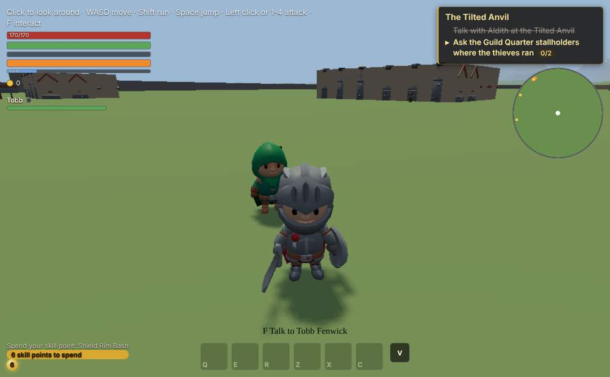 |

**Rewards:** 300 XP; the room at the Anvil (rest and save point).

**Verify**
- [ ] Each class changes the model, weapons, keys 1 to 4 and the ability bar; the drill teaches them.
- [ ] Resting in the Anvil's room saves (Continue slot).
- [ ] After M07: Aldith offers R03, Whitlock offers R04, Wystan offers M08, J07 notice appears, Tobb offers J10 (if J04 is done).

---

## M08 Kneel Before the Boy

**Main** · Halvard Bastion, Keep of Valdren · Giver: Lord Wystan Halvard · Opens after M07 · Jump: `?act1=m08&new` · Design time 50 min

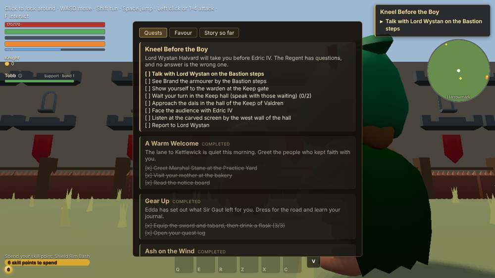

**Steps**
1. Talk with Lord Wystan on the Bastion steps.
2. See Brand the armourer by the steps (Halvard surcoat).
3. Show yourself to Keep Warden Ordric at the Keep gate (Watch Pass plus Wystan's list).
4. Wait your turn in the Keep hall: speak with Lady Merrin Oswin and Lord Aldous Grisel (0/2).
5. Approach the dais.
6. Face the audience with King Edric IV (the Regent's three questions, then the king's own: "Does it hurt? The fire.").
7. Listen at the carved screen by the hall's west wall.
8. Report to Lord Wystan.

| Armourer | Keep warden | Merrin and Grisel in the hall | The screen |
| --- | --- | --- | --- |
| 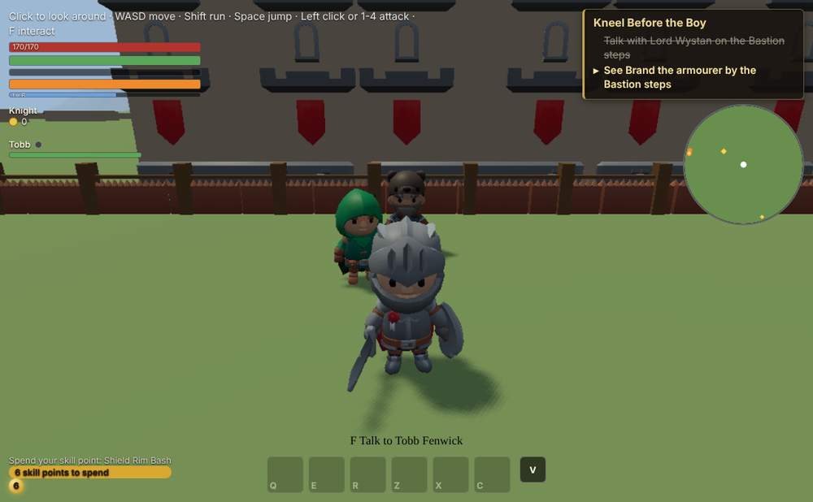 | 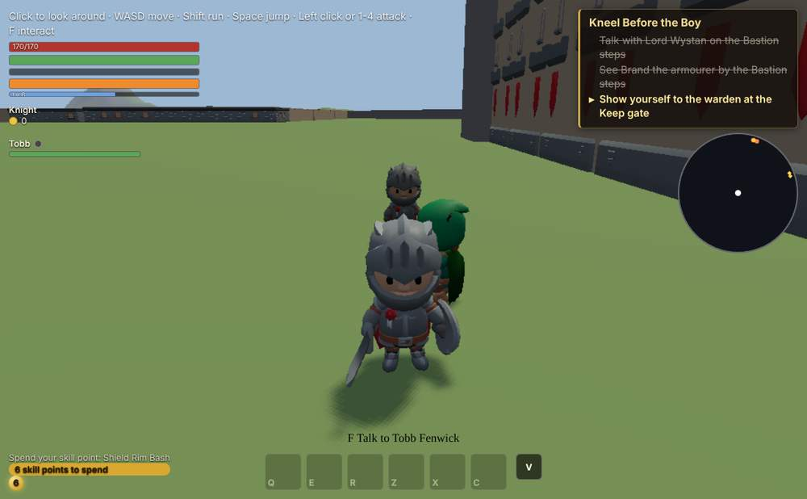 |  |  |

**Rewards:** 400 XP, Halvard Signet.

**Choices:** answers to the Regent move favour; Edric's question (`story.m08.edricAsked`: truth, brave or turn; no favour).

**Verify**
- [ ] The Keep stays shut until the warden's check.
- [ ] Favour changes from the answers show in the journal's Favour tab.

**Taste calls:** the overheard word is a note at the screen, not a stealth section.

---

## R03 The Brewer's Debt

**Region** · Tilted Anvil, Guildhall · Giver: Aldith Stonebrewer · Opens after M07 · Jump: `?act1=r03&new` · Design time 40 min

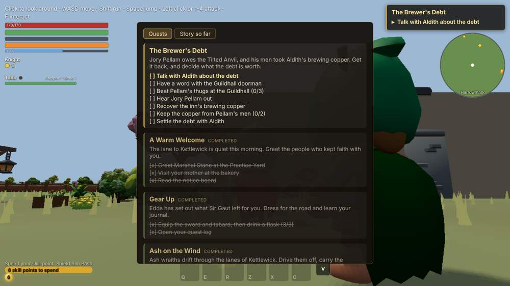

**Steps**
1. Talk with Aldith about the debt.
2. Have a word with Leofric the Doorman at the Guildhall.
3. Beat Pellam's three thugs on the Guildhall steps.
4. Hear Jory Pellam out (the debt was his dead brother Coll's).
5. Recover the brewing copper from the old stable behind.
6. Keep the copper from Pellam's two men on the way back.
7. Settle the debt with Aldith.

| The doorman | Pellam at the stable | The snatchers |
| --- | --- | --- |
| 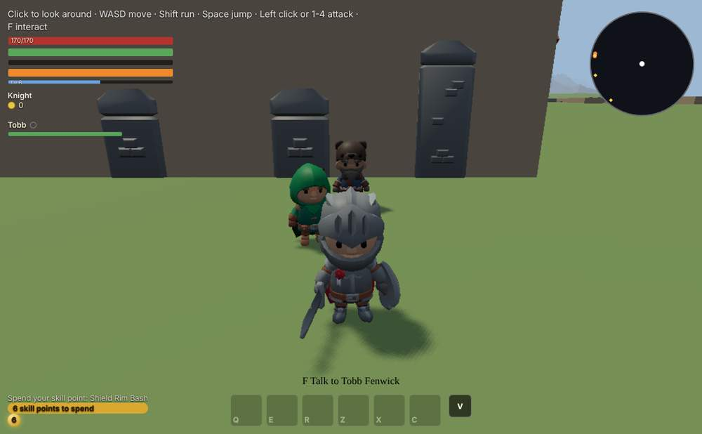 | 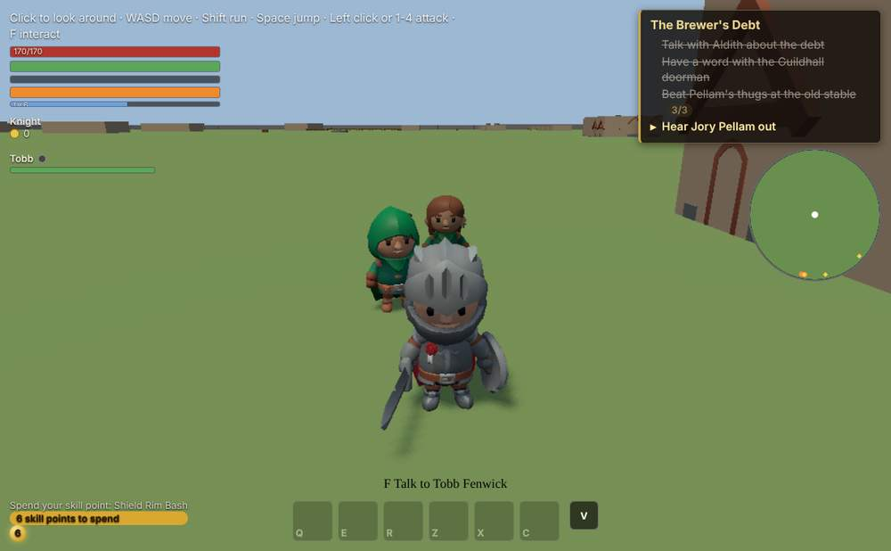 | 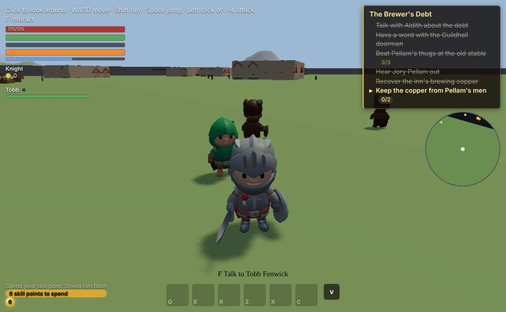 |

**Rewards:** 300 XP, Aldith's Stout.

**Choices:** tell Aldith Pellam's plea or not (`story.r03.promise`); forgive the debt (loyal inn, cheaper rooms) or take the coin.

---

## R04 The Archivist's Missing Pages

**Region** · Oswin Archive, chapel, Guild Quarter, Counting-House steps · Giver: Whitlock the Archivist · Opens after M07 · Jump: `?act1=r04&new` · Design time 40 min

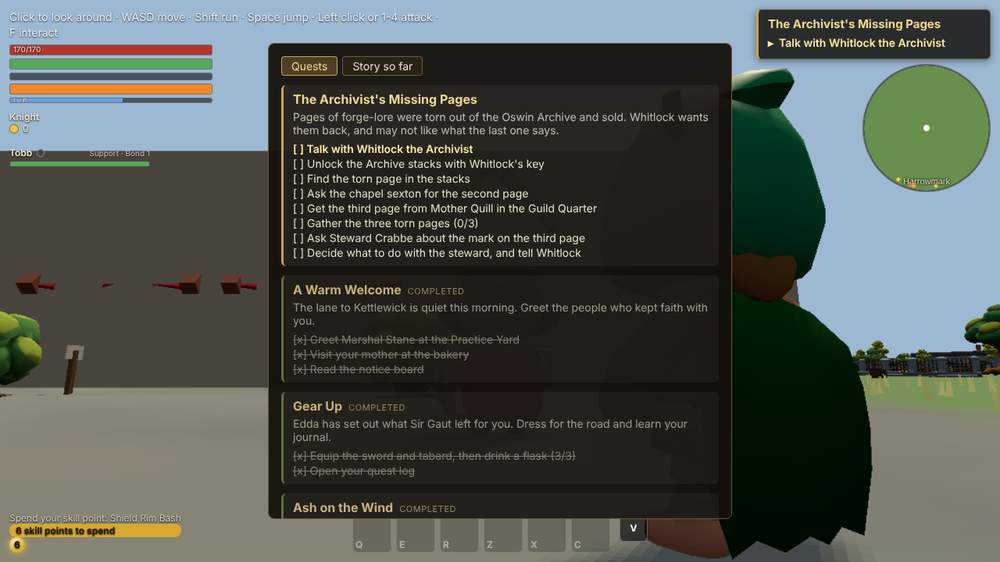

**Steps**
1. Talk with Whitlock the Archivist.
2. Unlock the Archive stacks with Whitlock's key.
3. Find the torn page in the stacks.
4. Ask Sexton Elric at the chapel for the second page.
5. Get the third page from Mother Quill in the Guild Quarter (20 gold, or a name).
6. (Ticks itself) Gather the three torn pages.
7. Ask Steward Hereward Crabbe about the mark on the third page (Counting-House steps).
8. Decide what to do with the steward, and tell Whitlock.

| Stacks gate | Sexton | Mother Quill | Crabbe |
| --- | --- | --- | --- |
| 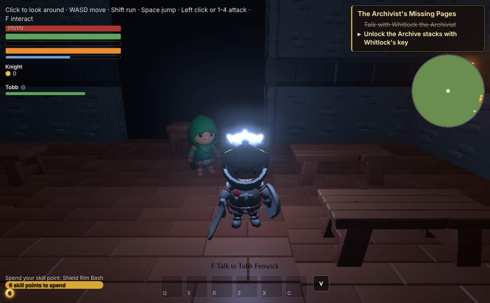 | 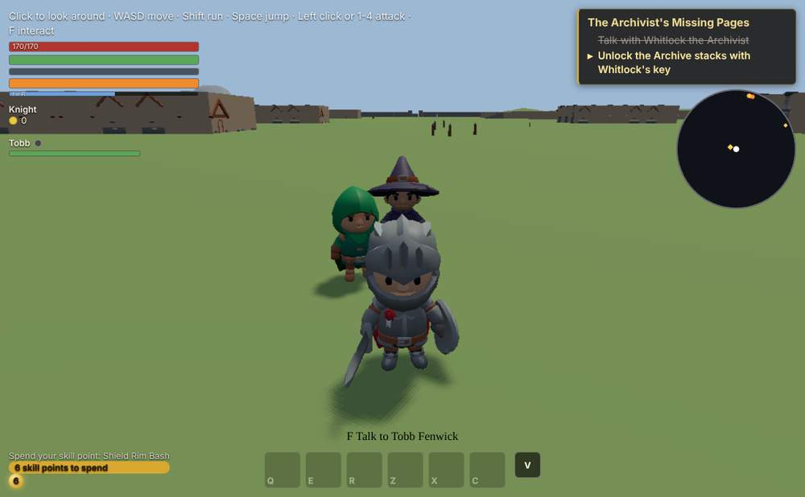 | 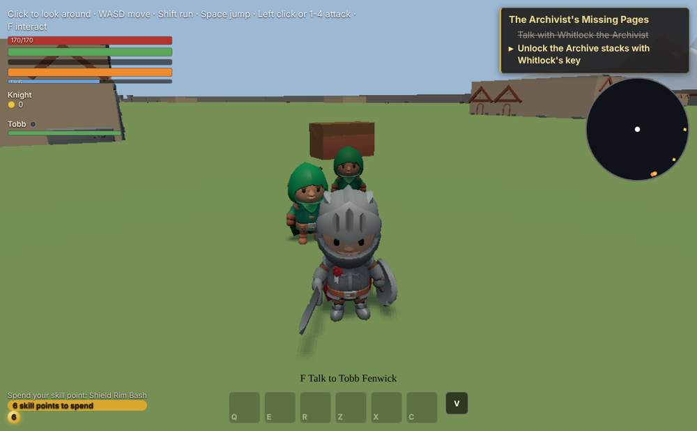 | 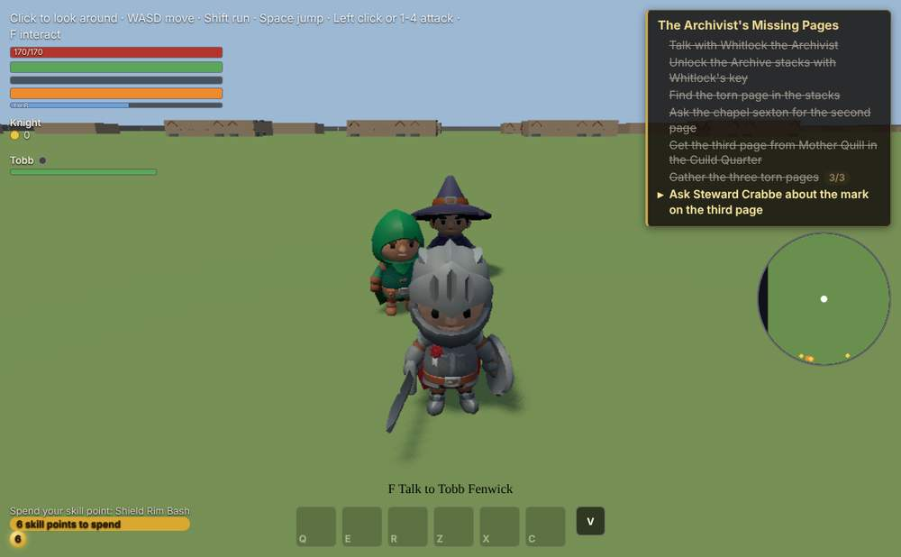 |

**Rewards:** 300 XP, Lore Tome I.

**Choices:** Mother Quill: pay 20 gold, or name Gerta (after M10) or Whitlock (under 20 gold) (`story.r04.fence`). Expose Crabbe (Halvard up, Oswin down) or shield him (the reverse).

**Verify**
- [ ] With under 20 gold the Whitlock option is offered.
- [ ] Favour moves the right way for expose and shield.

---

## M09 Oswin's Ledger

**Main** · Oswin Counting-House · Giver: Lady Merrin Oswin · Opens after M08 · Jump: `?act1=m09&new` · Design time 55 min

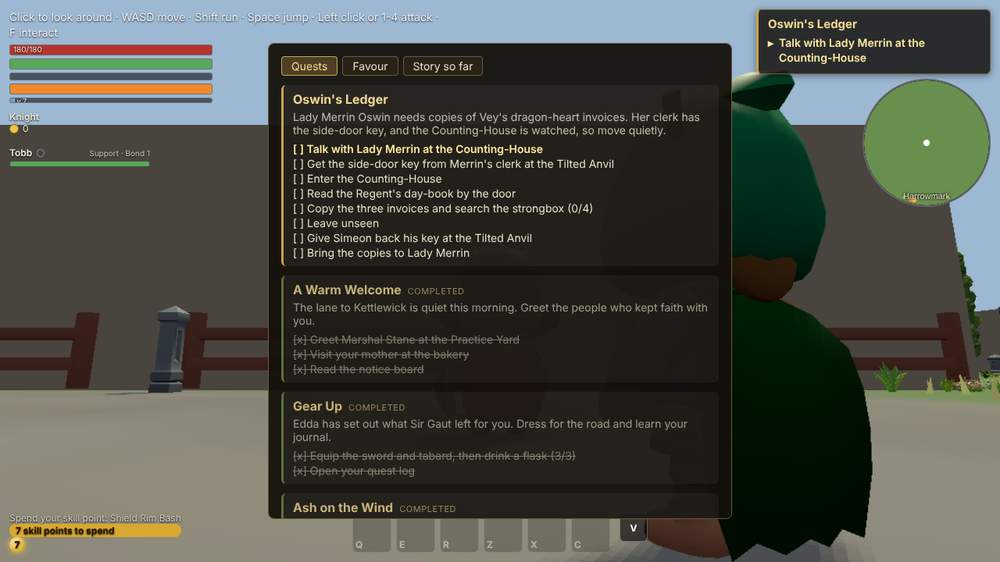

**Steps**
1. Talk with Lady Merrin at the Counting-House.
2. Get the side-door key from Simeon Penhallow, her clerk, on the Tilted Anvil's bench: buy him a drink (10 gold), ask in Merrin's name (Oswin Banked or better), or lift it once he dozes.
3. Enter the Counting-House.
4. Read the Regent's day-book by the door.
5. Copy the three invoices and search the strongbox (0/4).
6. Leave unseen (stealth section).
7. Give Simeon back his key.
8. Bring the copies to Merrin.

| Simeon on the bench | Day-book | Strongbox |
| --- | --- | --- |
| 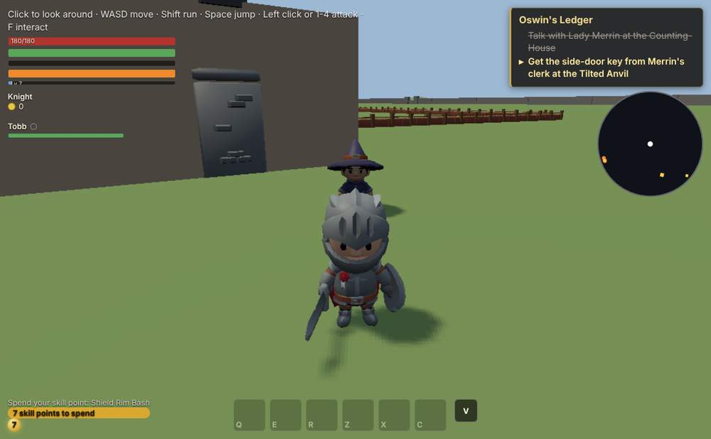 | 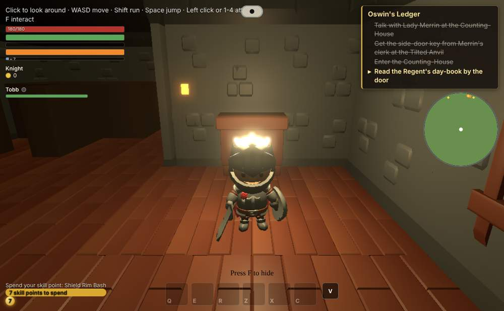 |  |

**Rewards:** 450 XP, Oswin Lockpicks x5.

**Choices:** key route (`story.m09.keyRoute`: bought, merrin or lifted).

**Verify**
- [ ] Being seen inside resets to the stealth checkpoint, not a death.
- [ ] Each of the three key routes works.

---

## M10 Smoke Over the Rooftops

**Main** · Rooftop Ward, South Gate stables · Giver: Gerta Quickfingers · Opens after M09 · Jump: `?act1=m10&new` · Design time 45 min

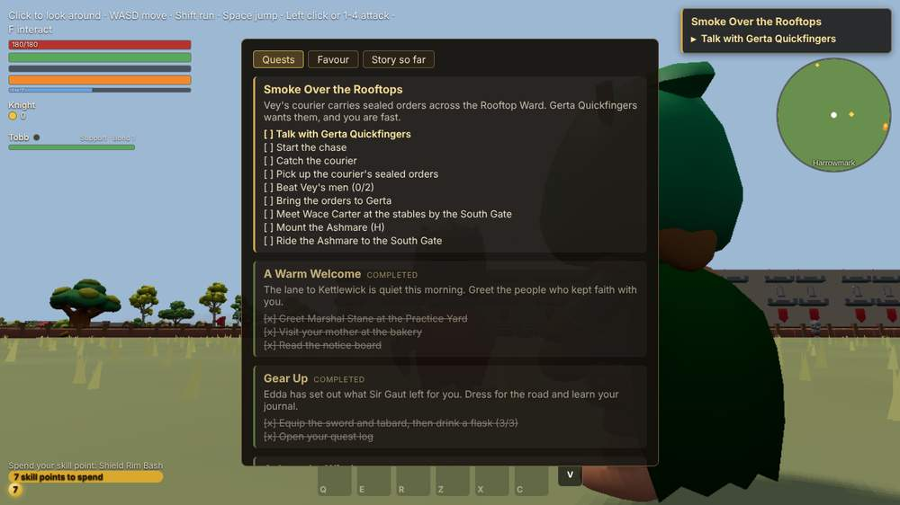

**Steps**
1. Talk with Gerta Quickfingers.
2. Start the chase.
3. Catch the courier across the rooftops.
4. Pick up the courier's sealed orders.
5. Beat Vey's two men (Guildhall Thugs).
6. Bring the orders to Gerta.
7. Meet Wace Carter at the stables by the South Gate.
8. Mount the Ashmare (H).
9. Ride the Ashmare to the South Gate.

| Orders where the courier fell | The ambush | Wace and the Ashmare |
| --- | --- | --- |
| 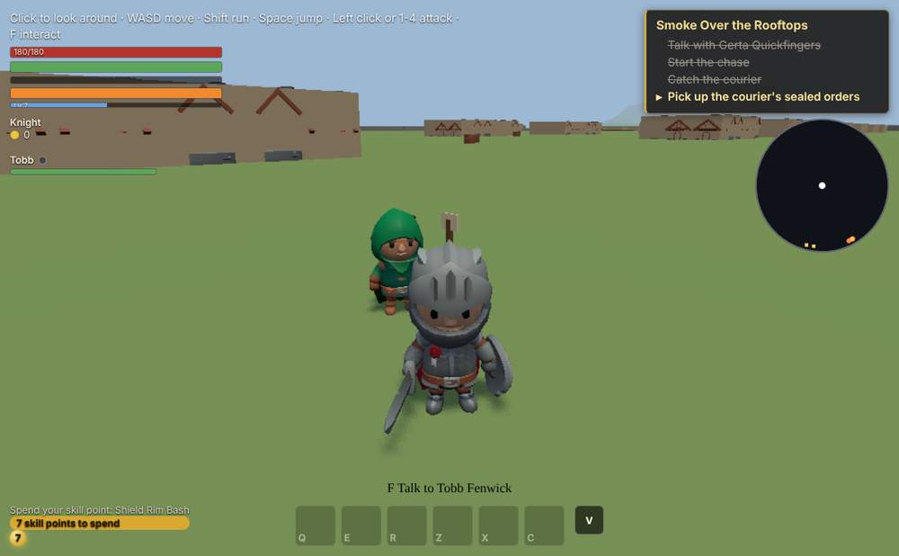 |  |  |

**Rewards:** 400 XP, Courier's Cloak; the Ashmare mount (H).

**Verify**
- [ ] Losing the courier restarts the chase cleanly.
- [ ] H mounts and dismounts; mounted speed is clearly faster.

---

## D02 Hounds of the Underways

**Dungeon** · Watch Barracks yard, the Underways · Giver: Captain Ealdred Rook · Opens after M01 to M10 and R01 to R04 · Jump: `?act1=d02&new` · Design time 60 min · **Boss: Gaffer Grimtooth**

**Steps**
1. Talk with Captain Rook (he gives Hearth Bread and unlocks Calm).
2. Calm or beat the two stray hounds in the Watch Barracks yard (hold T with bread in the bag).
3. Tell Rook how it went (the Underways door opens on this word).
4. Go down into the Underways.
5. Beat or Calm four Ember Hounds.
6. Read the tally chalked by the sluice.
7. Turn both sluice valves (0/2).
8. Beat the three hounds that come through the drained tunnel.
9. Face Gaffer Grimtooth: break him three times; Calm him at his last break, or put him down.
10. Search Grimtooth's den (crates with the Crucible's mark).
11. Tell Rook.

| Barracks strays | Sluice valves | Sluice hounds |
| --- | --- | --- |
|  |  |  |

**Rewards:** 700 XP, Sewer Master Key (opens J11's grate).

**Verify**
- [ ] Calm shows "Hold T: Calm (Hearth Bread)" and uses one bread.
- [ ] The arena gate stays shut until the sluice hounds are dealt with.
- [ ] Completing D02 (with M10 done) ends the act (see below).

---

## Act 1 ending: "Smoke Over Harrowmark"

When the second of M10 and D02 completes:
- [ ] The act-ending card appears once (and again after a load if it was not closed).
- [ ] After closing it, the camp scene plays; it sings the J04 and J10 verses if those jobs were done.
- [ ] `story.gate.a2` is set; Gaut now offers M11 (Act 2).
- [ ] Quitting mid-card or mid-camp and loading brings the card or camp back, not a skip.

---

## Side jobs J01 to J11

Optional, short (about 2 to 5 minutes each). Pay: 50 to 80 XP and 10 to 25 gold each; 610 XP and 176 gold for all eleven.

### J01 Hob's Strayed Lambs
Giver **Hob Waygrey** at his waystone post · Opens after M02 · Reward 55 XP, 15 gold.
1. Look for a lamb on the scorched stubble east of the barley.
2. Look for a lamb among the scarecrows.
3. Look for a lamb at the stepping stones of the lane drain.
4. Carry the three lambs to Hob's fold (0/3).
5. Tell Hob his lambs are home.

| Offer | Carrying a lamb | The fold | Done |
| --- | --- | --- | --- |
|  |  |  |  |

- [ ] Lambs are a placeholder "bundle" look until art exists (expected).

### J02 Edda's Bread Round
Giver **Edda Brannoc** at the bakery · Opens after M02 and Edda's farewell line · Reward 50 XP, 12 gold.
1. Take the basket from the bakery step.
2. Take a loaf to Orla Pike at the lane's end (leave the extra loaf or take it back: `story.j02.loaf`).
3. Take a loaf to Aldwin the miller.
4. Take a loaf to Sexton Osmund by the chapel.
5. Tell Edda how the round went (she remarks on the loaf choice).

### J03 Waystones of the Dead Road
No giver: starts when you read either stone · Reward 80 XP, 25 gold, 1 Healing Flask.
1. Read the stone on the bluff above the road's western end (a Surge Leap reaches it).
2. Lay the two barrow wraiths to rest.
3. Read the tablet at the barrow.

| Bluff stone | Barrow wraiths | Tablet |
| --- | --- | --- |
|  |  |  |

- [ ] The codex entry "older waystones" lights on completion; the wraiths never respawn.

### J04 Tobb's First Verse
Giver **Tobb Fenwick** · Opens after M05 (Tobb's bond scene) · Reward 50 XP, 10 gold.
1. Light the old fire ring on the road to the Quenchstone.
2. Give Tobb his line about the knighting (ash, grain or bread: `story.j04.verse`).

- [ ] The Act 1 camp scene sings the chosen verse.

### J05 Rook's Board: The Guild Hound
Starts from the notice on **Rook's board** by the Watch Barracks · Opens after M06 · Reward 55 XP, 15 gold.
1. Read the notice about the lost dog.
2. Ask Godric the Pie-Man about his dog.
3. Look for Crumb at the west stalls of the market ring, in the yard behind the Guild houses, and in the lane by the Guildhall.
4. Find Crumb (waits at the third search point).
5. Tell Godric his dog is home.

| Notice | Crumb found |
| --- | --- |
|  |  |

- [ ] Crumb is a small brown stand-in figure (no dog model yet: expected).

### J06 Rook's Board: The Smith's Crate
Notice on **Rook's board** · Opens after M06 · Reward 50 XP, 12 gold.
1. Read the smith's notice.
2. Ask Master Smith Dunstan Ironside about the crate.
3. Carry the crate from the old smelter yard to Dunstan's forge on Forge Row.
4. Tell Dunstan his iron is home.

### J07 Rook's Board: Candles for the Chapel
Notice on **Rook's board** · Opens after M07 · Reward 55 XP, 14 gold.
1. Read the chapel's notice.
2. Take candles from Cedric the chandler's stall (chapel way and Main Street).
3. Light a candle in each of the three chapel niches.
4. Tell Sexton Elric the niches are lit.

### J08 Watch Patrol
Giver **Watch-Sergeant Ulf Marrick** at Rook's board · Opens after M06 · Reward 55 XP, 18 gold.
1. Hear the sergeant's orders.
2. Walk to the Main Street lane, then the Forge Row end; ask the smith what he has seen.
3. Walk to the Tilted Anvil yard; ask Aldith what she has seen.
4. Walk to the alley behind the Anvil; break up the cutpurse pair (a Spare counts).
5. Report to the sergeant.

### J09 Stane's Open Board
Giver **Marshal Stane** in the Bastion yard · Opens after R02 and once M06 has started · Reward 50 XP, 20 gold.
1. Spar with three yard veterans in turn, hearing Stane out between bouts.
2. Hear Stane's closing word.

| Offer | A bout |
| --- | --- |
|  |  |

- [ ] The bouts pay no kill XP and no gold; Stane offers one repeat bout afterwards.

### J10 Tobb's Second Verse
Giver **Tobb** · Opens after M07 and J04 · Reward 50 XP, 10 gold.
1. Light the fire ring in the Tilted Anvil yard.
2. Give Tobb his line about Harrowmark (forge, gate or window: `story.j10.verse`).

- [ ] The camp scene sings this verse after the road verse.

### J11 The Crates' Cart Tracks
Giver **Captain Rook** (or the waybill note) · Opens after D02 · Reward 60 XP, 25 gold.
1. Hear Rook's memory of the cart spur.
2. Unlock the grate west of the first kennel in the Underways with the Sewer Master Key.
3. Follow the cart tracks to the first and second marks.
4. Put down the two hounds at the end of the tracks (a Spare counts).
5. Read the waybill on the last post.
6. Tell Rook what the tracks led to.

| Offer | The grate | Hounds |
| --- | --- | --- |
|  |  |  |

- [ ] Without the key, the grate refuses with a toast.

**Side-job taste calls** (Act 1 side content rounds 1 and 2): Orla Pike, Sexton Osmund, Hob's fold and lambs, the bluff waystone and barrow tablet, Tobb's verse lines, Watch-Sergeant Ulf Marrick, Crumb, Cedric the chandler, the waybill text ("RECEIPT UNSIGNED. CARTS COUNTED AT THE GATE: NINE."), the Underways cart spur.
