# Act 2: Coin and Cinders

Cinderreach Hills (Cinder Road, Cinderford, Stonefold, Fellwalker Pasture, the Hushed Anvil, Scorchhold) and the Oldsmoke Mines (Deepgate and the five mine levels). Levels 8 to 19. Back to the [index](README.md).

**Act 2 count:** 12 main quests (M11 to M22), 7 region quests (R05 to R11), 2 dungeons (D03, D04). Two companions join (Hrolf at M13, Aelfreda at M14). The act ends when M22 and D04 are both complete.

**Phases.** Phase C is Cinderreach (M11 to M15, R05 to R07, R11, D03). Phase D is Oldsmoke (M16 to M22, R08 to R10, D04) and opens when D03 is done. The Phase C region quests are optional until M22, which waits for every Act 2 M, R and D quest except itself.

| Id | Name | Giver | Opens after | Jump |
| --- | --- | --- | --- | --- |
| M11 | Road of Cinders | Sir Gaut Halvard | Act 1 ending | `?act2=m11&new` |
| M12 | Cinderford Under Siege | Reeve Osgar Thane | M11 | `?act2=m12&new` |
| R06 | The Cinderford Well | Mother Maud | M12 | `?act2=r06&new` |
| R05 | Ketta's Lost Flock | Ketta Fellwalker | M12 | `?act2=r05&new` |
| M13 | The Warden's Oath | Hrolf Ironbrow | M12 | `?act2=m13&new` |
| R07 | Wolf-Mother's Kits | Ketta Fellwalker | M13, R05 | `?act2=r07&new` |
| R11 | Hrolf's Brother's Axe | Hrolf Ironbrow | M13 | `?act2=r11&new` |
| M14 | Hushed Anvil Rites | Sister Aelfreda | M13 | `?act2=m14&new` |
| M15 | The Hunters' Pens | Reeve Osgar Thane | M14 | `?act2=m15&new` |
| D03 | The Fall of Scorchhold | Reeve Osgar Thane | M15 | `?act2=d03&new` |
| M16 | Grisel's Invitation | Osgar (Aldous's letter) | D03 | `?act2=m16&new` |
| M17 | Down the Oldsmoke Shaft | Foreman Burchard Slagg | M16 | `?act2=m17&new` |
| R09 | Sooty Coin | Foreman Slagg | M16 | `?act2=r09&new` |
| R08 | Pickett's Last Shift | Burel Pickett (ghost) | M17 | `?act2=r08&new` |
| R10 | The Miners' Strike | Foreman Slagg | M17 | `?act2=r10&new` |
| M18 | Breath for the Bellows | Fire-tender Cuthbert Pike | M17 | `?act2=m18&new` |
| M19 | What Grisel Hides | Lady Wenna Grisel | M18 | `?act2=m19&new` |
| M20 | Chain and Ember | Lady Wenna Grisel | M19 | `?act2=m20&new` |
| M21 | Parley at Deepgate | Lady Wenna Grisel | M20 | `?act2=m21&new` |
| D04 | The Deepdelve Descent | Foreman Slagg | M20 | `?act2=d04&new` |
| M22 | Return to the Capital | Lord Wystan Halvard | every other Act 2 quest | `?act2=m22&new` |
| Ending | "The Houses Stand" | | M22 and D04 | `?act2=ending&new` |

Add `&class=warden|emberwright|pathfinder|ashblade` to any Act 2 jump to test another class (default Knight).

**Systems introduced in Act 2** (check once, anywhere in the act):
- [ ] Companions: Hrolf never lands a killing blow (foes stay at 1 HP or more); his Stonehide takes 20% of melee and spell hits while he is within 4 m; downed, he kneels 8 s then stands at 30%.
- [ ] Aelfreda as a companion: never fights, heals 2% of max health every 5 s out of combat; her Hearth Rite removes one Scar once per act (companion talk).
- [ ] Party (P): one companion seat until "The Houses Stand", then two; the party can change for 120 s after a waystone rest near the stone; waiting companions stand by the Tilted Anvil hearth.
- [ ] Tempering at the Hushed Anvil (from M14): the 16-step strike bar, key 1 or the Strike button, keep or replace an affix.
- [ ] The Deepgate lift is a stop menu (fade to black, "The cage shudders"); stops unlock with the quests (shaft at M17, Old Galleries at R08, Bellows at M18, Lower Galleries at M19, Deepdelve during D04).
- [ ] The map names only open regions; Act 2 points of interest get markers when found; Fox-Fire chests show only with the Fox-Fire buff.

| Tempering: picking | Tempering: the rhythm bar |
| --- | --- |
| 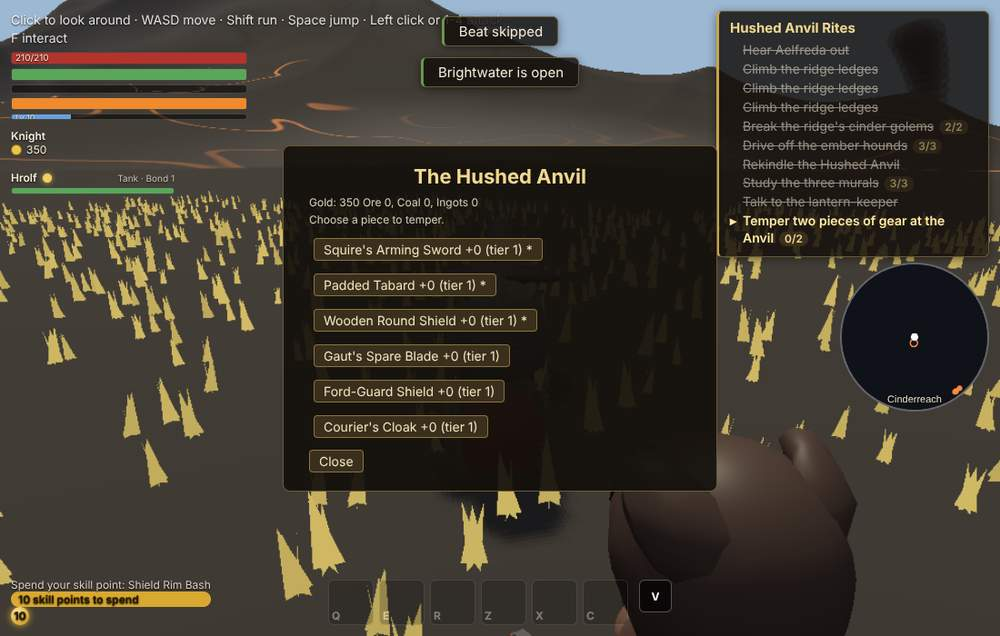 | 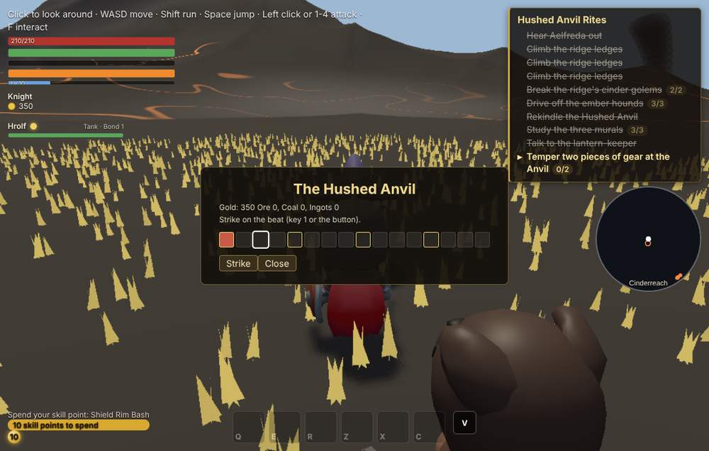 |

---

## M11 Road of Cinders

**Main** · Harrowmark to the Cinder Road · Giver: Sir Gaut Halvard (at the Bastion) · Opens after the Act 1 ending · Jump: `?act2=m11&new` · Design time 45 min

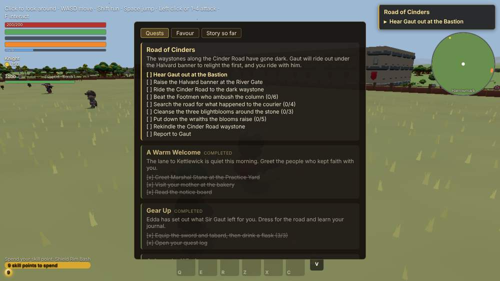

**Steps**
1. Hear Gaut out at the Bastion.
2. Raise the Halvard banner at the River Gate (the column rides out; Gaut leads on a horse, two Halvard riders behind).
3. Ride the Cinder Road to the dark waystone (three banter stops on the way).
4. Beat the six Footmen who ambush the column.
5. Search the road for what happened to the courier (0/4).
6. Cleanse the three blightblooms around the stone (0/3).
7. Put down the five wraiths the blooms raise.
8. Rekindle the Cinder Road waystone (hold F).
9. Report to Gaut.

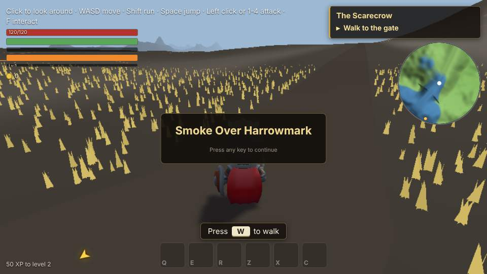

**Rewards:** 450 XP, Ashmare Saddle (more mount stamina).

**Verify**
- [ ] Gaut waits when Cael falls more than 12 m behind; the riders dismount at the ring.
- [ ] The rekindled stone becomes a fast-travel point.

---

## M12 Cinderford Under Siege

**Main** · Cinderford · Giver: Reeve Osgar Thane · Opens after M11 · Jump: `?act2=m12&new` · Design time 50 min

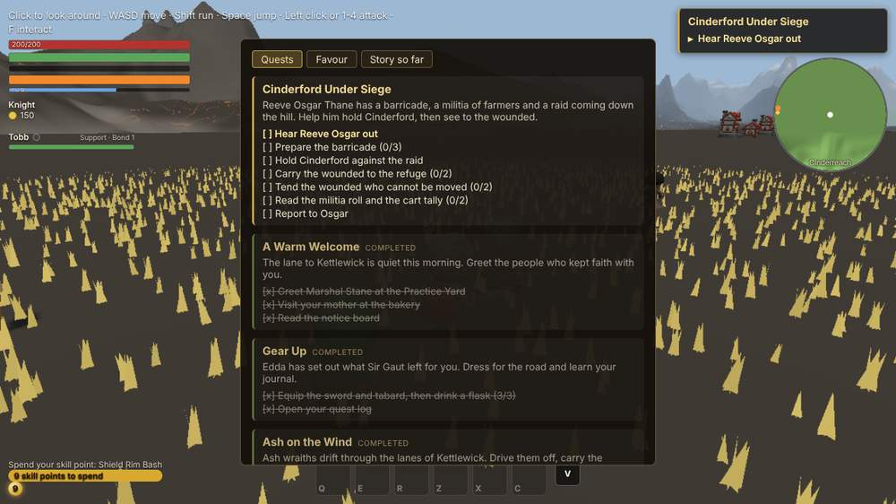

**Steps**
1. Hear Reeve Osgar out.
2. Prepare the barricade (0/3).
3. Hold Cinderford against the raid (waves; the barricade's health bar shows under the boss bar).
4. Carry two wounded to the refuge.
5. Tend the two wounded who cannot be moved.
6. Read the militia roll and the cart tally.
7. Report to Osgar.

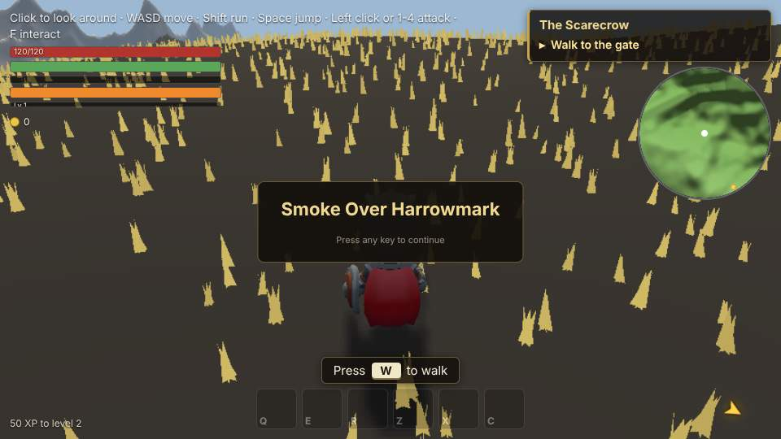

**Rewards:** 500 XP, 200 gold (Reeve's Bounty).

**Verify**
- [ ] If the barricade falls, the defence fails and can be retried.
- [ ] After M12: Maud (R06), Ketta (R05) and Hrolf at Stonefold (M13) offer their quests.

**Taste calls:** the M12 station choice (A12, invented).

---

## R06 The Cinderford Well

**Region** · Cinderford · Giver: Mother Maud · Opens after M12 · Jump: `?act2=r06&new` · Design time 40 min

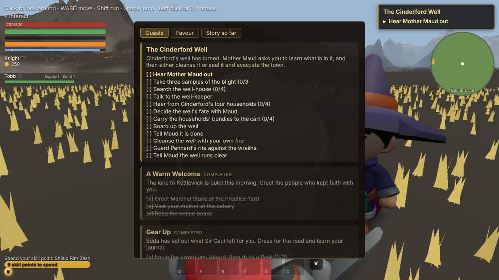

**Steps**
1. Hear Mother Maud out.
2. Take three samples of the blight.
3. Search the well-house (0/4).
4. Talk to the well-keeper, Edmer Holt.
5. Hear from Cinderford's four households (0/4).
6. Decide the well's fate with Maud. Then one branch:
   - **Seal and evacuate:** carry the four households' bundles to the cart, board up the well, tell Maud it is done.
   - **Cleanse:** cleanse the well with your own fire, guard Pennard's rite against the wraiths, tell Maud the well runs clear.

**Rewards:** 350 XP, Maud's Remedy (heals 40%).

**Choices:** seal or cleanse (flag F4). A sealed well hides Maud, Beornwyn and the households and boards the well; a cleansed well removes the blight stain.

**Verify**
- [ ] Only the chosen branch's objectives show after the choice.
- [ ] Cinderford looks different afterwards (boarded and empty, or clean).

---

## R05 Ketta's Lost Flock

**Region** · Fellwalker Pasture · Giver: Ketta Fellwalker · Opens after M12 · Jump: `?act2=r05&new` · Design time 35 min

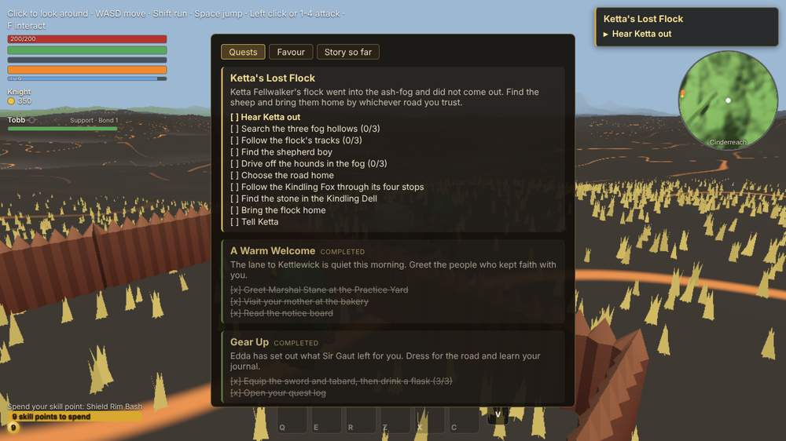

**Steps**
1. Hear Ketta out.
2. Search the three fog hollows.
3. Follow the flock's tracks (0/3).
4. Find the shepherd boy, Pell.
5. Drive off the three hounds in the fog.
6. Choose the road home. Then one branch:
   - **Safe road:** bring the flock home.
   - **Kindling Fox:** follow the fox through its four stops, find the stone in the Kindling Dell, then bring the (smaller) flock home.
7. Tell Ketta.

**Rewards:** 350 XP, Fox-Fire Ember.

**Verify**
- [ ] The fox road loses some sheep but reaches the Kindling Dell early; the Dell's warm ash bed gives the Fox-Fire buff (30 min, refreshes) and the first visit gives a Kindling Brush.
- [ ] With Fox-Fire active, hidden Fox-Fire chests appear in the pasture (six, a Barley Cake each).

---

## M13 The Warden's Oath

**Main** · Stonefold · Giver: Hrolf Ironbrow · Opens after M12 · Jump: `?act2=m13&new` · Design time 50 min

**Steps**
1. Meet Hrolf Ironbrow at Stonefold.
2. Talk to Hrolf's kin in the hall (Ealdred Ironbrow).
3. Carry the three logs to the ring.
4. Talk to Hrolf at the ring.
5. Heave the boulder to the gate.
6. Search the brothers' hall (0/3).
7. Win Hrolf's trial of strength (a duel: a stagger or holding a side at 1 HP is a break; both heal between rounds; a loss restarts the score).
8. Take the warden's oath. **Hrolf joins the party** (bond rank 1).

**Rewards:** 500 XP, Hrolf's Axe-Rune (trinket, +3 attack).

**Verify**
- [ ] The trial duel pays no XP and cannot kill.
- [ ] Hrolf takes the companion seat; Tobb goes to wait at the Tilted Anvil.

---

## R07 Wolf-Mother's Kits

**Region** · near Stonefold · Giver: Ketta Fellwalker (at Stonefold once R05 is done) · Opens after M13 and R05 · Jump: `?act2=r07&new` · Design time 35 min

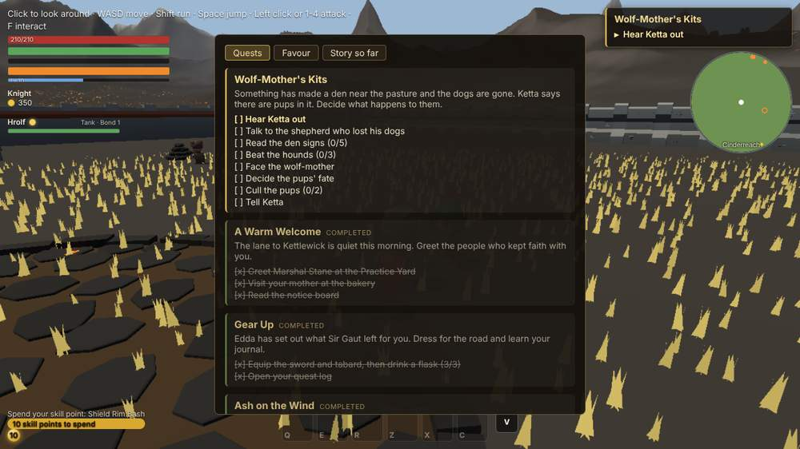

**Steps**
1. Hear Ketta out.
2. Talk to the shepherd who lost his dogs (Osric Reed).
3. Read the den signs (0/5).
4. Beat the three hounds.
5. Face the wolf-mother.
6. Decide the pups' fate. If you cull: cull the two pups.
7. Tell Ketta.

**Rewards:** 350 XP; Pup Collar only if the den is spared.

**Choices:** spare (an Ember pup follows Cael, raids on Cinderford stop) or cull (safe pasture, no pup). Flag `story.r07.choice`.

**Verify**
- [ ] A spared den gives the collar and the half-size pup that sits when idle; a culled den gives no collar.

---

## R11 Hrolf's Brother's Axe

**Region** · the wyrm den above Stonefold · Giver: Hrolf Ironbrow · Opens after M13 · Jump: `?act2=r11&new` · Design time 40 min

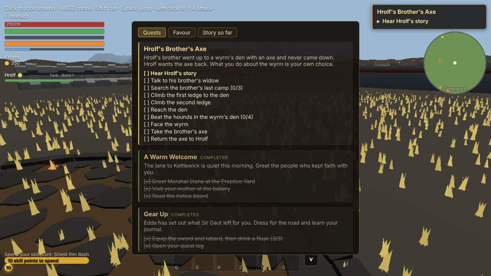

**Steps**
1. Hear Hrolf's story.
2. Talk to his brother's widow, Wynne Ironbrow.
3. Search the brother's last camp (0/3).
4. Climb the first and second ledges to the den (Surge Leap).
5. Reach the den and beat the four hounds.
6. Face the wyrm: slay it or spare it.
7. Take the brother's axe.
8. Return the axe to Hrolf.

**Rewards:** 450 XP; Brother's Axe (18 attack if the wyrm was slain, 13 if spared).

**Choices:** slay (dragons favour -4, full axe) or spare (dragons +5, Hrolf's bond rises, a stone marker on the den shelf, and the wyrm later joins the dragons at the rim).

**Verify**
- [ ] Hrolf's den lines differ for spared and slain.

---

## M14 Hushed Anvil Rites

**Main** · the Hushed Anvil ridge · Giver: Sister Aelfreda (waits at the Anvil from M13) · Opens after M13 · Jump: `?act2=m14&new` · Design time 55 min

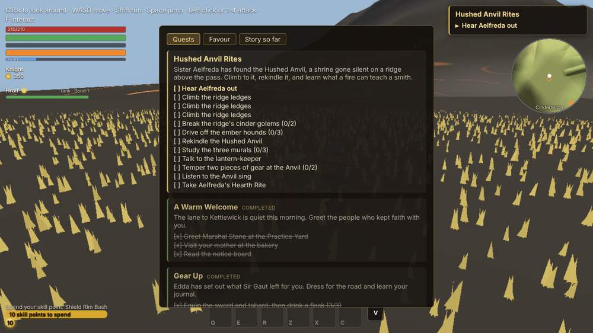

**Steps**
1. Hear Aelfreda out.
2. Climb the ridge ledges (three).
3. Break the ridge's two cinder golems; drive off three ember hounds.
4. Rekindle the Hushed Anvil (hold F).
5. Study the three murals (codex lore entries).
6. Talk to the lantern-keeper.
7. Temper two pieces of gear at the Anvil.
8. Listen to the Anvil sing.
9. Take Aelfreda's Hearth Rite. **Aelfreda joins the party.**

| The Hearth Rite | Rhythm bar |
| --- | --- |
| 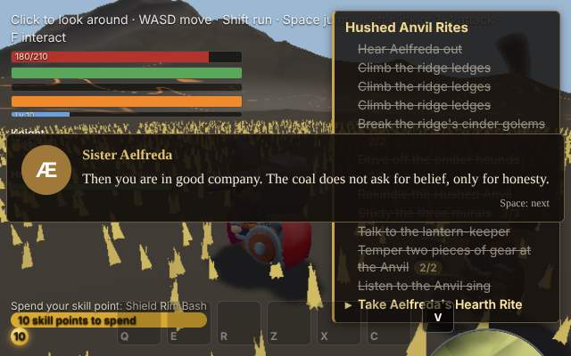 |  |

**Rewards:** 550 XP; tempering unlocked.

**Verify**
- [ ] Aelfreda's Brightwater chapel NPC is gone once she joins.
- [ ] Tempering keeps or replaces one affix as chosen.

**Taste calls:** the three murals' text; "Anvil sings" has no camera hold.

---

## M15 The Hunters' Pens

**Main** · the hunters' camp above Cinderford · Giver: Reeve Osgar Thane · Opens after M14 · Jump: `?act2=m15&new` · Design time 50 min

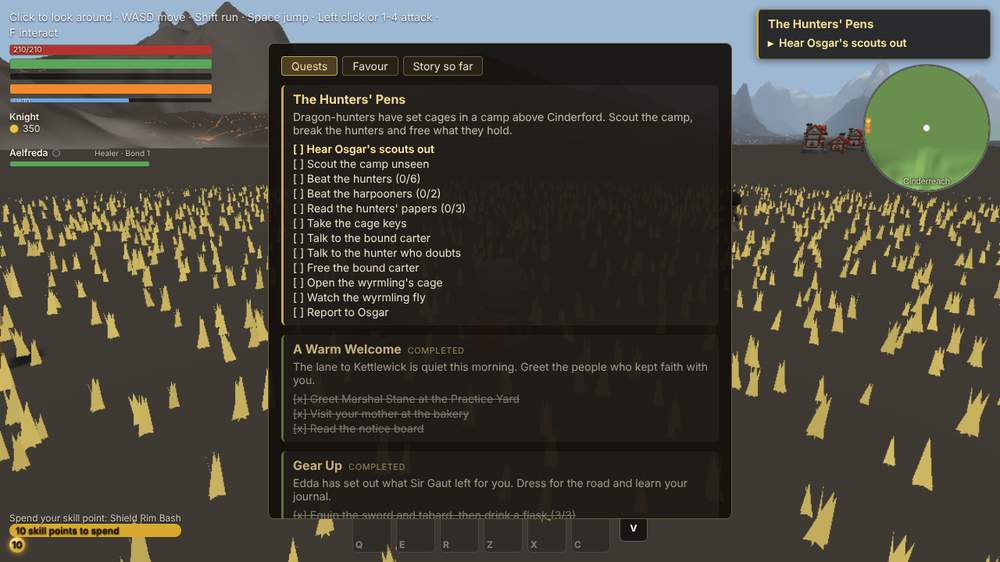

**Steps**
1. Hear Osgar's scouts out.
2. Scout the camp unseen (stealth, three watch guards).
3. Beat six spearmen and two harpooners.
4. Read the hunters' papers (0/3).
5. Take the cage keys.
6. Talk to the bound carter and to Corwin, the hunter who doubts.
7. Free the bound carter.
8. Open the wyrmling's cage and watch it fly.
9. Report to Osgar.

| Cage keys | Freeing the carter |
| --- | --- |
| 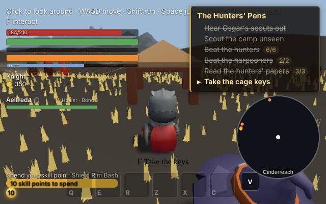 | 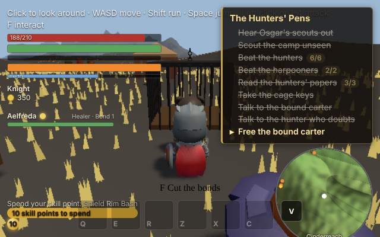 |

**Rewards:** 500 XP, Wyrmling Scale.

**Verify**
- [ ] Spared hunters count as witnesses.
- [ ] The wyrmling flies off after a few seconds.

---

## D03 The Fall of Scorchhold

**Dungeon** · Scorchhold fort · Giver: Reeve Osgar Thane · Opens after M15 · Jump: `?act2=d03&new` · Design time 60 min · **Boss: Hunt-Captain Thrandil Redmane**

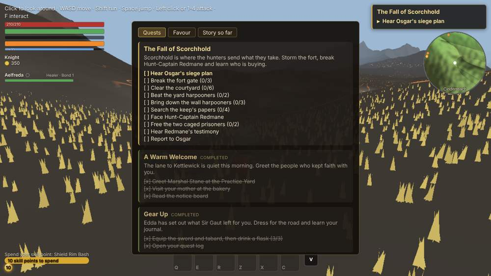

**Steps**
1. Hear Osgar's siege plan.
2. Break the fort gate (three charges).
3. Clear the courtyard (six), beat the two yard harpooners, bring down the three wall harpooners.
4. Search the keep's papers (four ledger desks in the entry hall).
5. Face Hunt-Captain Redmane (lance charge, net throw, lance thrust, harpoon traps).
6. Free the two caged prisoners.
7. Hear Redmane's testimony (by Osgar's post if spared).
8. Report to Osgar.

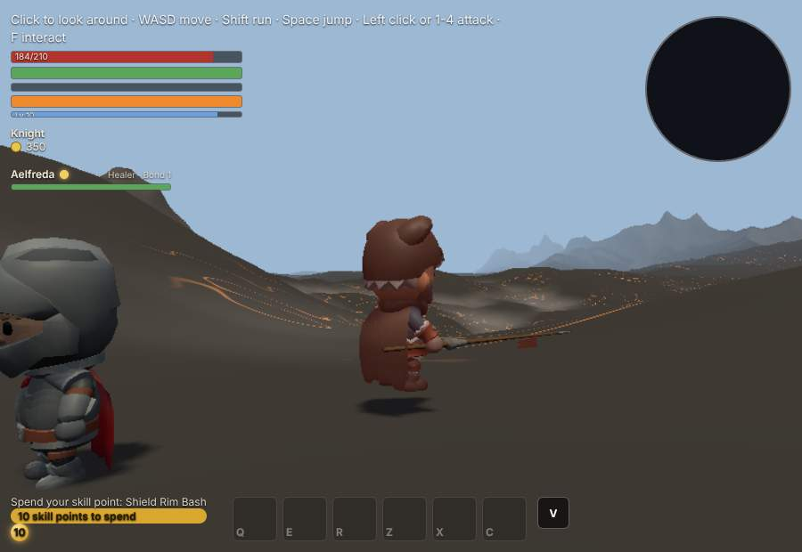

**Rewards:** 800 XP, Redmane's Lance.

**Choices:** spare Redmane at his final-phase break (6 s window, hold T; he drops the lance, kneels and fades, and testifies) or kill him.

**Verify**
- [ ] A missed Spare window reopens on the next final-phase break.
- [ ] Harpoon traps root for 1 s and can only be dodged.
- [ ] D03 opens Phase D: Osgar hands over Aldous's letter (M16).

---

## M16 Grisel's Invitation

**Main** · the Oldsmoke pass, Deepgate · Giver: Osgar hands over Lord Aldous Grisel's letter · Opens after D03 · Jump: `?act2=m16&new` · Design time 45 min

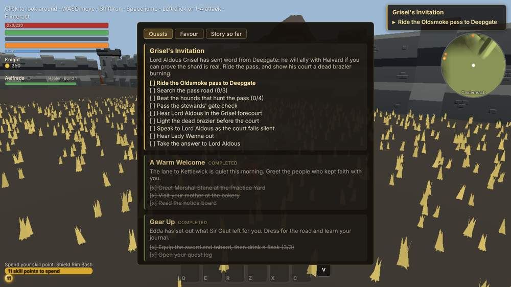

**Steps**
1. Ride the Oldsmoke pass to Deepgate.
2. Search the pass road (toll ledger, burned cart, miner's shrine).
3. Beat the four hounds that hunt the pass.
4. Pass the stewards' gate check.
5. Hear Lord Aldous in the Grisel forecourt.
6. Light the dead brazier before the court (scripted rekindle, 10 Burn).
7. Speak to Lord Aldous as the court falls silent.
8. Hear Lady Wenna out.
9. Take the answer to Lord Aldous.

| Deepgate gate | The forecourt | The brazier |
| --- | --- | --- |
| 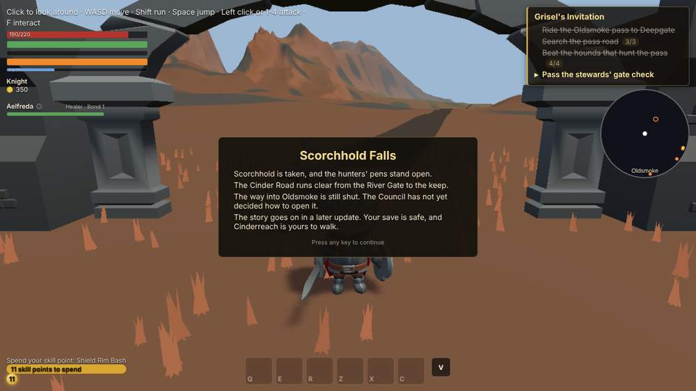 | 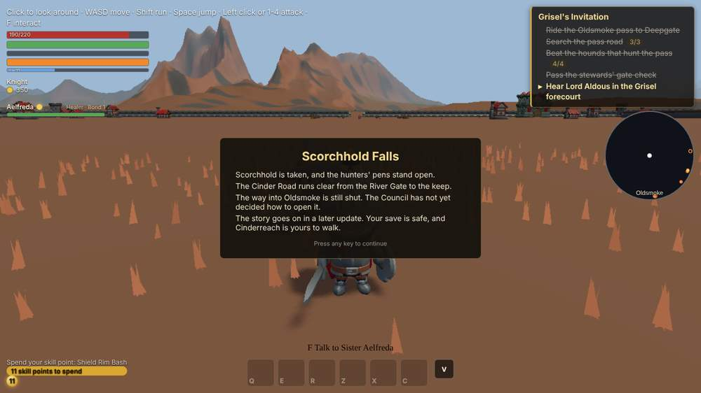 | 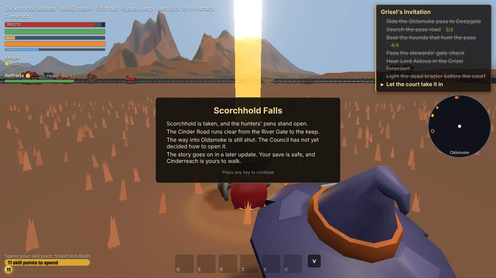 |

**Rewards:** 500 XP, Grisel Writ.

---

## M17 Down the Oldsmoke Shaft

**Main** · Deepgate shaft head, shaft floor · Giver: Foreman Burchard Slagg · Opens after M16 · Jump: `?act2=m17&new` · Design time 45 min

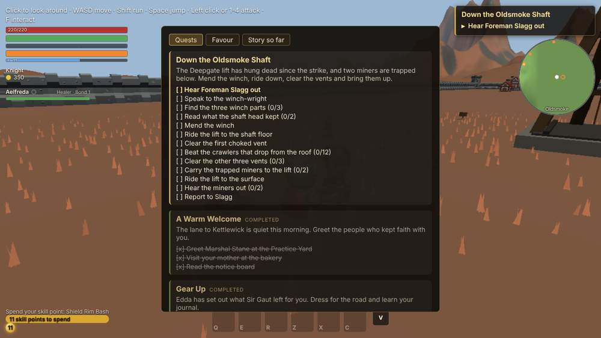

**Steps**
1. Hear Foreman Slagg out; speak to Winch-wright Ansel.
2. Find the three winch parts; read the lift board and the headframe tally.
3. Mend the winch (the lift menu opens).
4. Ride the lift to the shaft floor.
5. Clear the first choked vent: twelve crawlers drop from the roof.
6. Clear the other three vents.
7. Carry the trapped miners, Hale and Brig, to the lift.
8. Ride up; hear the miners out; report to Slagg.

| Shaft head | Shaft floor | The swarm |
| --- | --- | --- |
| 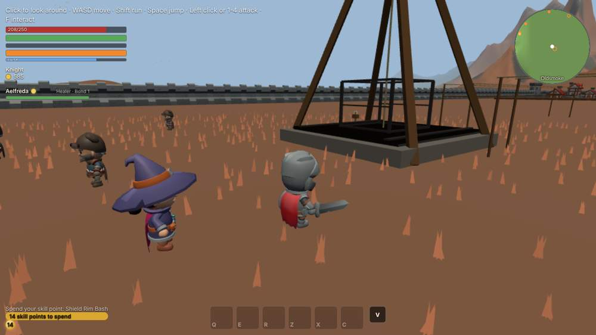 | 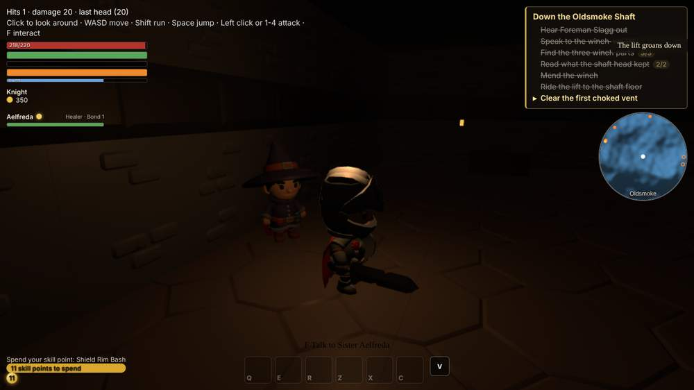 | 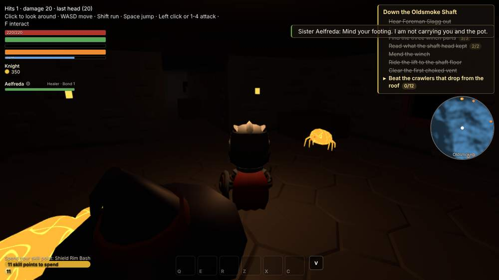 |

**Rewards:** 500 XP, Miner's Helm (armour slot, defense 2).

---

## R09 Sooty Coin

**Region** · Deepgate market cellars · Giver: Foreman Slagg · Opens after M16 · Jump: `?act2=r09&new` · Design time 35 min

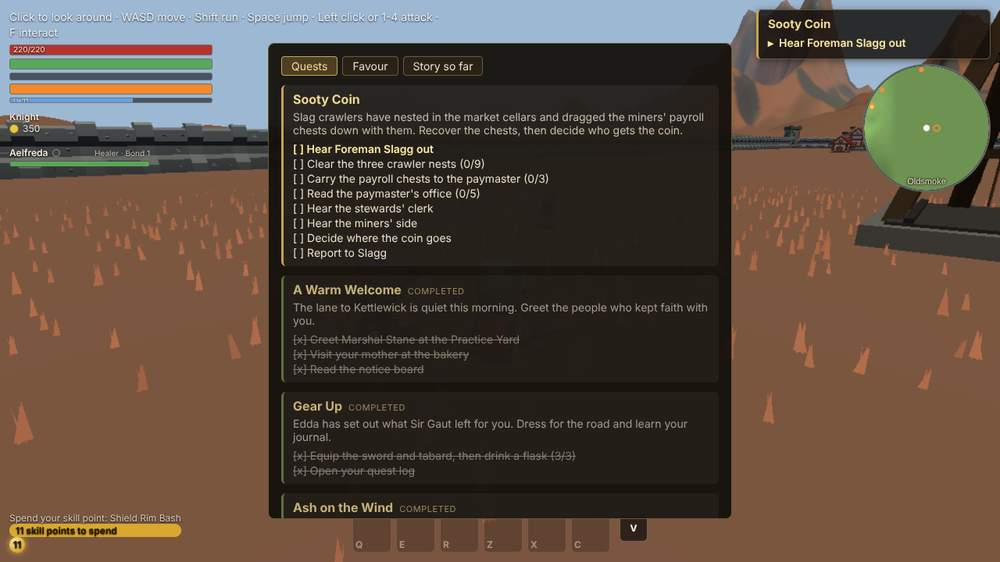

**Steps**
1. Hear Slagg out.
2. Clear the three crawler nests (nine crawlers).
3. Carry the three payroll chests to the paymaster.
4. Read the paymaster's office (0/5).
5. Hear the stewards' clerk and the miners' side.
6. Decide where the coin goes.
7. Report to Slagg (a scene; it ticks when his last line plays).

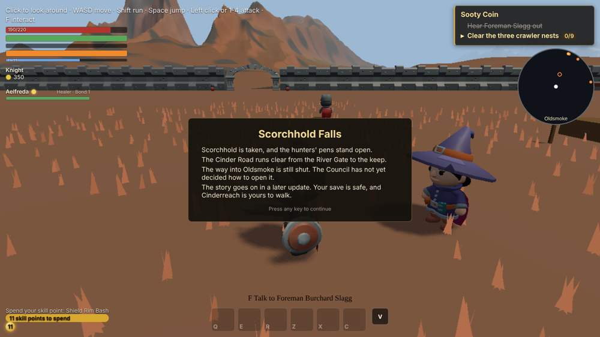

**Rewards:** 400 XP, 300 gold (on either side).

**Choices:** stewards (Grisel +5) or miners (Grisel -3, union discount).

---

## R08 Pickett's Last Shift

**Region** · the Old Galleries · Giver: the ghost of Burel Pickett · Opens after M17 · Jump: `?act2=r08&new` · Design time 40 min

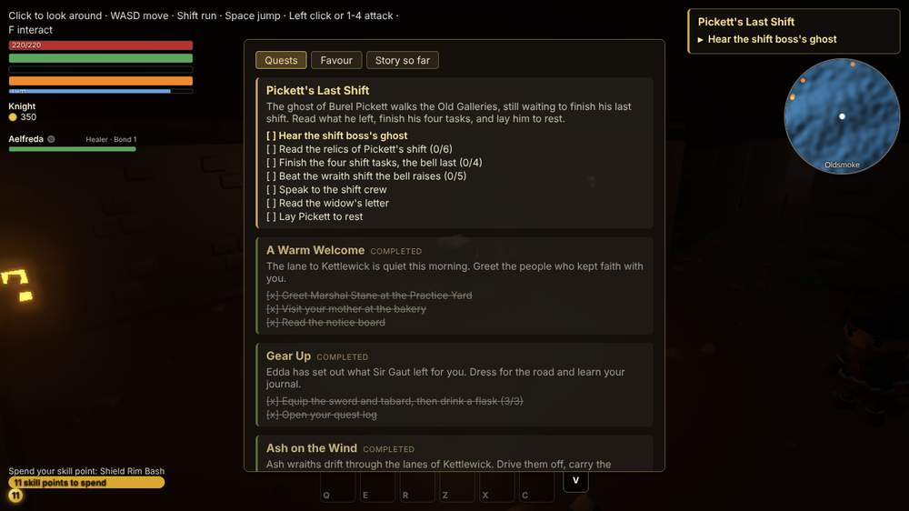

**Steps**
1. Hear the shift boss's ghost.
2. Read the six relics of Pickett's shift.
3. Finish the four shift tasks: pump, cart, prop, then the bell last.
4. Beat the five wraiths the bell raises.
5. Speak to the shift crew; read the widow's letter.
6. Lay Pickett to rest.

| Old Galleries | The bell | The wraith shift |
| --- | --- | --- |
| 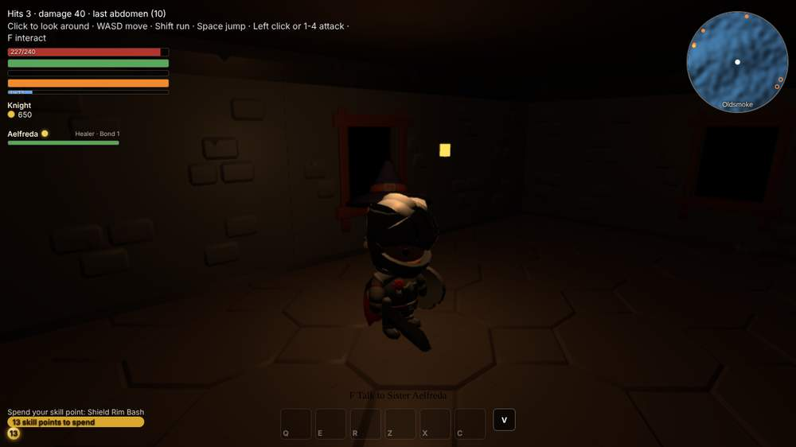 | 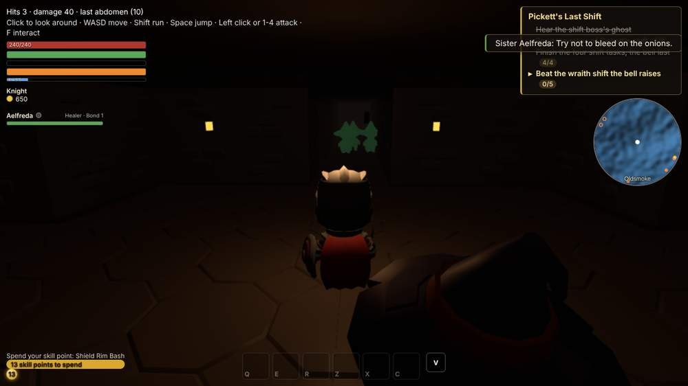 | 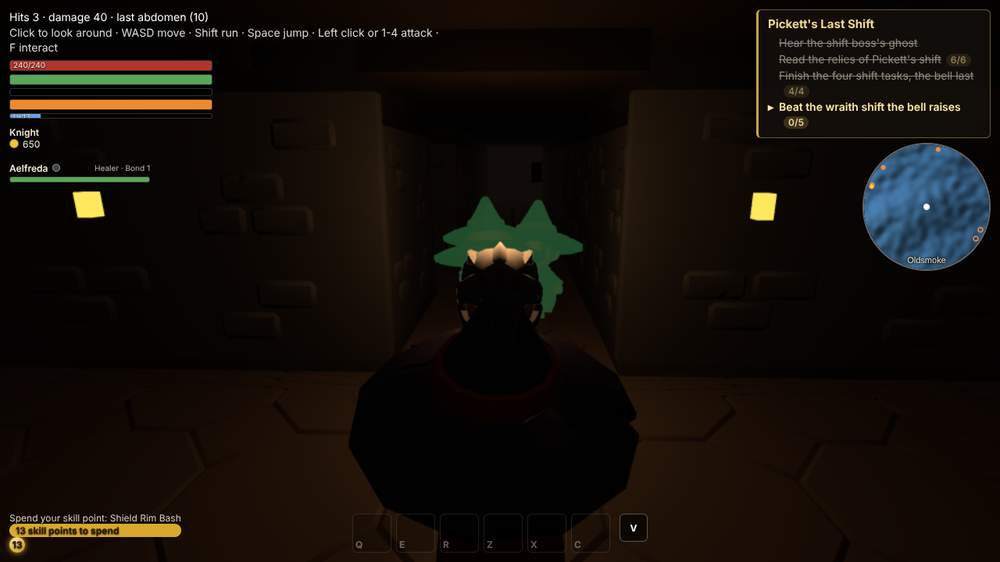 |

**Rewards:** 400 XP, Pickett's Lantern (trinket, defense 2).

- [ ] The bell refuses until the other three tasks are done.

---

## R10 The Miners' Strike

**Region** · Deepgate · Giver: Foreman Slagg · Opens after M17 · Jump: `?act2=r10&new` · Design time 45 min

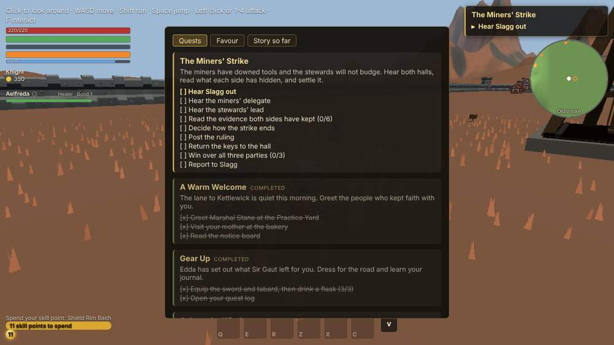

**Steps**
1. Hear Slagg out; hear the miners' delegate (Oda) and the stewards' lead (Halse).
2. Read the six pieces of evidence both sides kept.
3. Decide how the strike ends. Then:
   - **Miners or stewards:** post the ruling, return the keys to the hall.
   - **Compromise:** win over all three parties (Oda, Halse, the clerk) in persuasion talks, or by a duel (R10's optional duels).
4. Report to Slagg.

**Rewards:** 450 XP, Union Badge (trade discount).

**Choices (flag F5):** miners Grisel -5; stewards Grisel +5; compromise Grisel +2 and Oswin +2. A persuasion round is won by the evidence read or by Grisel favour 10 or more; a lost round gives a hint and can be asked again.

---

## M18 Breath for the Bellows

**Main** · the Weeping Bellows · Giver: Fire-tender Cuthbert Pike · Opens after M17 · Jump: `?act2=m18&new` · Design time 50 min

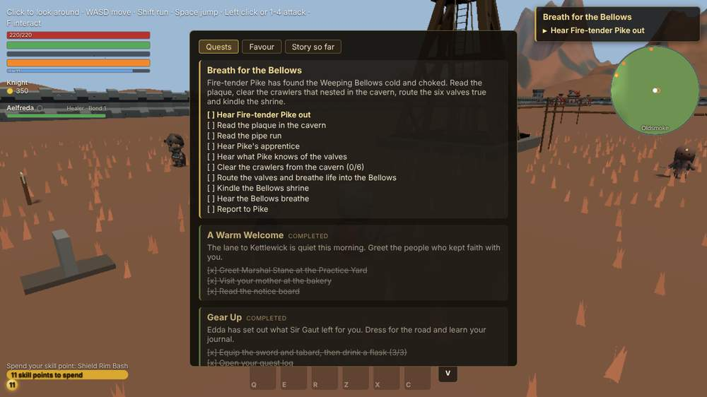

**Steps**
1. Hear Pike out.
2. Read the plaque in the cavern and the pipe run.
3. Hear Pike's apprentice (Hob) and what Pike knows of the valves.
4. Clear the six crawlers from the cavern.
5. Route the six valves and breathe life into the Bellows (the pressure bar puzzle).
6. Kindle the Bellows shrine; hear the Bellows breathe.
7. Report to Pike.

| The cavern | Solved |
| --- | --- |
| 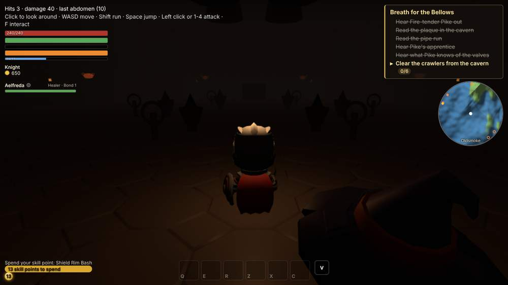 | 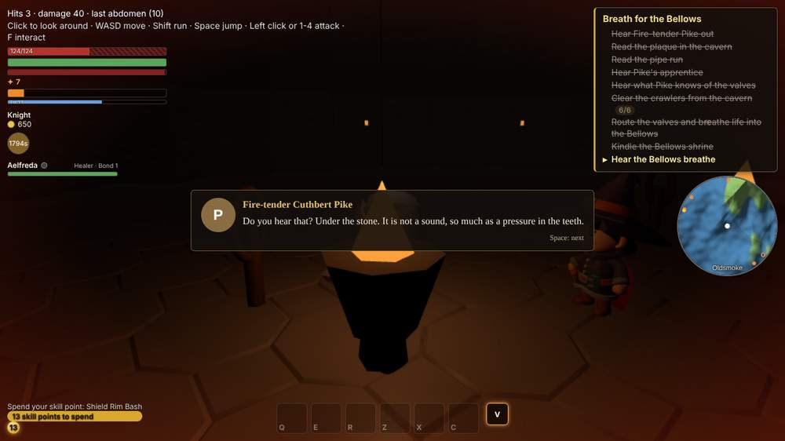 |

**Rewards:** 550 XP (Bellows Blessing buff from the shrine).

---

## M19 What Grisel Hides

**Main** · the Lower Galleries · Giver: Lady Wenna Grisel (her confession is the offer) · Opens after M18 · Jump: `?act2=m19&new` · Design time 50 min

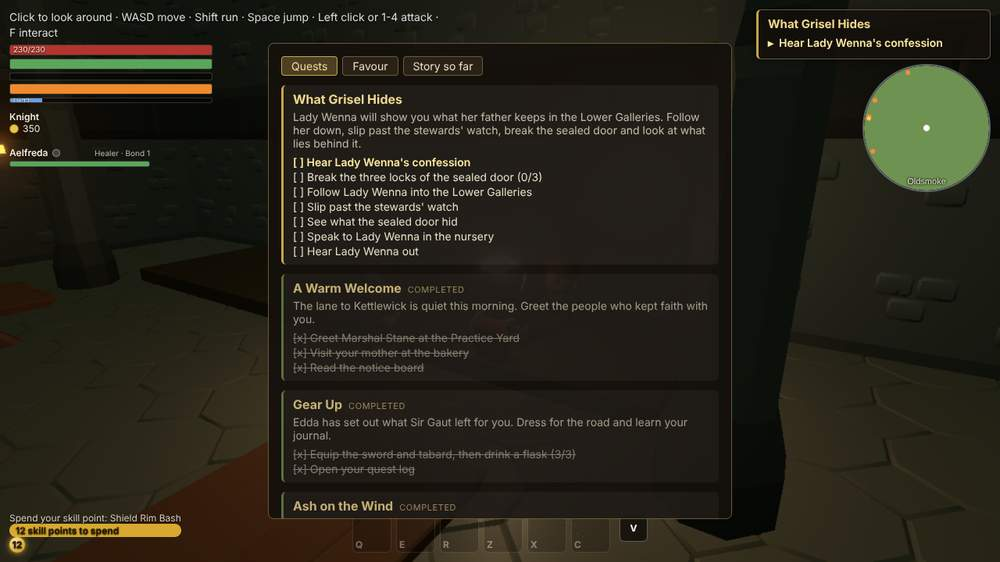

**Steps**
1. Hear Lady Wenna's confession.
2. Break the three locks of the sealed door.
3. Follow Wenna into the Lower Galleries.
4. Slip past the stewards' watch (one patrolling guard, four hide spots; Wenna waits in a hide spot).
5. See what the sealed door hid.
6. Speak to Wenna in the nursery; hear her out.

| Sealed door | Stealth start | The nursery |
| --- | --- | --- |
| 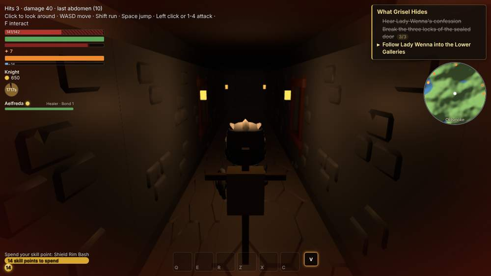 | 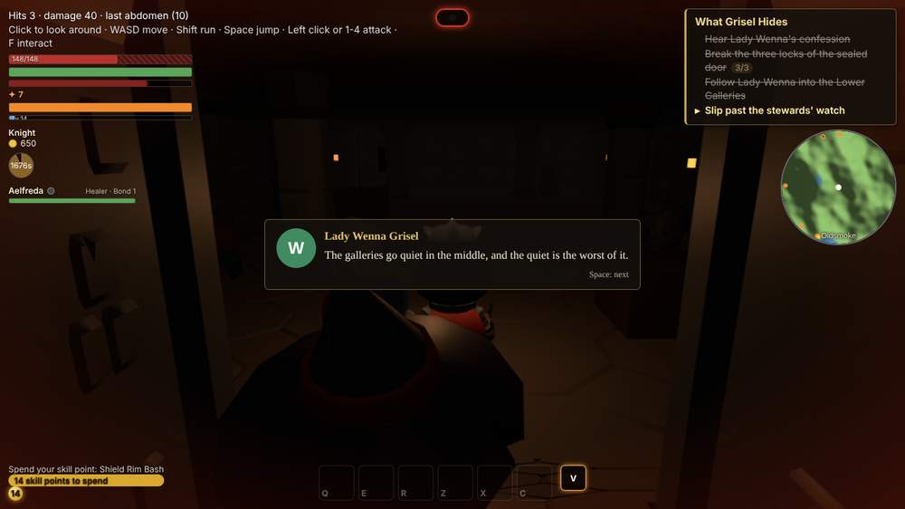 | 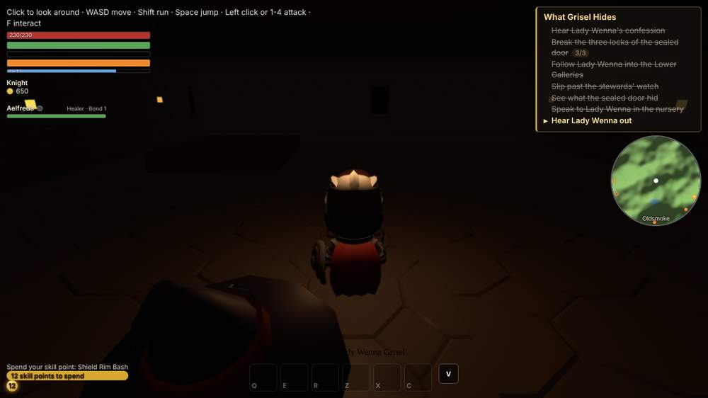 |

**Rewards:** 550 XP.

---

## M20 Chain and Ember

**Main** · the Lower Galleries hall · Giver: Lady Wenna Grisel · Opens after M19 · Jump: `?act2=m20&new` · Design time 45 min

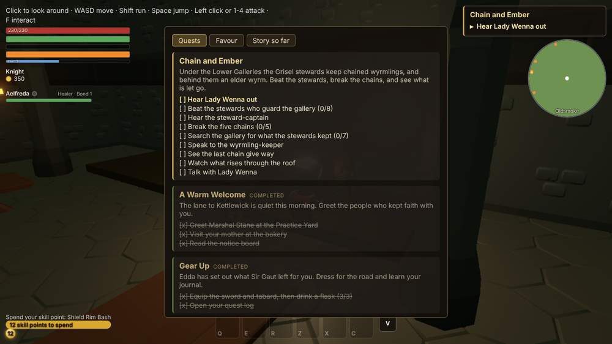

**Steps**
1. Hear Wenna out.
2. Beat the eight stewards who guard the gallery.
3. Hear Steward-Captain Hobb Varley.
4. Break the five chains (each frees a wyrmling).
5. Search the gallery (seven notes); speak to Wyrmling-Keeper Tamsin Roke.
6. See the last chain give way and watch Orsk the Bellows-Keeper tear out through the roof.
7. Talk with Wenna.

| Orsk's hall | Orsk rises |
| --- | --- |
| 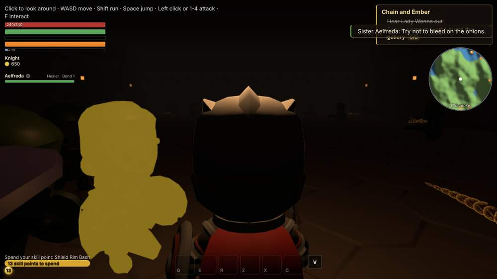 | 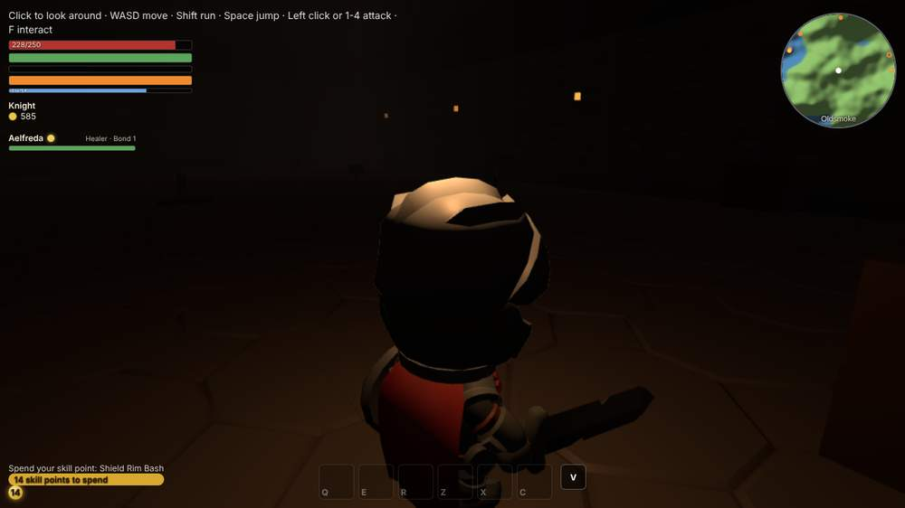 |

**Rewards:** 600 XP, Orsk's Cinder.

- [ ] Reloading during the Orsk scene replays it from the start; the roof stays broken afterwards.

---

## M21 Parley at Deepgate

**Main** · Grisel Hall · Giver: Lady Wenna Grisel · Opens after M20 · Jump: `?act2=m21&new` · Design time 40 min

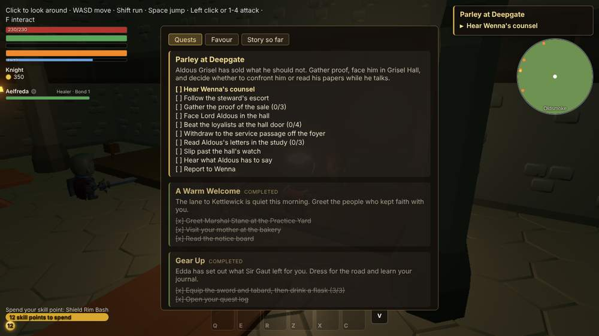

**Steps**
1. Hear Wenna's counsel; follow the steward's escort.
2. Gather the three proofs of the sale.
3. Face Lord Aldous in the hall. Then one branch:
   - **Confront:** persuade (two of the three proofs, or Grisel favour 15, or a 40 gold tip) and it ends without a fight; a pressed case without proof brings four loyalists to beat at the hall door.
   - **Spy:** withdraw to the service passage off the foyer, read Aldous's three letters in the study, slip past the hall's watch (four guards).
4. Hear what Aldous has to say; report to Wenna.

| Study | Caught: back to the checkpoint |
| --- | --- |
| 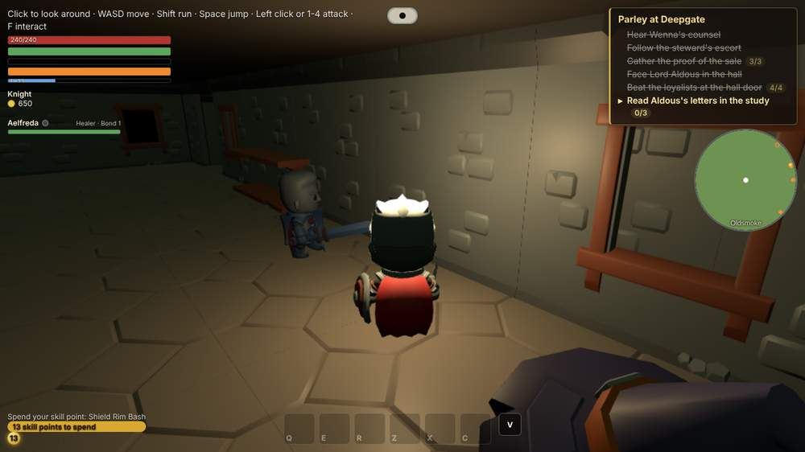 | 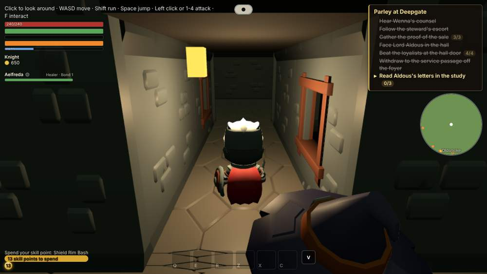 |

**Rewards:** 500 XP, Favour Mark.

**Choices:** confront or spy (`story.m21.choice`, `story.m21.persuaded`); spying yields the Grisel Spy-Letter, which lets Wenna turn her father's guards in D09.

---

## D04 The Deepdelve Descent

**Dungeon** · Deepdelve · Giver: Foreman Slagg · Opens after M20 · Jump: `?act2=d04&new` · Design time 65 min · **Boss: the Slagmaw**

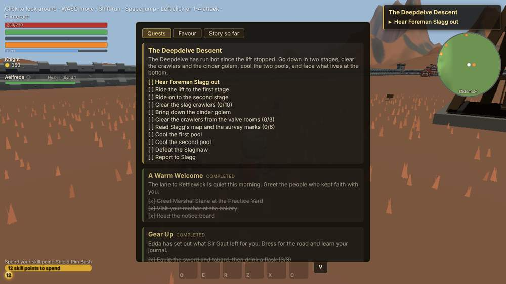

**Steps**
1. Hear Slagg out.
2. Ride the lift to the first stage, then on to the second.
3. Clear ten slag crawlers; bring down the cinder golem; clear three crawlers from the valve rooms.
4. Read Slagg's map and the survey marks (0/6).
5. Cool the first and second pools (valve puzzles).
6. Defeat the Slagmaw: its crust is hot and takes no poise damage; open one live coolant valve per phase to douse a 7 m disc, and break it while it surfaces in the cooled area. Dodge the eruptions (1.2 s tremor warning) and the lava spit.
7. Report to Slagg.

| Deepdelve | Slagmaw intro | Defeated |
| --- | --- | --- |
| 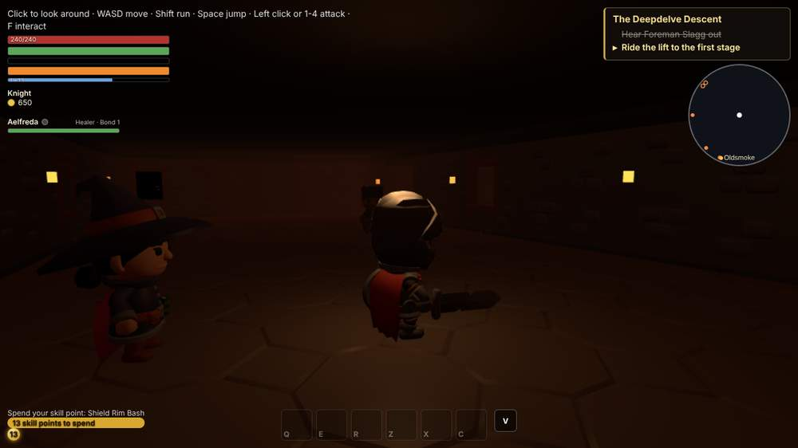 | 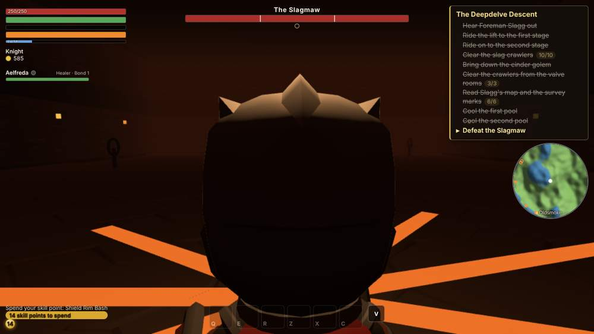 | 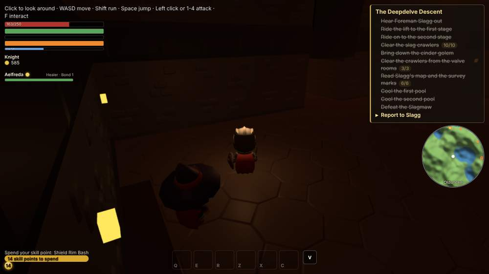 |

**Rewards:** 900 XP, Slag Core. No mercy option (defeat is the only outcome).

- [ ] A wasted valve re-arms.

**Taste calls:** the procedural worm art for the Slagmaw is a placeholder.

---

## M22 Return to the Capital

**Main** · Keep of Valdren, Harrowmark · Giver: Lord Wystan Halvard · Opens after every other Act 2 quest · Jump: `?act2=m22&new` · Design time 45 min

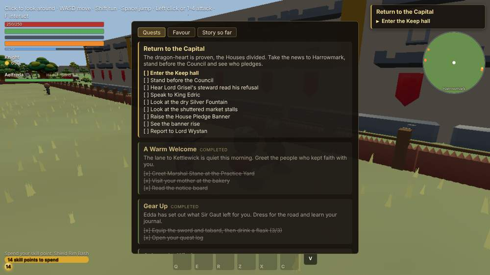

**Steps**
1. Enter the Keep hall: the Council scene starts (Wystan, Merrin, Edric; it names your earlier choices).
2. Stand before the Council.
3. Hear Steward Orrin read Lord Grisel's refusal (Aldous's seat is empty).
4. Speak to King Edric.
5. Look at the dry Silver Fountain and the shuttered market stalls.
6. Raise the House Pledge Banner; see it rise.
7. Report to Lord Wystan.

**Rewards:** 550 XP, House Pledge Banner.

---

## Act 2 ending: "The Houses Stand"

When M22 and D04 are both complete (`?act2=ending&new` plays it):

| Card | The fountain runs | Stalls open | Camp scene |
| --- | --- | --- | --- |
|  |  |  |  |

- [ ] The card lists: Halvard and Oswin pledged, the Silver Fountain runs, the stalls reopen, Wenna joins the camp, a second companion seat.
- [ ] The Silver Fountain runs and the market stalls are open in Harrowmark afterwards.
- [ ] Wenna stands at the Tilted Anvil hearth; the Party screen allows two companions.
- [ ] The camp scene plays once; `story.gate.a3` is set and Act 3 opens (Leofa at Reedgate offers M23, Thorgar at Wyrmwatch Lodge offers M28).
