# Act 3: The Coal-Mother

Greyfen Marches (Reedgate, the ferry, Hathren's Mere, Greywatch, the Sunken Chapel, the Mirewater Deeps) and Dragonspine Peaks (Wyrmwatch Lodge, Rime Pass, the Last Anvil, Hawk Cliffs, the summit, Skyhold, Frostfang Aerie). Levels 18 to 28. Back to the [index](README.md).

**Act 3 count:** 12 main quests (M23 to M34), 7 region quests (R12 to R18), 2 dungeons (D05, D06). The act ends when M34 and D06 are both complete.

**Blocks and order.** The Greyfen block (M23 to M27, D05, R12 to R14) and the lower Dragonspine block (M28 to M30, R15 to R18) open together and can be played in either order or interleaved. Enemy levels in each block are set when its first main quest is accepted (the lower Dragonspine is capped at your level plus 3). The summit block (M31 to M34, D06) opens when both blocks' main quests, D05 and R16 are done; M34 also waits for every Act 3 region quest.

**Test both orders.** Jumps take `&order=greyfen` (default) or `&order=spine`, which says which block was played first. Run the Greyfen-first and the spine-first routes at least once each.

| Id | Name | Giver | Opens after | Jump |
| --- | --- | --- | --- | --- |
| M23 | Into the Fen | Leofa Hartley | Act 2 ending | `?act3=m23&new` |
| M24 | The Ferryman's Fee | Dudda Reedly | M23 | `?act3=m24&new` |
| R14 | Leofa's Lost Patrol | Leofa Hartley | M23 | `?act3=r14&new` |
| R12 | Reed-Cutters' Dues | Dudda Reedly | M24 | `?act3=r12&new` |
| M25 | The Peat-Witch's Bargain | Gytha Mireweather | M24 | `?act3=m25&new` |
| R13 | Hathren's Lullaby | Gytha Mireweather | M25 | `?act3=r13&new` |
| M26 | Quench-Tongue Wakes | Gytha Mireweather | M25 | `?act3=m26&new` |
| M27 | Hunters in the Reeds | Leofa Hartley | M26, R14 | `?act3=m27&new` |
| D05 | Into the Mirewater | Gytha Mireweather | M27 | `?act3=d05&new` |
| M28 | Climb to Wyrmwatch | Thorgar Skyhold | Act 2 ending | `?act3=m28&new` |
| R15 | Skyhold Supplies | Thorgar Skyhold | M28 | `?act3=r15&new` |
| R18 | Rime Hawk Eggs | Thorgar Skyhold | M28 | `?act3=r18&new` |
| M29 | The Hermit of Rime Pass | Eadgyth Frostbrow | M28 | `?act3=m29&new` |
| R16 | Frostbrow's Lost Axe | Eadgyth Frostbrow | M29 | `?act3=r16&new` |
| M30 | The Keepers' Rubbings | Brother Ansgar | M29 | `?act3=m30&new` |
| R17 | Candles for the Last Anvil | Brother Ansgar | M30 | `?act3=r17&new` |
| M31 | The Coal-Mother's Trial | Eadgyth Frostbrow | M23 to M30, D05, R16 | `?act3=m31&new` |
| M32 | Ysmeryth Speaks | Ysmeryth the Coal-Mother | M31 | `?act3=m32&new` |
| M33 | The Hunters' Net | Thorgar Skyhold | M32 | `?act3=m33&new` |
| M34 | Fire Sworn | Ysmeryth | M31 to M33 and every R12 to R18 | `?act3=m34&new` |
| D06 | Wings of Frostfang | Thorgar Skyhold | M34 | `?act3=d06&new` |

**Systems introduced in Act 3** (check once):
- [ ] Diving: a breath meter shows underwater and drains; surfacing or an air pocket refills it; running out hurts.
- [ ] The Reedgate ferry (after M24): a stop menu; Esc cancels.
- [ ] Dragonspine Glide (after M34): from a glide ledge, F lets go; slope wind keeps you 10 to 30 m over three lanes; leaving a lane fades you back to the ledge.
- [ ] The map shows each block locked or open with its level.
- [ ] Gear sockets and shard-gems (smiths in the lodge).

| Diving | Ferry menu | Glide |
| --- | --- | --- |
| 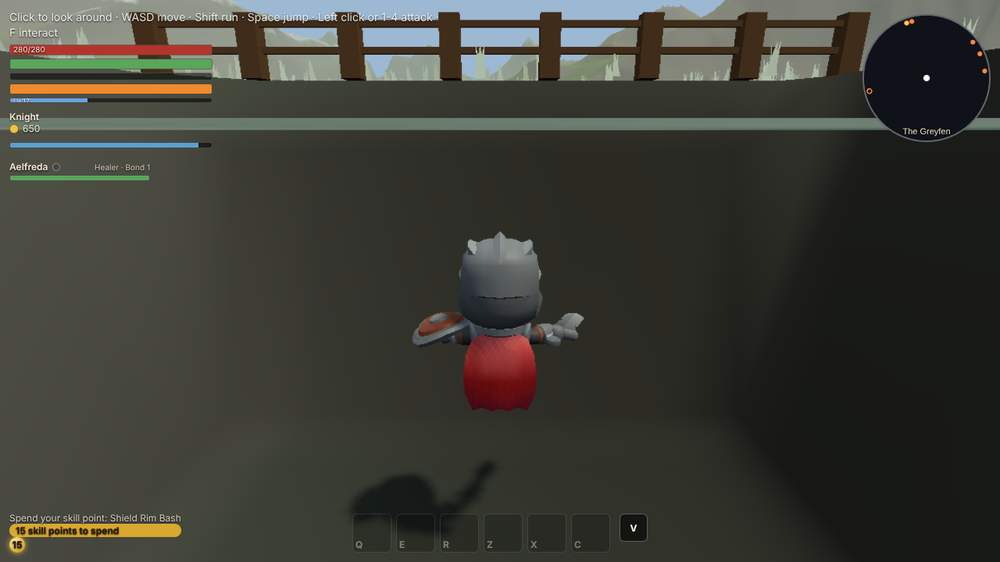 | 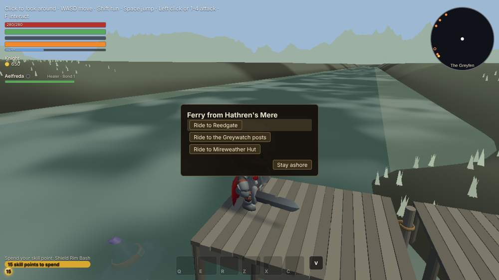 | 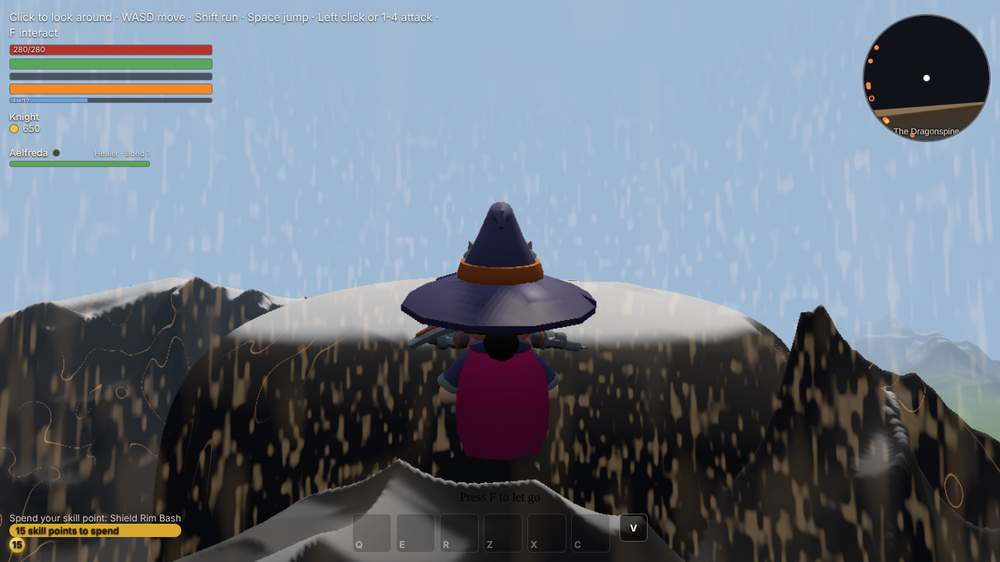 |

---

# The Greyfen block

## M23 Into the Fen

**Main** · Reedgate causeway to Hathren's Mere · Giver: Leofa Hartley · Opens with Act 3 · Jump: `?act3=m23&new` · Design time 45 min

| Journal (J) at the start | On the causeway |
| --- | --- |
| 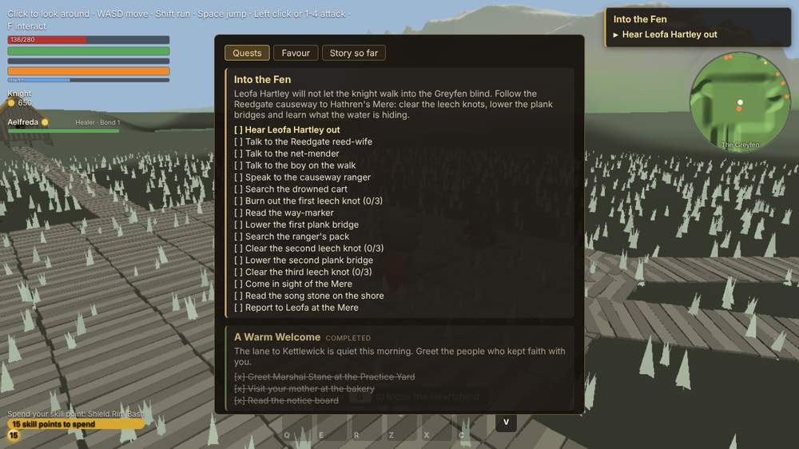 | 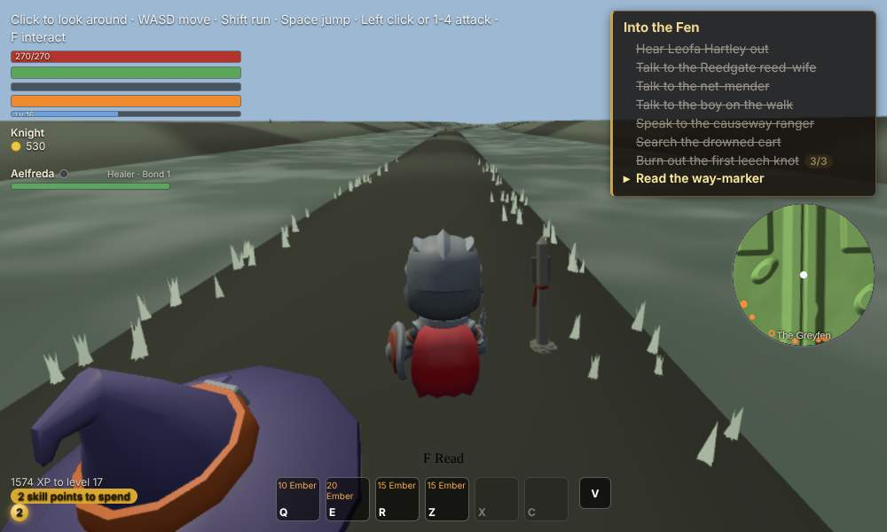 |

**Steps**
1. Hear Leofa Hartley out (she hands over the Pathfinder master book once).
2. Talk to the Reedgate reed-wife, the net-mender and the boy on the walk.
3. Speak to the causeway ranger; search the drowned cart.
4. Burn out the first leech knot (3); read the way-marker; lower the first plank bridge.
5. Search the ranger's pack; clear the second knot (3); lower the second bridge.
6. Clear the third knot (3).
7. Come in sight of the Mere; read the song stone on the shore.
8. Report to Leofa at the Mere.

**Rewards:** 600 XP, Fen Boots.

---

## M24 The Ferryman's Fee

**Main** · Reedgate Ferry · Giver: Dudda Reedly · Opens after M23 · Jump: `?act3=m24&new` · Design time 40 min

| Journal (J) at the start | Mid quest |
| --- | --- |
| 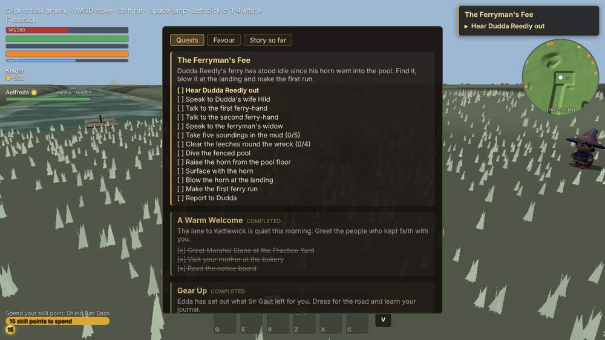 | 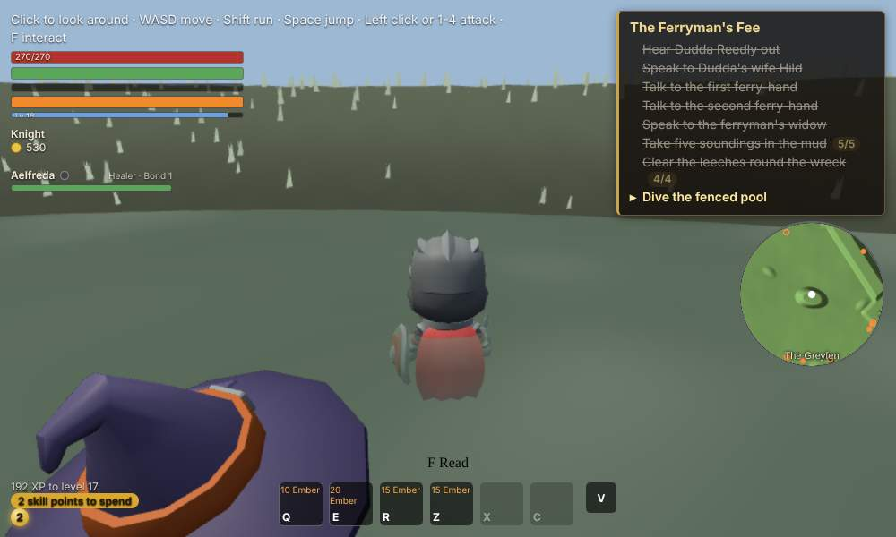 |

**Steps**
1. Hear Dudda out; speak to his wife Hild, the two ferry-hands and the ferryman's widow.
2. Take five soundings in the mud.
3. Clear the four leeches round the wreck.
4. Dive the fenced pool; raise the horn from the pool floor; surface with it.
5. Blow the horn at the landing.
6. Make the first ferry run (the ferry waits for the horn).
7. Report to Dudda.

**Rewards:** 550 XP, Ferry Token (fen fast travel).

- [ ] Drowning in the pool returns you to its rim with the quest intact.

---

## R14 Leofa's Lost Patrol

**Region** · the four Greywatch posts · Giver: Leofa Hartley · Opens after M23 · Jump: `?act3=r14&new` · Design time 45 min

| Journal (J) at the start | Mid quest |
| --- | --- |
| 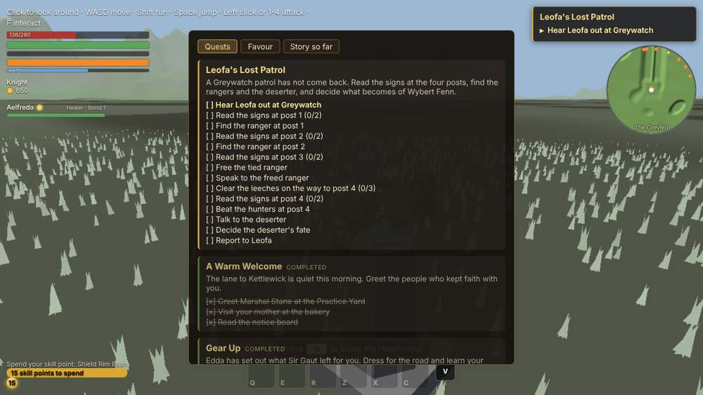 | 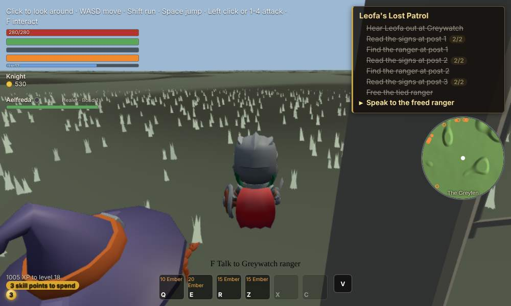 |

**Steps**
1. Hear Leofa out at Greywatch.
2. At posts 1 and 2: read the signs (2 each) and find the ranger.
3. At post 3: read the signs, free the tied ranger, speak to him.
4. Clear three leeches on the way to post 4; read its signs; beat the hunters there.
5. Talk to the deserter, Wybert Fenn; decide his fate.
6. Report to Leofa.

**Rewards:** 500 XP, Ranger Longbow.

**Choices:** bring Wybert back for judgement (Leofa's trust) or let him go (a ranger ally appears in M27).

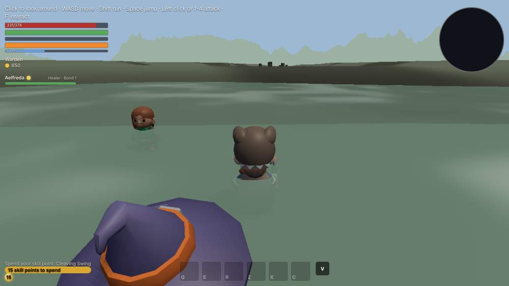

---

## R12 Reed-Cutters' Dues

**Region** · the five Reedgate reed beds · Giver: Dudda Reedly · Opens after M24 · Jump: `?act3=r12&new` · Design time 35 min

| Journal (J) at the start | Mid quest |
| --- | --- |
| 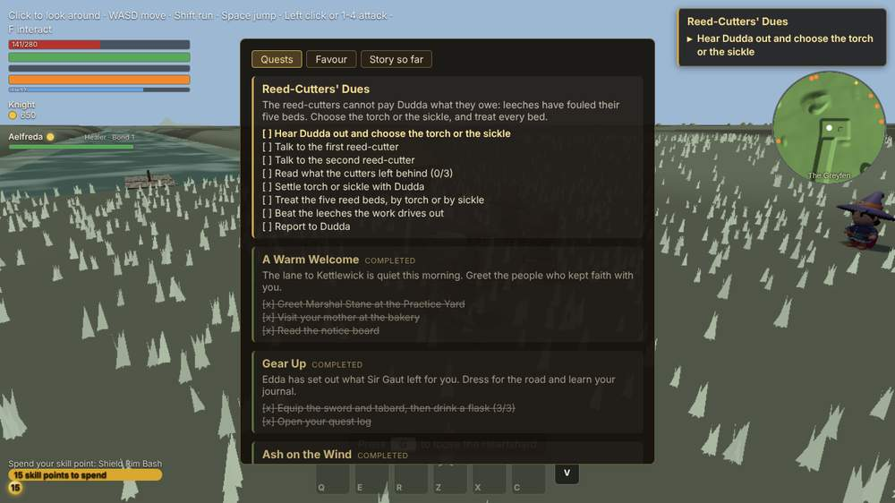 | 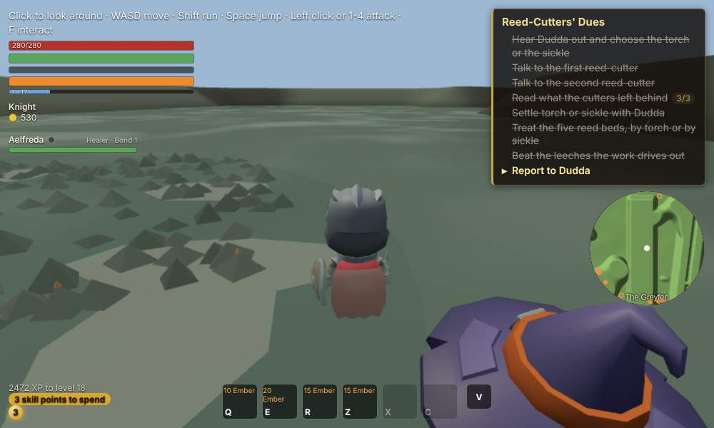 |

**Steps**
1. Hear Dudda out and choose the torch or the sickle.
2. Talk to the two reed-cutters; read what they left behind (3).
3. Settle torch or sickle with Dudda.
4. Treat the five reed beds the chosen way; beat the leeches the work drives out.
5. Report to Dudda.

**Rewards:** 450 XP, Reed Armour.

**Choices:** torch (faster, the beds stay black) or sickle (slower, the fen stays lush).

- [ ] The beds' look after the job matches the choice.

---

## M25 The Peat-Witch's Bargain

**Main** · Mireweather Hut and herb beds · Giver: Gytha Mireweather · Opens after M24 · Jump: `?act3=m25&new` · Design time 50 min

| Journal (J) at the start | Picking herbs |
| --- | --- |
| 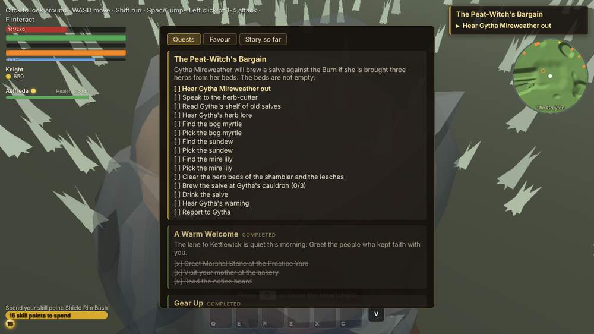 | 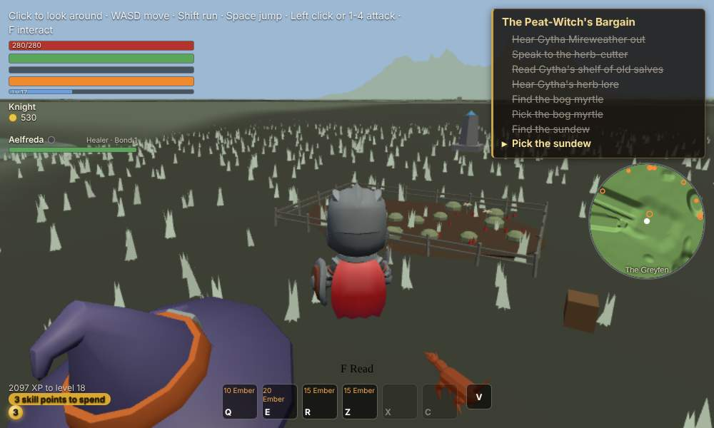 |

**Steps**
1. Hear Gytha out; speak to the herb-cutter; read her shelf of old salves; hear her herb lore.
2. Find and pick the bog myrtle, the sundew and the mire lily.
3. Clear the herb beds of the shambler and the leeches.
4. Brew the salve at Gytha's cauldron (3 steps); drink it.
5. Hear Gytha's warning; report.

**Rewards:** 600 XP, Gytha's Salve Recipe.

- [ ] A bog shambler that is staggered can be dragged and "laid to rest" (prompt shows).

---

## R13 Hathren's Lullaby

**Region** · the Sunken Chapel · Giver: Gytha Mireweather · Opens after M25 · Jump: `?act3=r13&new` · Design time 45 min

| Journal (J) at the start | The water-song bar |
| --- | --- |
| 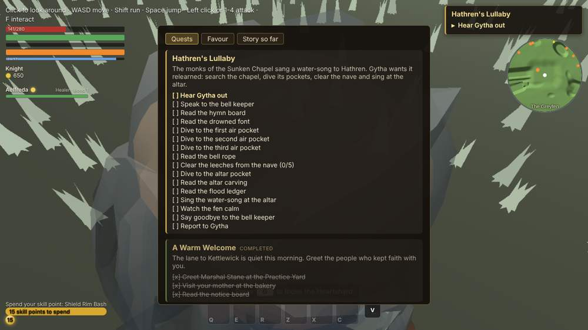 | 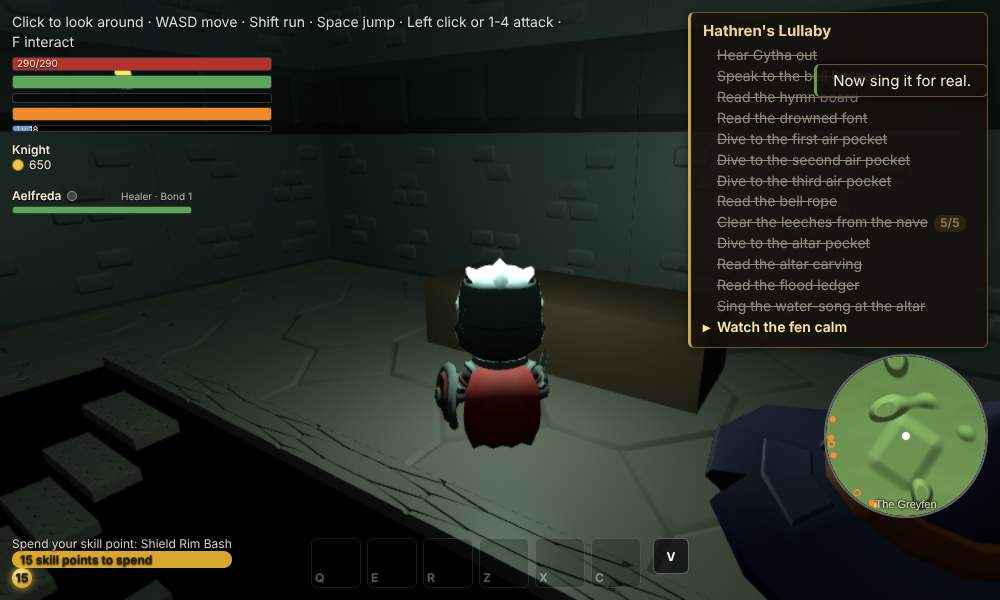 |

**Steps**
1. Hear Gytha out; speak to the bell keeper.
2. Read the hymn board and the drowned font.
3. Dive to the first, second and third air pockets; read the bell rope.
4. Clear five leeches from the nave.
5. Dive to the altar pocket; read the altar carving and the flood ledger.
6. Sing the water-song at the altar (a rhythm bar; after three failed bars the window widens).
7. Watch the fen calm; say goodbye to the bell keeper; report to Gytha.

**Rewards:** 500 XP, Lullaby Reed-Pipe.

---

## M26 Quench-Tongue Wakes

**Main** · Hathren's Mere · Giver: Gytha Mireweather · Opens after M25 · Jump: `?act3=m26&new` · Design time 55 min

| Journal (J) at the start | The wake | The nets |
| --- | --- | --- |
| 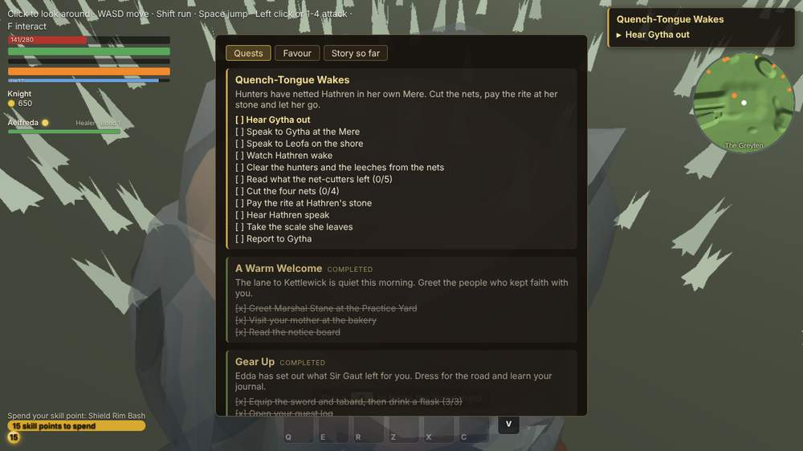 | 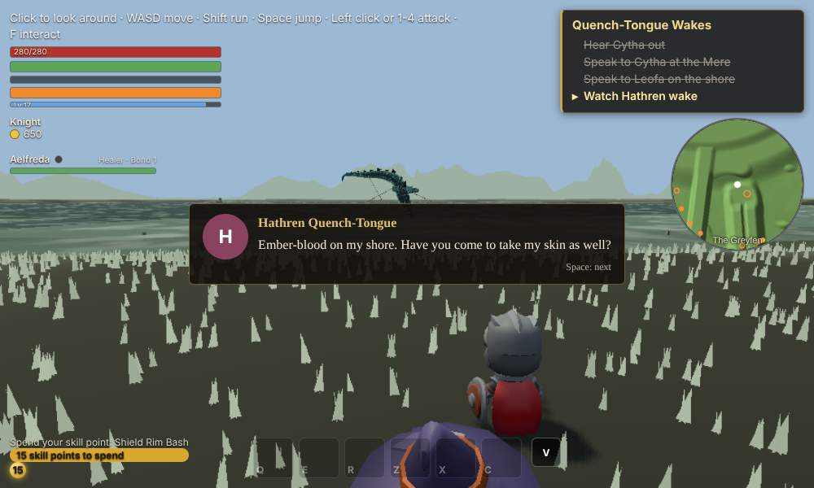 | 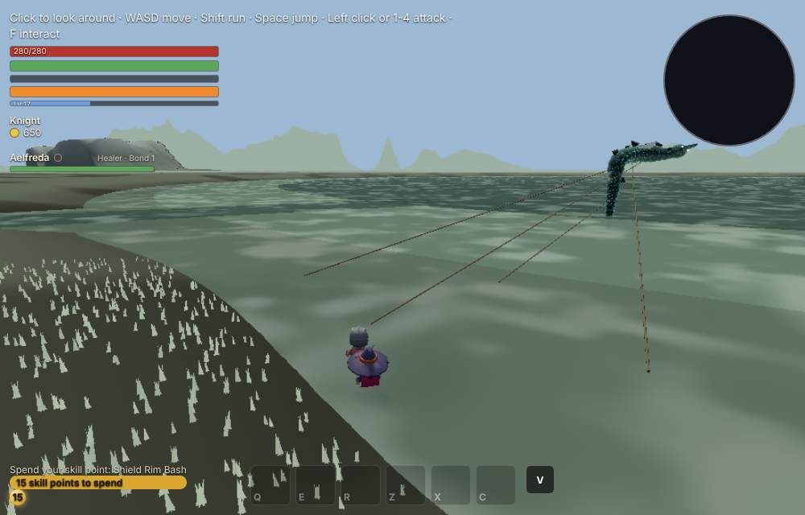 |

**Steps**
1. Hear Gytha out; speak to her at the Mere; speak to Leofa on the shore.
2. Watch Hathren wake (a framed scene within 30 m of the shore, five lines).
3. Clear the hunters and leeches from the nets.
4. Read what the net-cutters left (5).
5. Cut the four nets while she thrashes.
6. Pay the rite at Hathren's stone.
7. Hear Hathren speak (the calm sequence, skippable, at most 40 s).
8. Take the scale she leaves; report to Gytha.

**Rewards:** 650 XP, Hathren's Scale (removes up to 3 Scars).

**Verify**
- [ ] It is not a fight: Hathren cannot be killed.
- [ ] The wake scene does not start while diving or with a hostile within 15 m.

---

## M27 Hunters in the Reeds

**Main** · the reed blinds by the Mere · Giver: Leofa Hartley · Opens after M26 and R14 · Jump: `?act3=m27&new` · Design time 45 min

| Journal (J) at the start | Reed blinds | The brood flies home |
| --- | --- | --- |
|  | 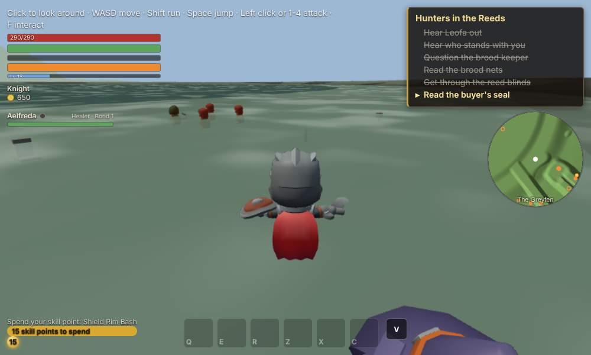 | 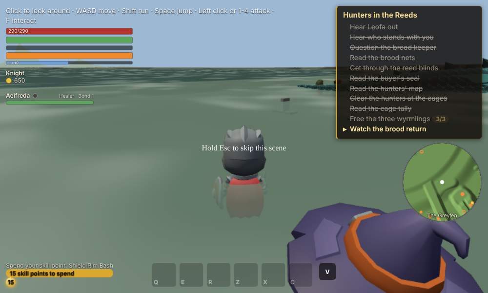 |

**Steps**
1. Hear Leofa out; hear who stands with you (the R14 ranger if you let Wybert go).
2. Question the brood keeper; read the brood nets.
3. Get through the reed blinds (stealth).
4. Read the buyer's seal and the hunters' map.
5. Clear the hunters at the cages; read the cage tally.
6. Free the three wyrmlings; watch the brood return.
7. Hear the aftermath; report to Leofa.

**Rewards:** 600 XP, Marsh Bow Bolts x20.

---

## D05 Into the Mirewater

**Dungeon** · the Mirewater Deeps · Giver: Gytha Mireweather · Opens after M27 · Jump: `?act3=d05&new` · Design time 60 min · **Boss: Murkjaw the Peat Eel-King**

| Journal (J) at the start | Murkjaw beached |
| --- | --- |
| 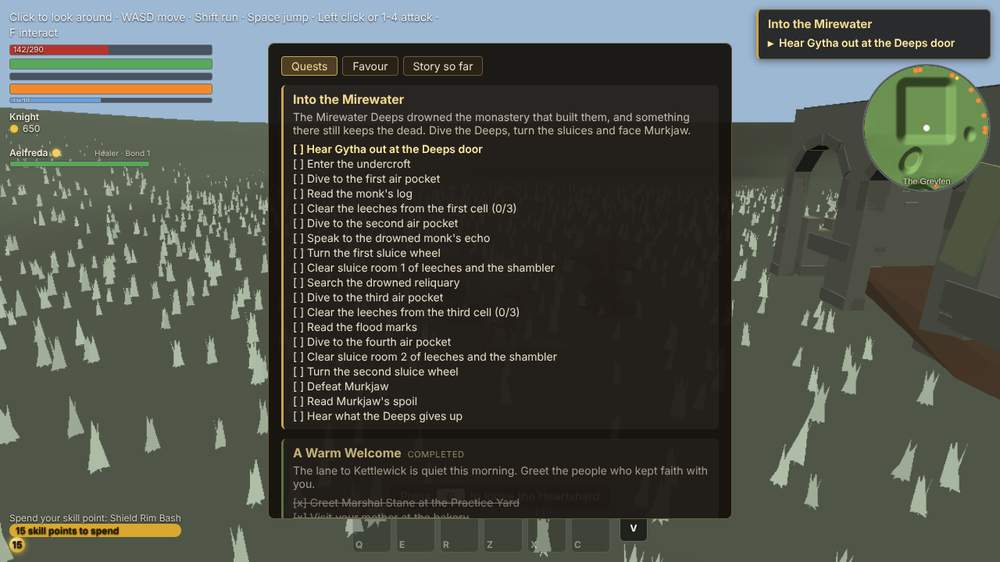 | 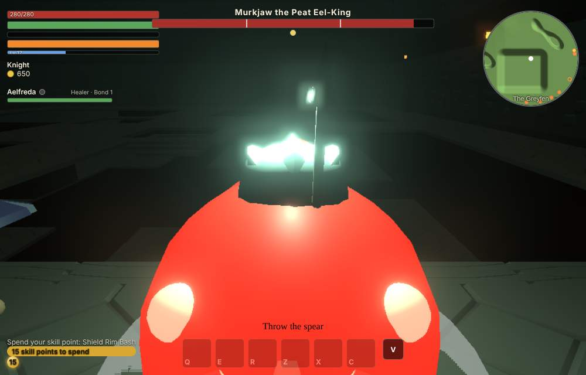 |

**Steps**
1. Hear Gytha out at the Deeps door; enter the undercroft.
2. Dive to the first air pocket; read the monk's log; clear the first cell (3 leeches).
3. Dive to the second pocket; speak to the drowned monk's echo.
4. Turn the first sluice wheel; clear sluice room 1 (leeches and a shambler).
5. Search the drowned reliquary; dive to the third pocket; clear the third cell; read the flood marks.
6. Dive to the fourth pocket; clear sluice room 2; turn the second sluice wheel.
7. Defeat Murkjaw: take a spear from one of the four racks (F), throw it (F) at his jaw when he is up within 22 m; three spears make a break, and each break beaches him on the walkway, stunned 3 s, for melee.
8. Read Murkjaw's spoil; hear what the Deeps give up.

**Rewards:** 900 XP, Murkjaw's Tooth.

**Verify**
- [ ] Racks hold 3 spears and refill one every 8 s; a carried spear returns if you leave the hall or die.
- [ ] Leaving the hall for 2 s resets the fight.
- [ ] After D05 the "The peaks are next" card shows once.

---

# The lower Dragonspine block

## M28 Climb to Wyrmwatch

**Main** · Wyrmwatch Lodge to the Hawk Crag · Giver: Thorgar Skyhold · Opens with Act 3 · Jump: `?act3=m28&new` · Design time 50 min

| Journal (J) at the start | On the trail |
| --- | --- |
| 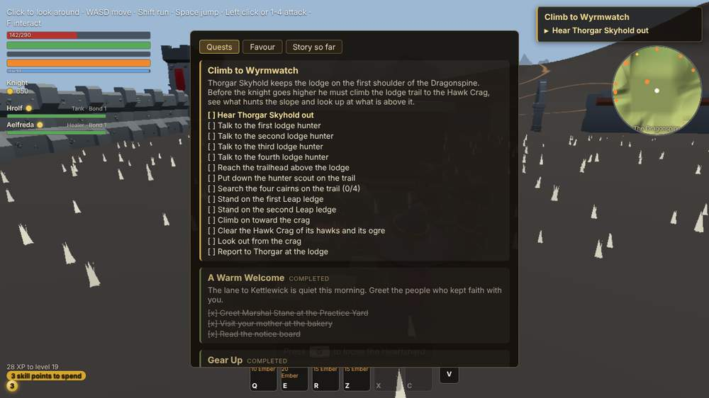 | 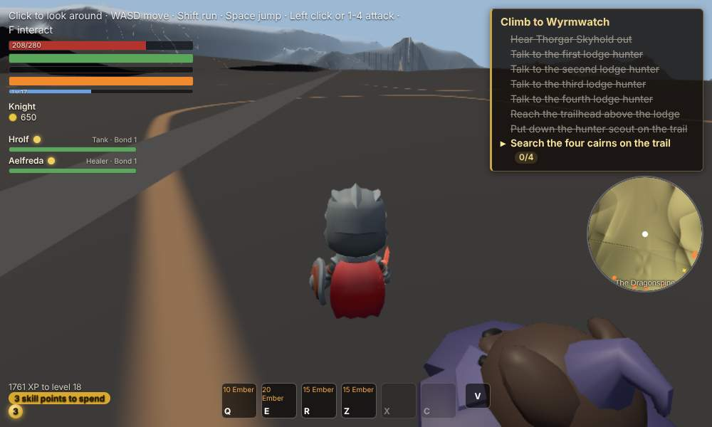 |

**Steps**
1. Hear Thorgar out; talk to the four lodge hunters.
2. Reach the trailhead above the lodge; put down the hunter scout.
3. Search the four cairns; stand on the first and second Leap ledges.
4. Climb on toward the crag.
5. Clear the Hawk Crag of its hawks and its ogre (at most two fight at once; the crag group deals three-quarter damage).
6. Look out from the crag (6 s camera hold); report to Thorgar.

**Rewards:** 650 XP, Rime Cloak.

**Verify**
- [ ] Rime hawks can be knocked down by a bolt or spell during the hover; Hawk Jerky calms a grounded hawk.
- [ ] The Crag Ogre glares before swinging; two Barley Cakes or a Hearth Bread can Calm it.

**Taste calls:** the M28 crag balance (three-quarter damage, two attackers at a time).

---

## R15 Skyhold Supplies

**Region** · the lodge road to the cache · Giver: Thorgar Skyhold · Opens after M28 · Jump: `?act3=r15&new` · Design time 40 min

| Journal (J) at the start | The surplus choice |
| --- | --- |
|  | 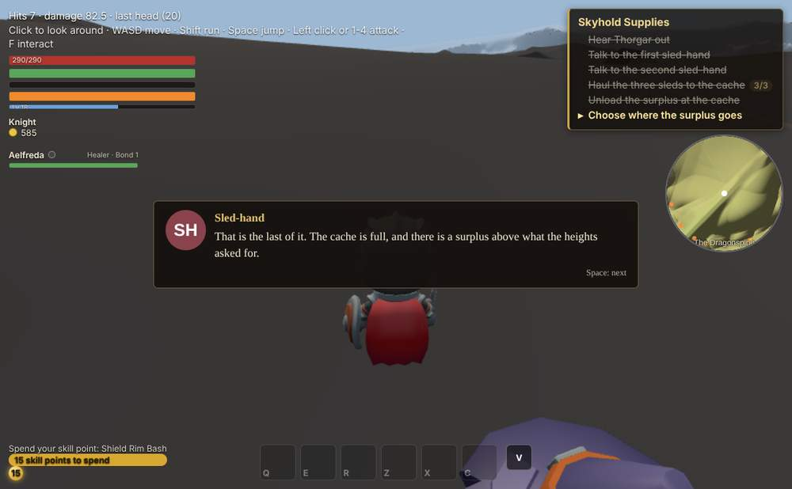 |

**Steps**
1. Hear Thorgar out; talk to the two sled-hands.
2. Haul the three sleds to the cache (a hawk hit drops the sled; Thorgar resets a lost haul).
3. Unload the surplus at the cache; choose where it goes.
4. Report to Thorgar.

**Rewards:** 450 XP, Ashmare Saddlebags.

**Choices:** the lodge (cold-gear discount) or Eadgyth's hut (a hunting-knife upgrade).

---

## R18 Rime Hawk Eggs

**Region** · the Hawk Cliffs · Giver: Thorgar Skyhold (from R15's wait menu or after R15) · Opens after M28 · Jump: `?act3=r18&new` · Design time 40 min

| Journal (J) at the start | A parent killed: eggs go back |
| --- | --- |
| 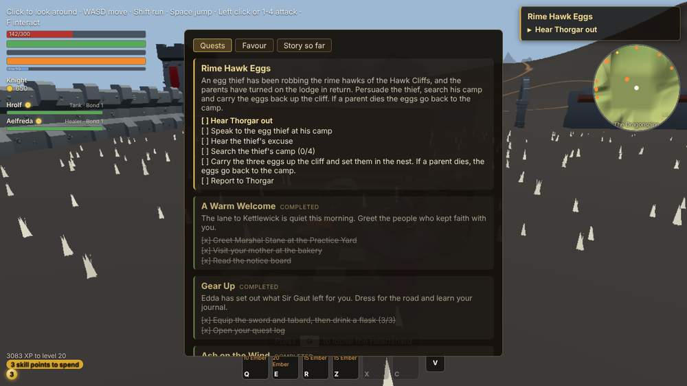 | 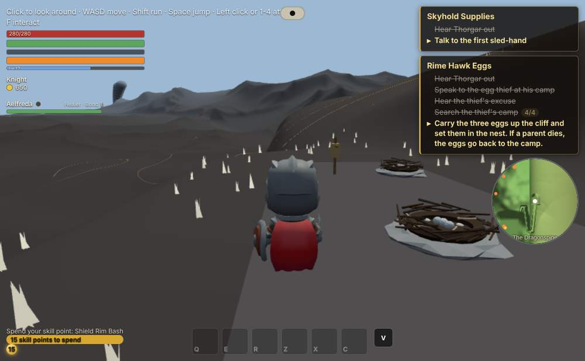 |

**Steps**
1. Hear Thorgar out.
2. Speak to the egg thief at his camp; hear his excuse; search his camp (4).
3. Carry the three eggs up the cliff and set them in the nest. If a parent dies, every egg goes back to the camp.
4. Report to Thorgar.

**Rewards:** 500 XP, Hawk-Feather Charm.

**Verify**
- [ ] Parents stoop only within 10 m of the nest and break off past 14 m.
- [ ] A toast counts eggs back in the nest; companions wait at the cliff foot.

---

## M29 The Hermit of Rime Pass

**Main** · Rime Pass shelter · Giver: Eadgyth Frostbrow · Opens after M28 · Jump: `?act3=m29&new` · Design time 40 min

| Journal (J) at the start | Mid quest |
| --- | --- |
| 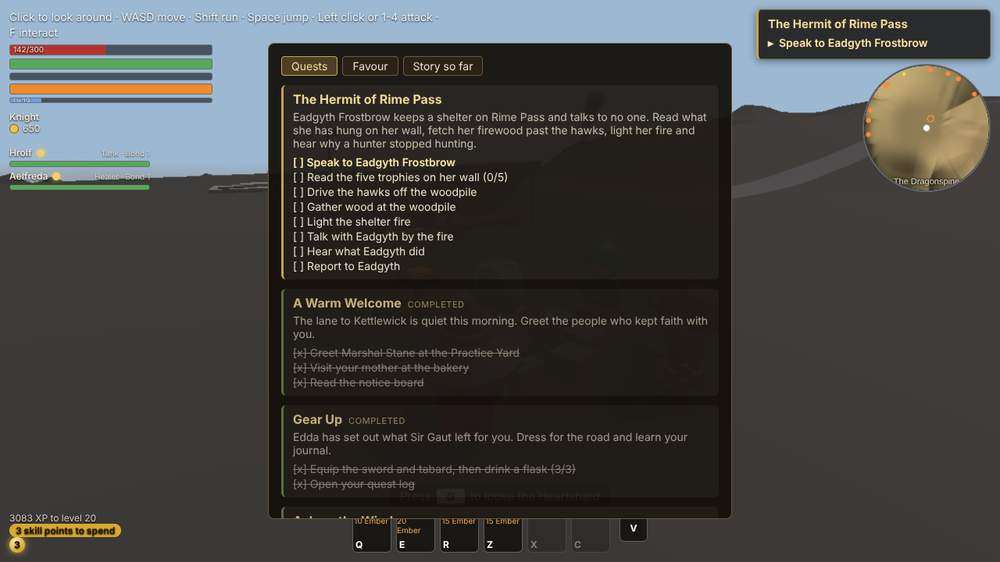 | 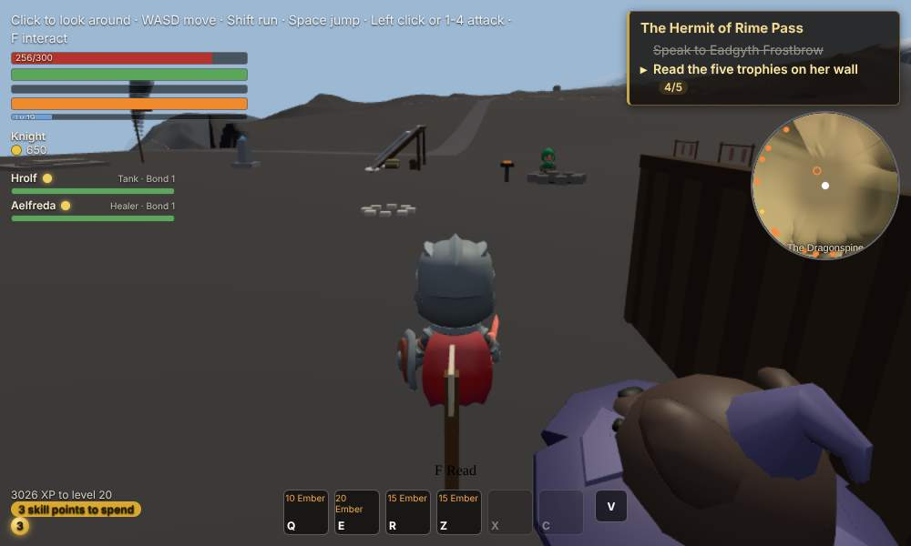 |

**Steps**
1. Speak to Eadgyth Frostbrow.
2. Read the five trophies on her wall.
3. Drive the hawks off the woodpile; gather wood.
4. Light the shelter fire; talk with her by the fire.
5. Hear what Eadgyth did (her confession); report.

**Rewards:** 600 XP, Frostbrow's Hunting Knife.

---

## R16 Frostbrow's Lost Axe

**Region** · the collapsed cave · Giver: Eadgyth Frostbrow · Opens after M29 · Jump: `?act3=r16&new` · Design time 40 min

| Journal (J) at the start | Settling the axe |
| --- | --- |
| 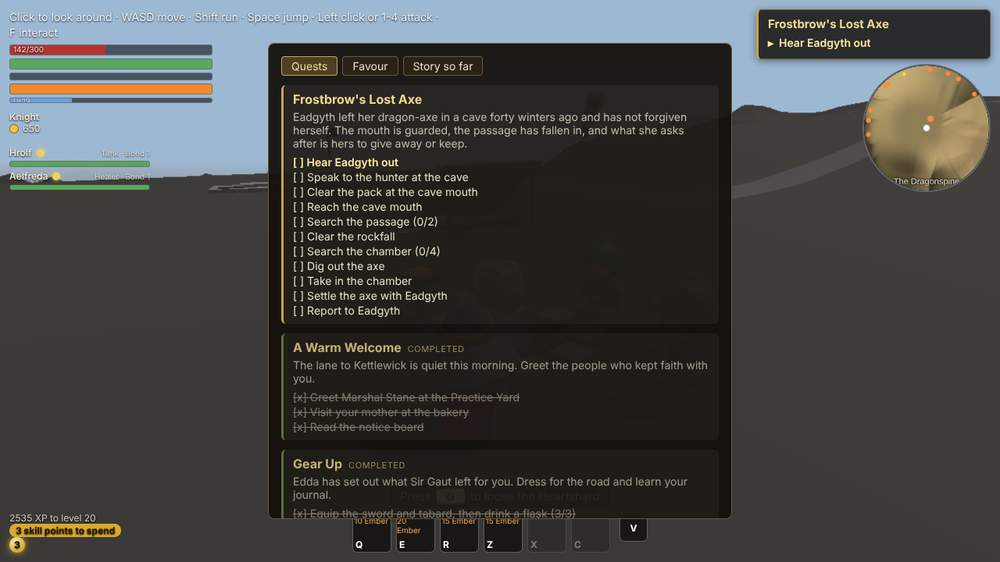 | 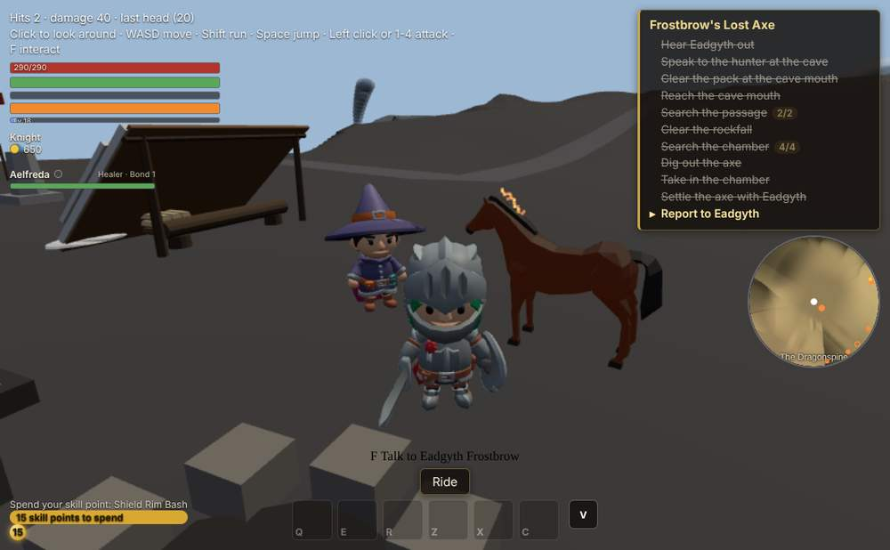 |

**Steps**
1. Hear Eadgyth out; speak to the hunter at the cave.
2. Clear the pack at the cave mouth; reach the mouth.
3. Search the passage (2); clear the rockfall; search the chamber (4).
4. Dig out the axe; take in the chamber.
5. Settle the axe with Eadgyth; report.

**Rewards:** 500 XP, Rimewood Haft.

**Choices:** give the axe to Ysmeryth in M32 (the dragons' trust; the axe then lies by her hoard) or keep it (bonus damage against dragons). Flag `story.r16.choice`.

---

## M30 The Keepers' Rubbings

**Main** · the Last Anvil · Giver: Brother Ansgar · Opens after M29 · Jump: `?act3=m30&new` · Design time 50 min

| Journal (J) at the start | Taking rubbings |
| --- | --- |
| 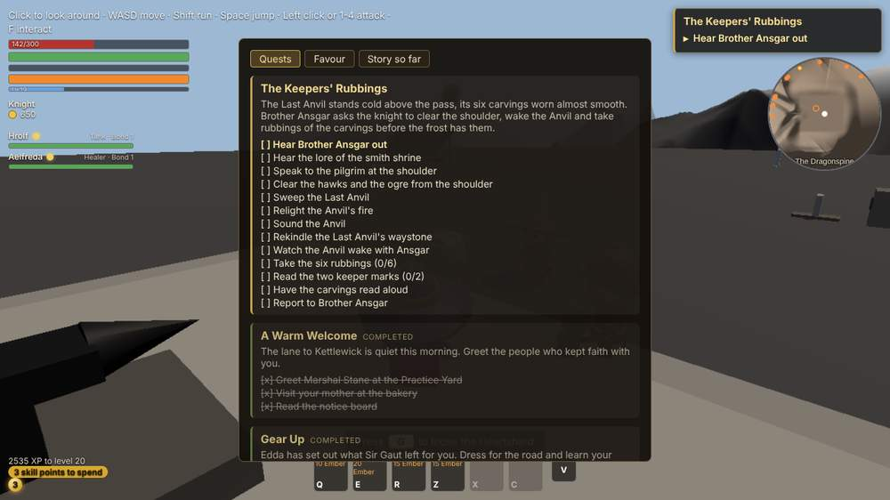 | 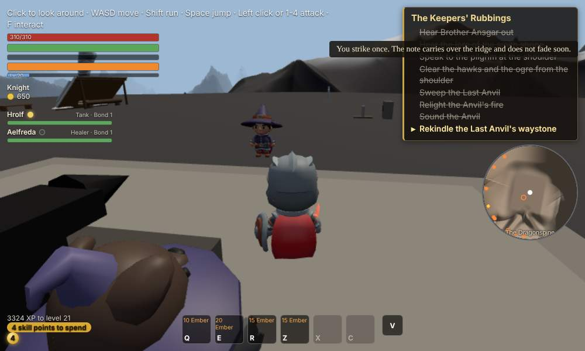 |

**Steps**
1. Hear Brother Ansgar out and the lore of the smith shrine; speak to the pilgrim at the shoulder.
2. Clear the hawks and the ogre from the shoulder.
3. Sweep the Last Anvil, relight its fire, sound it, rekindle its waystone.
4. Watch the Anvil wake with Ansgar (three talk lines replace the planned updraft set piece).
5. Take the six rubbings; read the two keeper marks; have the carvings read aloud.
6. Report.

**Rewards:** 650 XP (the rubbings can be read only after M32).

---

## R17 Candles for the Last Anvil

**Region** · six wayside shrines · Giver: Brother Ansgar · Opens after M30 · Jump: `?act3=r17&new` · Design time 35 min

| Journal (J) at the start | Mid quest |
| --- | --- |
| 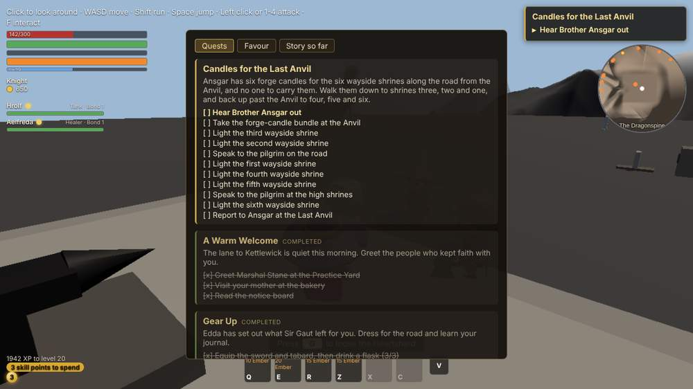 | 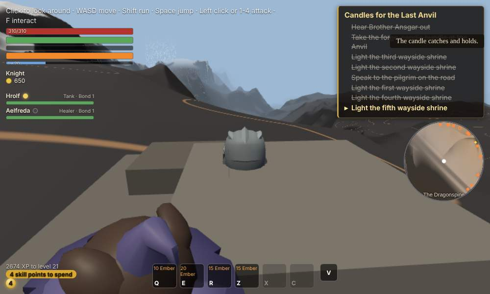 |

**Steps**
1. Hear Ansgar out; take the forge-candle bundle at the Anvil.
2. Light shrines three, two (speak to the pilgrim on the road), one.
3. Walk back up past the Anvil to light four, five (speak to the pilgrim at the high shrines) and six.
4. Report at the Last Anvil.

**Rewards:** 450 XP, Ansgar's Blessing.

- [ ] A dropped or reset bundle returns to the last stop passed; a load puts it back in your hands.

---

# The summit

## M31 The Coal-Mother's Trial

**Main** · the summit gate and the roost · Giver: Eadgyth Frostbrow · Opens after both blocks' main quests, D05 and R16 · Jump: `?act3=m31&new` · Design time 60 min

| Journal (J) at the start | The trial begins |
| --- | --- |
| 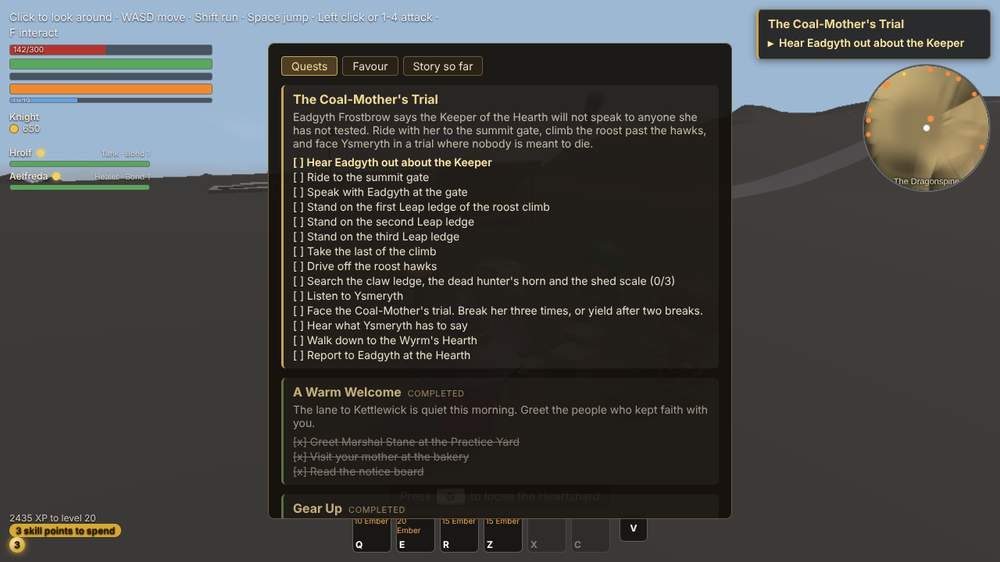 | 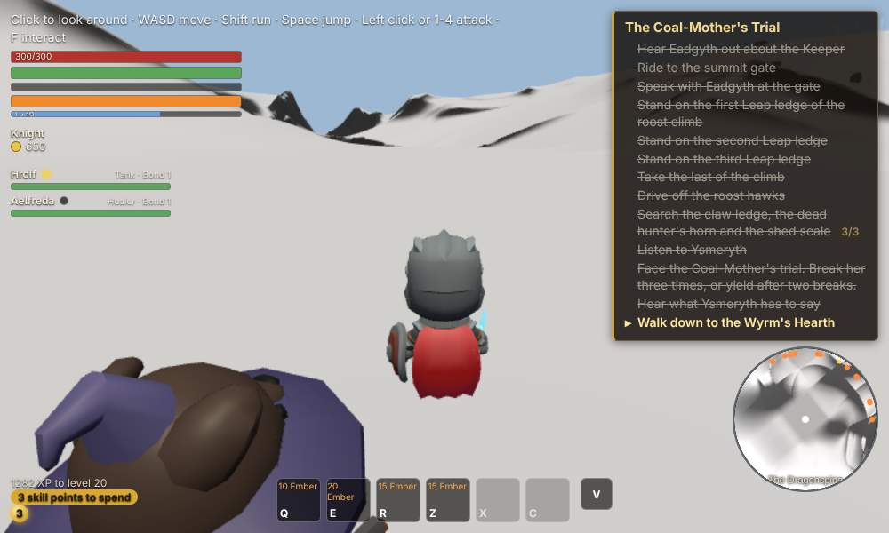 |

**Steps**
1. Hear Eadgyth out about the Keeper; ride to the summit gate; speak with her there.
2. Stand on the three Leap ledges of the roost climb; take the last of the climb.
3. Drive off the roost hawks.
4. Search the claw ledge, the dead hunter's horn and the shed scale.
5. Listen to Ysmeryth.
6. Face the Coal-Mother's trial: break her three times, or yield after two breaks. Nobody dies.
7. Hear what she has to say; walk down to the Wyrm's Hearth; report to Eadgyth.

**Rewards:** 750 XP, Scale of the Banked Coal (keepsake).

---

## M32 Ysmeryth Speaks

**Main** · the Wyrm's Hearth · Giver: Ysmeryth the Coal-Mother · Opens after M31 · Jump: `?act3=m32&new` · Design time 45 min

| Journal (J) at the start | End |
| --- | --- |
| 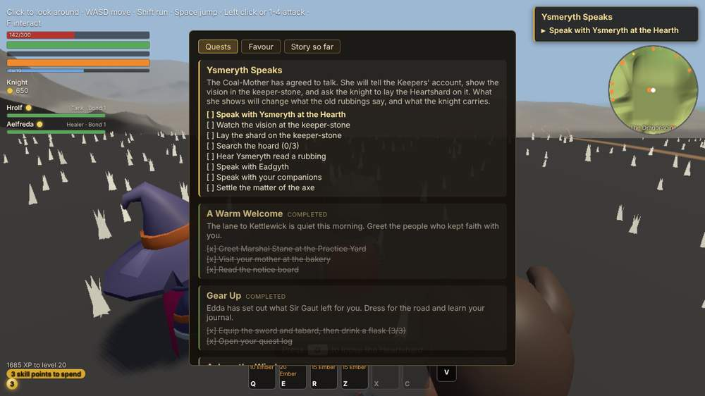 | 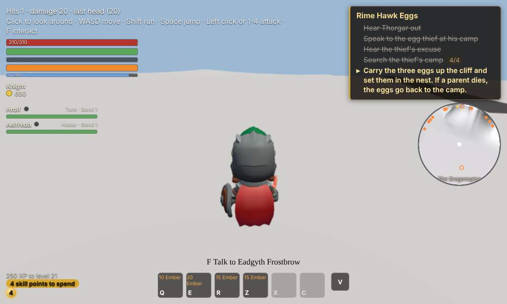 |

**Steps**
1. Speak with Ysmeryth at the Hearth; watch the vision at the keeper-stone.
2. Lay the shard on the keeper-stone.
3. Search the hoard (3); hear Ysmeryth read a rubbing.
4. Speak with Eadgyth and with your companions.
5. Settle the matter of the axe (R16's choice).

**Rewards:** 700 XP; Keeper's Understanding perk (Burn cools twice as fast while you walk or sprint; a toast says so once).

---

## M33 The Hunters' Net

**Main** · Skyhold spur · Giver: Thorgar Skyhold · Opens after M32 · Jump: `?act3=m33&new` · Design time 50 min

| Journal (J) at the start | Mid quest |
| --- | --- |
| 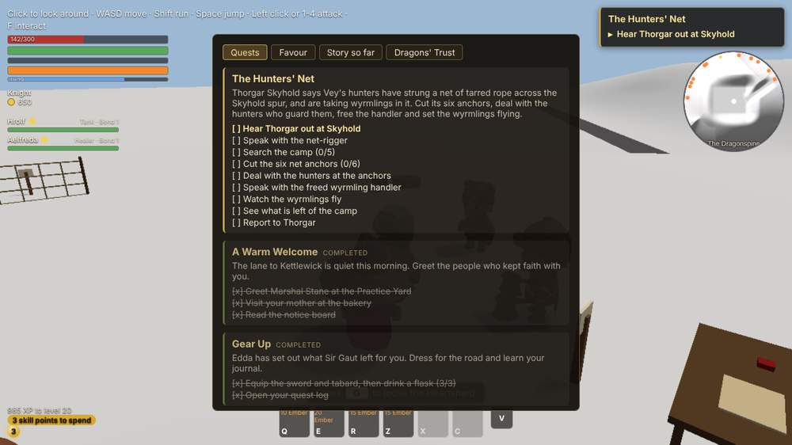 | 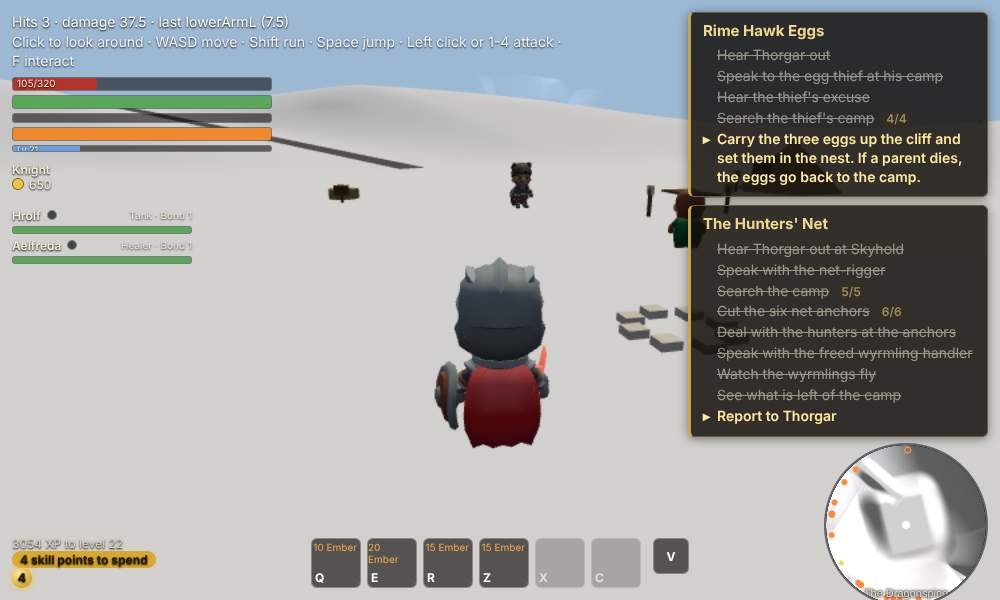 |

**Steps**
1. Hear Thorgar out at Skyhold; speak with the net-rigger; search the camp (5).
2. Cut the six net anchors; deal with the hunters at the anchors.
3. Speak with the freed wyrmling handler; watch the wyrmlings fly.
4. See what is left of the camp; report.

**Rewards:** 700 XP, Cliff Crampons.

**Verify**
- [ ] Each spared hunter counts once as a witness (up to eight); Thorgar's report names the number.

---

## M34 Fire Sworn

**Main** · the Wyrm's Hearth · Giver: Ysmeryth · Opens after M31 to M33 and every Act 3 region quest · Jump: `?act3=m34&new` · Design time 45 min

| Journal (J) at the start | Mid quest |
| --- | --- |
| 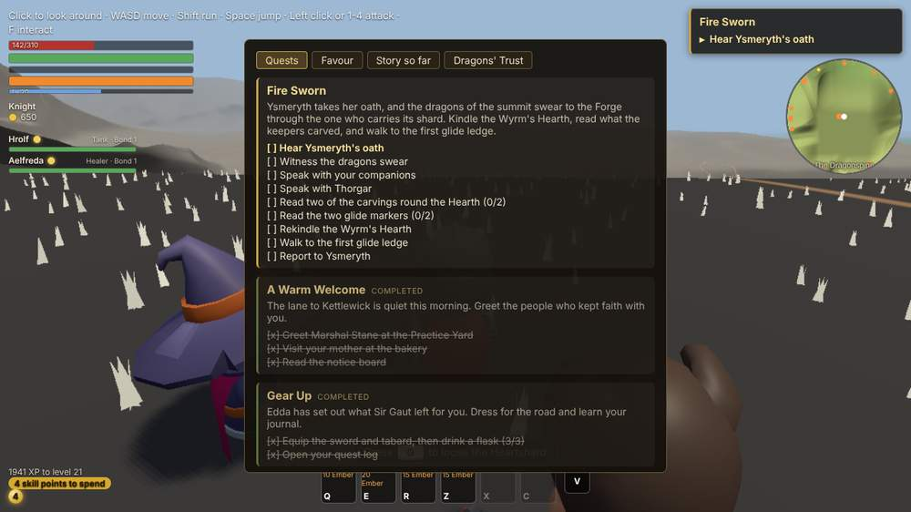 | 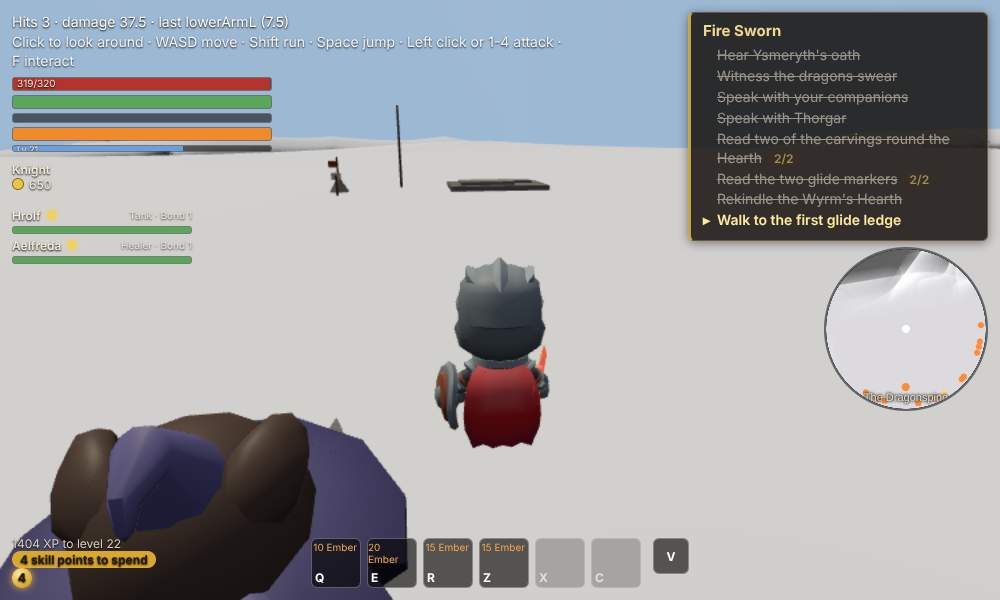 |

**Steps**
1. Hear Ysmeryth's oath; witness the dragons swear.
2. Speak with your companions and with Thorgar.
3. Read two carvings round the Hearth and the two glide markers.
4. Rekindle the Wyrm's Hearth.
5. Walk to the first glide ledge; report to Ysmeryth.

**Rewards:** 750 XP, 2 skill points; Dragonspine Glide unlocked.

- [ ] After M34: two Ember Wyrms rest on the lodge towers, and the lodge fire is lit.

---

## D06 Wings of Frostfang

**Dungeon** · Frostfang Aerie · Giver: Thorgar Skyhold · Opens after M34 · Jump: `?act3=d06&new` · Design time 65 min · **Boss: Hunt-Marshal Corvin Skarl and his chained drake**

| Journal (J) at the start | Gliding the chasm | Skarl's Spare window |
| --- | --- | --- |
| 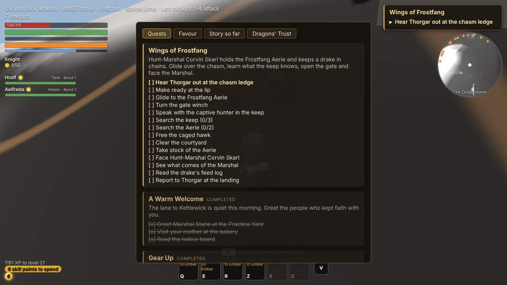 | 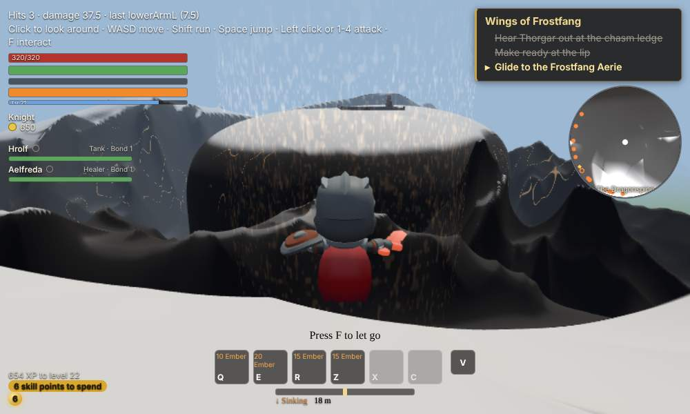 | 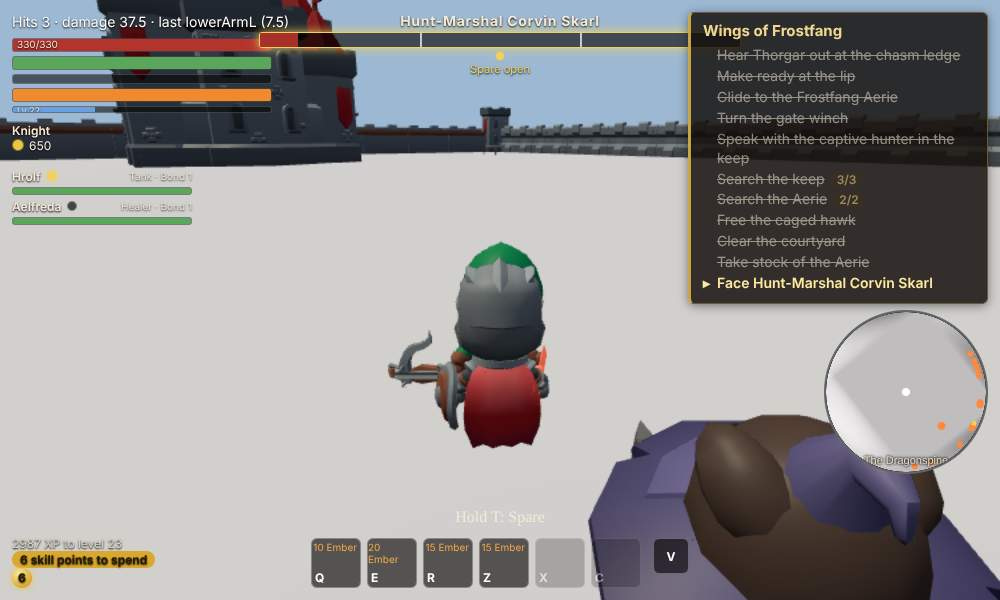 |

**Steps**
1. Hear Thorgar out at the chasm ledge; make ready at the lip.
2. Glide to the Frostfang Aerie.
3. Turn the gate winch; speak with the captive hunter in the keep.
4. Search the keep (3) and the Aerie (2); free the caged hawk; clear the courtyard.
5. Take stock of the Aerie.
6. Face Skarl: pull the release lever at the drake's chain post (F, every 20 s) or strike the chain while the drake is down to force a break; poise breaks also count. The drake is freed at the last break.
7. See what comes of the Marshal (Spare in the 6 s window, or kill).
8. Read the drake's feed log; report to Thorgar at the landing.

**Rewards:** 1000 XP, Skarl's Crossbow.

**Choices:** Spare (dragons -2, Oswin +3) or kill (dragons +2).

**Verify**
- [ ] The drake takes off and dives (a regression from the Act 3 playthrough, fixed in #188).
- [ ] After D06 the drake's ring nest sits on the Aerie's north-east tower.

---

## Act 3 ending: "The Coal-Mother's Oath"

| Card | Camp at the lodge |
| --- | --- |
| 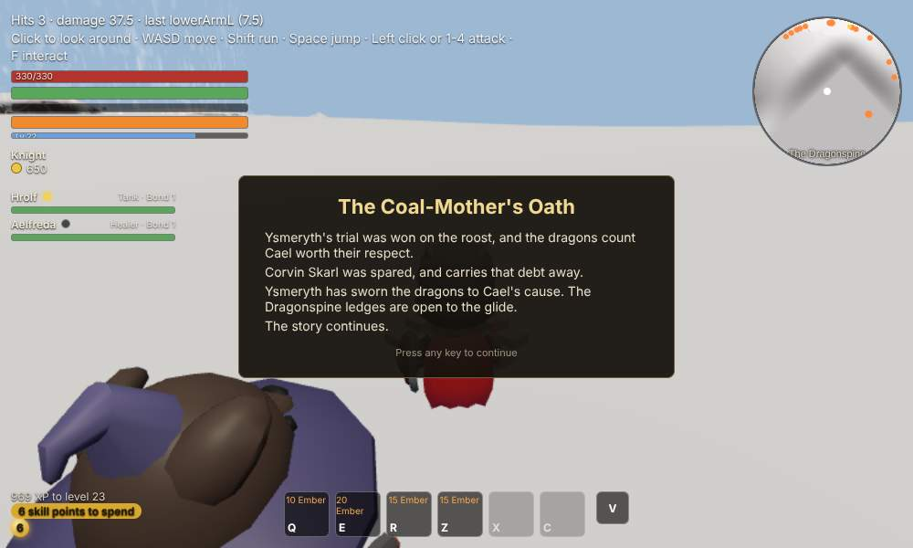 | 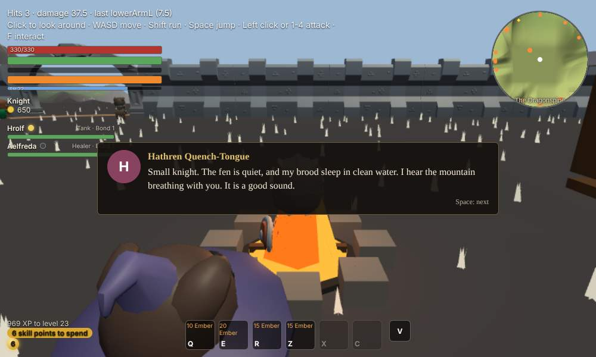 |

- [ ] The card names Ysmeryth's trial, Skarl spared or fallen, the oath and the open glide ledges.
- [ ] The screen fades to the Wyrmwatch Lodge hearth and the nine-line camp scene plays once.
- [ ] `story.gate.a4` is set; Lord Wystan's summons (M35) is offered in Harrowmark.
