# Act 4: The Council of Ash

Harrowmark under the Regent (Phase G) and the Ashen Waste (Phase H). Levels 28 to 35. Back to the [index](README.md).

**Act 4 count:** 12 main quests (M35 to M46), 7 region quests (R19 to R25), 2 dungeons (D07, D08). The act ends when M46 and D08 are both complete.

**Taste calls** in this act are cited by their number in `design/veto-digest-2026-11.md` (for example "digest 34"), so a struck number can be traced straight to the quest it changes.

**Phases.** Phase G is Harrowmark: M35 to M41, R19 to R23, D07. M37 waits for every Phase G quest before it. From M38 the city falls; it stays occupied for the rest of the game, and Act 1's city side jobs (R03, R04, D02, J05, J07, J08, J10) close with Edric's warning (digest 39). Phase H is the Waste: M42 to M46, R24, R25, D08; the Waste opens when M42 is accepted (digest 41). M46 waits for every Phase H quest.

| Id | Name | Giver | Opens after | Jump |
| --- | --- | --- | --- | --- |
| M35 | Summons to the Council | Lord Wystan Halvard | Act 3 ending | `?act4=m35&new` |
| M36 | Votes and Daggers | Lady Merrin Oswin | M35 | `?act4=m36&new` |
| R19 | Halvard Banners | Lord Wystan Halvard | M35 | `?act4=r19&new` |
| R22 | The King's Blade | Master Smith Dunstan Ironside | M35 | `?act4=r22&new` |
| R23 | The Watch Remembers | Captain Ealdred Rook | M35 | `?act4=r23&new` |
| R20 | Oswin's Silver | Lady Merrin Oswin | M36 | `?act4=r20&new` |
| R21 | Grisel's Daughter | Lady Wenna Grisel | M36 | `?act4=r21&new` |
| D07 | The Regent's Crucible | Captain Rook | M35, R23 | `?act4=d07&new` |
| M37 | The Night Before | Tobb Fenwick | every quest above | `?act4=m37&new` |
| M38 | The Council of Houses | King Edric IV | M37 | `?act4=m38&new` |
| M39 | Gaut's Last Stand | (follows M38) | M38 | `?act4=m39&new` |
| M40 | Flight Through the Underways | Captain Rook | M39 | `?act4=m40&new` |
| M41 | The Boy King Remembers | (follows M40) | M40 | `?act4=m41&new` |
| M42 | Gate of Ash | Wulfhild of the Ashwalkers | M41 | `?act4=m42&new` |
| M43 | What the Walkers Know | Wulfhild | M42 | `?act4=m43&new` |
| M44 | Ebba's Song | Little Ebba | M43 | `?act4=m44&new` |
| R24 | Ashwalker Water-Debt | Wulfhild | M43 | `?act4=r24&new` |
| D08 | The Cathedral of Husks | Wulfhild | M43 | `?act4=d08&new` |
| R25 | The Child's Candle | Little Ebba | M44 | `?act4=r25&new` |
| M45 | Chimes in the Glass | Wulfhild | M44 | `?act4=m45&new` |
| M46 | Road to the Rim | Hrolf Ironbrow | M42 to M45, D08, R24, R25 | `?act4=m46&new` |

**Systems introduced in Act 4** (check once):
- [ ] Act 4 spawns are capped at your level plus 3; kill XP x2.4 in Act 4 regions.
- [ ] Escorts (delegations, convoy, miners, Edric, R24's cart) halt when Cael is over 25 m away and wait at junctions and shelters; escort members kneel and rise, never die (digest 25, 26).
- [ ] Ash storms in the Waste: a storm meter, a 3 m/s storm walk with no sprint, exposure; shelters stop exposure; the Ash Shroud Mask (M42) opens sight to about 400 m but does not clear the storm (digest 1 to 3, 46, 56).
- [ ] Rope-lines and shelters show on the map in tan (digest 46).
- [ ] The Ashgate refuge from M41: six shops, four trainer desks (Stane, Pennard, Gerta, Ashdown, Rook) (digest 8, 19).
- [ ] Journal pointers and "still needed" lists before M37 and M46 (digest 45).

| Storm without mask | Storm with mask | Waste map |
| --- | --- | --- |
| 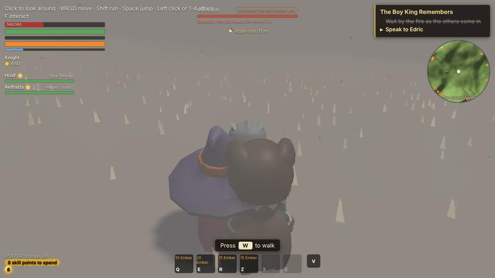 | 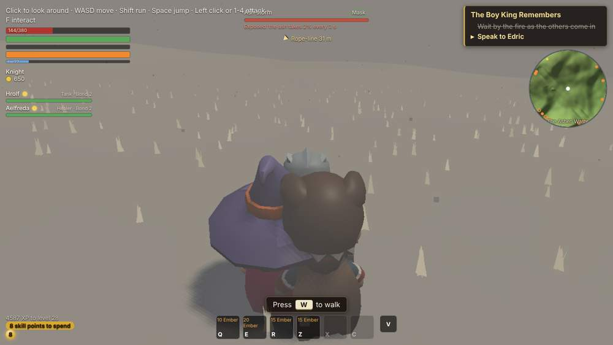 | 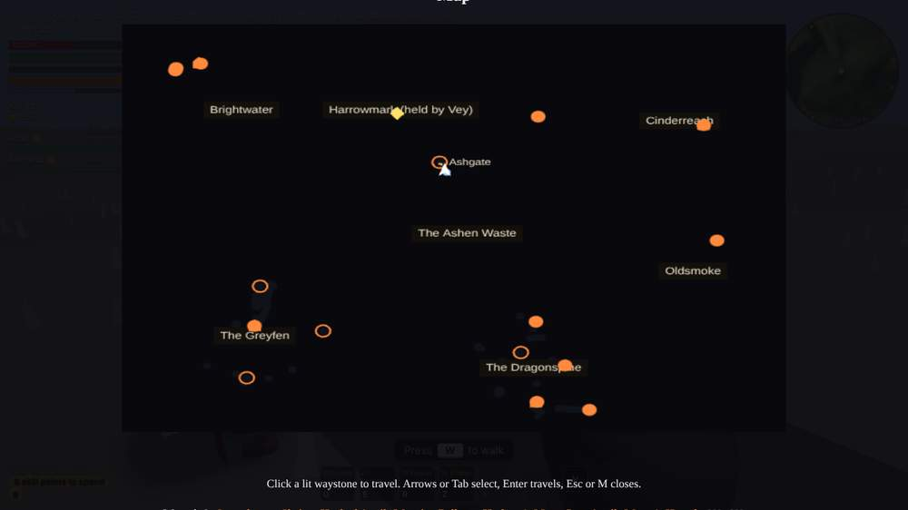 |

---

# Phase G: Harrowmark

## M35 Summons to the Council

**Main** · Keep, Counting-House, Bastion, River Gate · Giver: Lord Wystan Halvard · Opens with Act 4 · Jump: `?act4=m35&new` · Design time 40 min

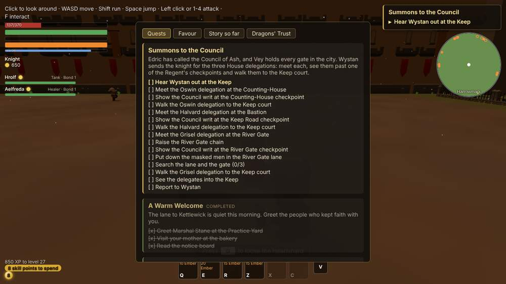

**Steps**
1. Hear Wystan out at the Keep.
2. Oswin delegation: meet Merrin at the Counting-House; show the Council writ at that checkpoint; walk them to the Keep court.
3. Halvard delegation: meet Ser Aldric Cole at the Bastion; show the writ at the Keep Road checkpoint; walk them in.
4. Grisel delegation: meet Steward Orrin at the River Gate; raise the River Gate chain; show the writ; put down the masked men in the River Gate lane; search the lane and gate (3); walk them in.
5. See the delegates into the Keep; report to Wystan.

**Rewards:** 700 XP, Council Seal.

**Taste calls:** digest 20 (no street fights before M38), 34 (checkpoint walks, River Gate ambush).

---

## M36 Votes and Daggers

**Main** · Counting-House, Bastion, Archive, Rooftop Ward · Giver: Lady Merrin Oswin · Opens after M35 · Jump: `?act4=m36&new` · Design time 55 min

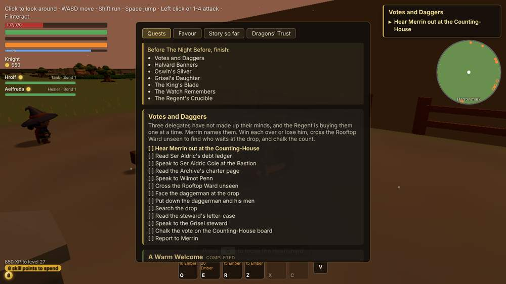

**Steps**
1. Hear Merrin out.
2. Read Ser Aldric's debt ledger; speak to Ser Aldric Cole (win him or lose him).
3. Read the Archive's charter page; speak to Wilmot Penn, Oswin clerk.
4. Cross the Rooftop Ward unseen; face the daggerman at the drop; put down him and his men; search the drop; read the steward's letter-case.
5. Speak to the Grisel steward.
6. Chalk the vote on the Counting-House board; report to Merrin.

**Rewards:** 800 XP, Oswin Silver Key.

**Choices:** each delegate is won or lost by dialogue (flag F3, read again at M38 and M52). Taste call: digest 34.

---

## R19 Halvard Banners

**Region** · Halvard Bastion · Giver: Lord Wystan Halvard · Opens after M35 · Jump: `?act4=r19&new` · Design time 40 min

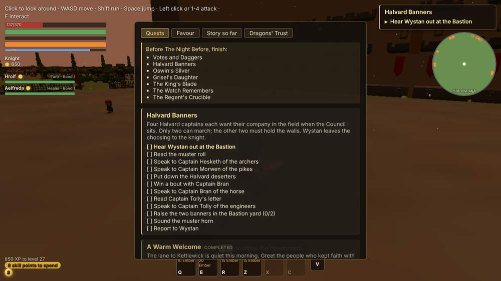

**Steps**
1. Hear Wystan out; read the muster roll.
2. Speak to Captain Hesketh (archers) and Captain Morwen (pikes).
3. Put down the Halvard deserters; win a bout with Captain Bran, then speak to him (horse).
4. Read Captain Tolly's letter; speak to him (engineers).
5. Raise two banners in the Bastion yard (the two companies that march); sound the muster horn.
6. Report.

**Rewards:** 550 XP, Banner Standard.

**Choices:** which two of the four companies march (they fly at M52). Taste calls: digest 11, 35.

---

## R22 The King's Blade

**Region** · Forge Row plus Cinderford, Greyfen, Rime Pass · Giver: Master Smith Dunstan Ironside · Opens after M35 · Jump: `?act4=r22&new` · Design time 45 min

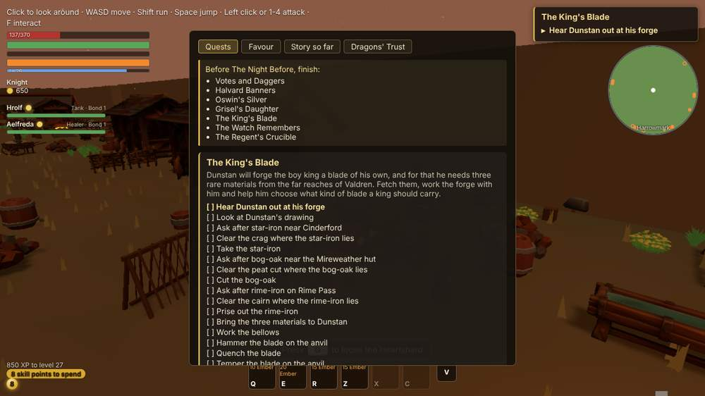

**Steps**
1. Hear Dunstan out; look at his drawing.
2. Star-iron: ask Thane the crag-cutter near Cinderford; clear the crag; take it.
3. Bog-oak: ask Wynne the peat-digger near the Mireweather hut; clear the peat cut; cut it.
4. Rime-iron: ask Sigrun of the cairns on Rime Pass; clear the cairn; prise it out.
5. Bring the three to Dunstan; work the bellows; hammer on the anvil (rhythm run); quench; temper (rhythm run); fit the bog-oak hilt.
6. Choose the blade with Dunstan.

**Rewards:** 650 XP.

**Choices:** light duelling blade or heavy greatsword (Edric wields it at M52). Taste call: digest 36.

---

## R23 The Watch Remembers

**Region** · Barracks, gatehouse, stables, chapel, Tilted Anvil yard · Giver: Captain Rook · Opens after M35 · Jump: `?act4=r23&new` · Design time 35 min

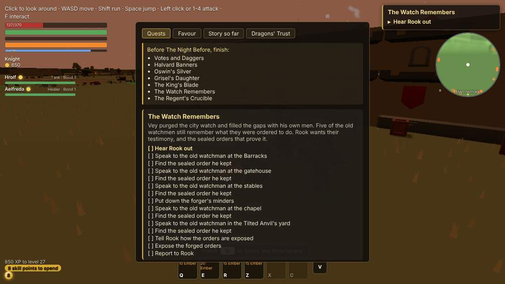

**Steps**
1. Hear Rook out.
2. Speak to the five old watchmen (Old Cuthred Hale, Osgood Fenn, Leofwine the Stabler, Wulfstan Reed, Aldred Tapper) and find each one's sealed order; put down the forger's minders on the way.
3. Tell Rook how the orders are exposed; expose them; report.

**Rewards:** 550 XP, Watch Seal.

**Choices (flag F7):** public (Halvard +5, Oswin -2) or private (Oswin +4). Taste call: digest 36.

---

## R20 Oswin's Silver

**Region** · River Gate and the farm ring · Giver: Lady Merrin Oswin · Opens after M36 · Jump: `?act4=r20&new` · Design time 45 min

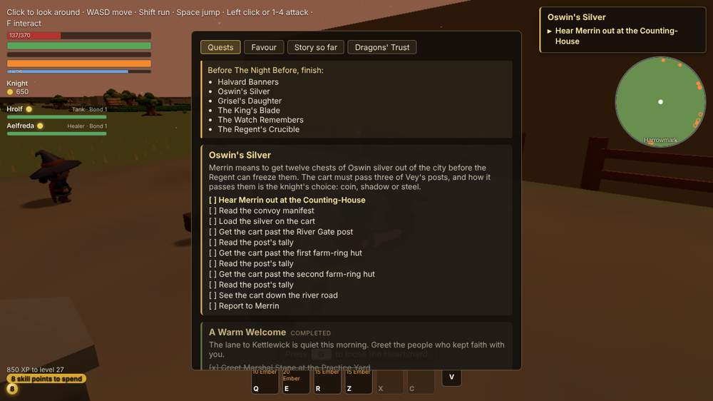

**Steps**
1. Hear Merrin out; read the convoy manifest; load the silver on the cart.
2. Get the cart past the River Gate post, the first farm-ring hut and the second; read each post's tally.
3. See the cart down the river road; report.

**Rewards:** 600 XP, Silver Convoy Writ.

**Choices:** bribe, stealth or force at the posts; force burns two farm huts for good (digest 22, 35).

---

## R21 Grisel's Daughter

**Region** · Guild Quarter cellars and back lanes · Giver: Lady Wenna Grisel · Opens after M36 · Jump: `?act4=r21&new` · Design time 40 min

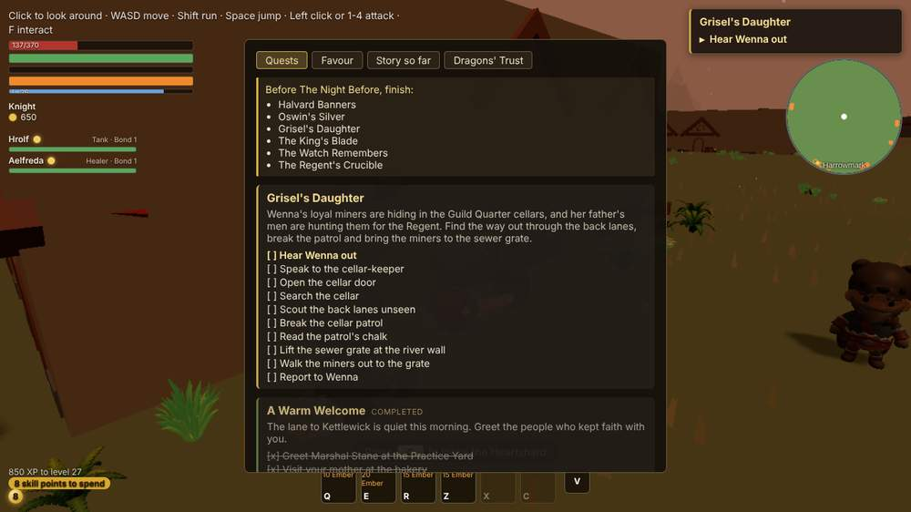

**Steps**
1. Hear Wenna out; speak to Old Hebba, the cellar-keeper; open the cellar door; search the cellar.
2. Scout the back lanes unseen; break the cellar patrol; read the patrol's chalk.
3. Lift the sewer grate at the river wall; walk the miners out; report.

**Rewards:** 550 XP, Wenna's Signet.

**Choices (flag F6):** leaders only (+2) or all the miners (+6, eight miners in the column) (digest 27, 35). Read again at R27.

---

## D07 The Regent's Crucible

**Dungeon** · under the old Smelter gate · Giver: Captain Rook · Opens after M35 and R23 · Jump: `?act4=d07&new` · Design time 60 min · **Boss: the Bellows-Engine**

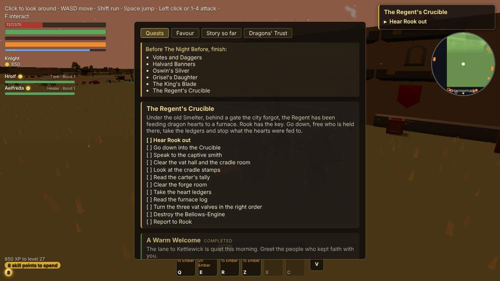

**Steps**
1. Hear Rook out; go down into the Crucible.
2. Speak to the captive smith, Eadric Smallbone.
3. Clear the vat hall and the cradle room; look at the cradle stamps; read the carter's tally.
4. Clear the forge room; take the heart ledgers; read the furnace log.
5. Turn the three vat valves in the right order (middle, north, south).
6. Destroy the Bellows-Engine: weapons cannot break it; shut its live valve (by hand or any hit) to break a bar; venting gives 8 s at x1.5 damage.
7. Report to Rook.

| The fight | Venting | The wreck |
| --- | --- | --- |
| 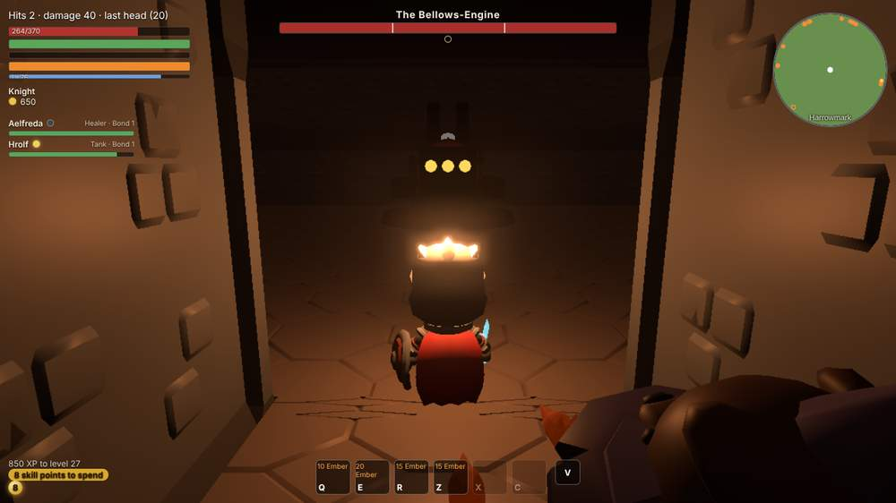 | 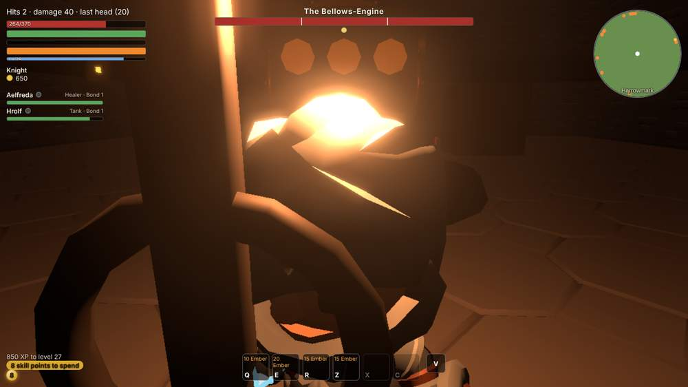 | 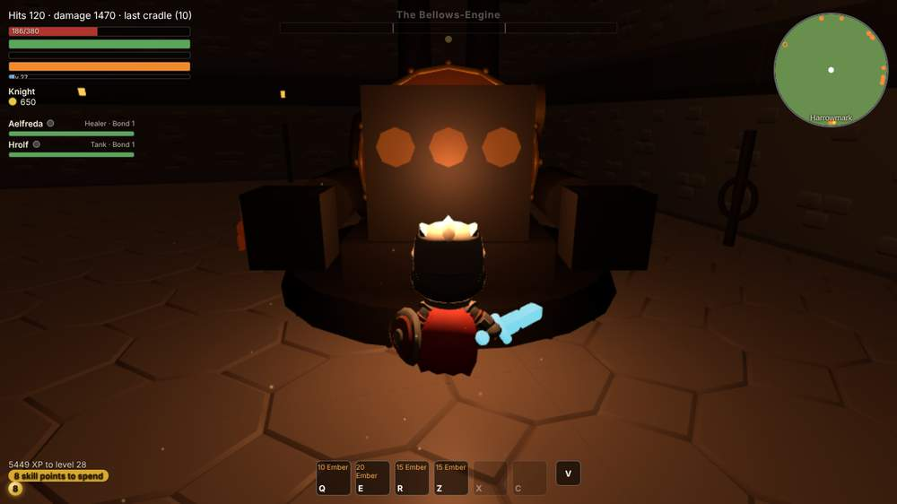 |

**Rewards:** 1100 XP, Engine Gear, one shard-gem.

- [ ] Leaving resets the fight with a toast; the wreck stays after.
- [ ] Bolt crates in the arena appear for Pathfinders only.

**Taste calls:** digest 30 to 33, 37.

---

## M37 The Night Before

**Main** · the Tilted Anvil · Giver: Tobb Fenwick · Opens after every Phase G quest above · Jump: `?act4=m37&new` · Design time 35 min

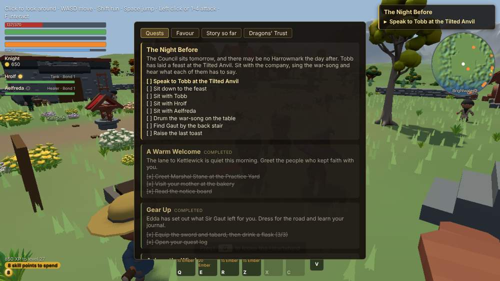

**Steps**
1. Speak to Tobb; sit down to the feast.
2. Sit with Tobb, Hrolf and Aelfreda (bond scenes).
3. Drum the war-song on the table (rhythm).
4. Find Gaut by the back stair; raise the last toast.

**Rewards:** 600 XP, Companion Cord; every companion reaches bond rank 2.

**Taste calls:** digest 29, 37.

---

## M38 The Council of Houses

**Main** · the Great Council Chamber · Giver: King Edric IV · Opens after M37 · Jump: `?act4=m38&new` · Design time 60 min

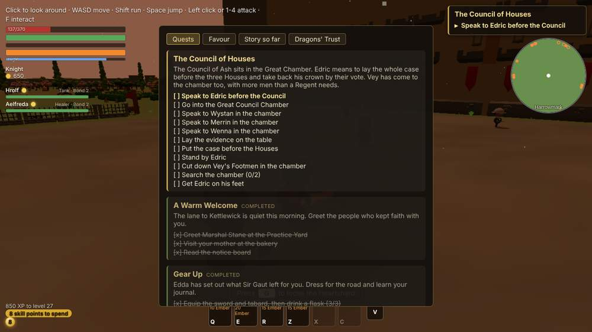

**Steps**
1. Speak to Edric before the Council; go into the chamber.
2. Speak to Wystan, Merrin and Wenna.
3. Lay the evidence on the table; put the case before the Houses.
4. The betrayal: stand by Edric; cut down Vey's Footmen in the chamber.
5. Search the chamber (2); get Edric on his feet.

| The betrayal | The chamber fight |
| --- | --- |
| 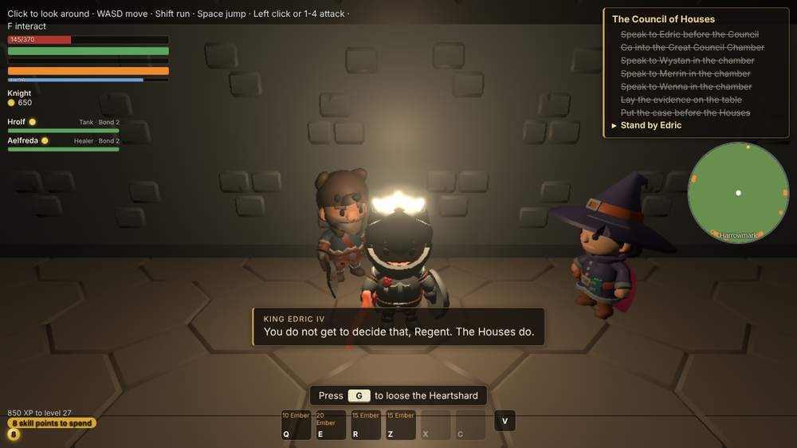 | 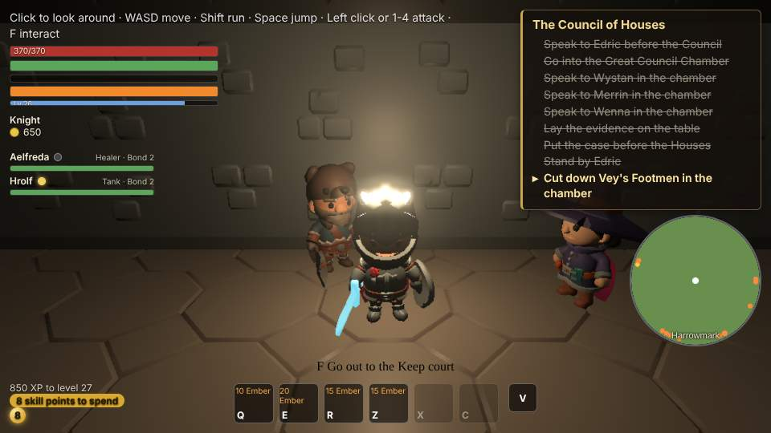 |

**Rewards:** 1200 XP.

- [ ] Earlier choices change the lines, never the end (digest 38).

---

## M39 Gaut's Last Stand

**Main** · the Keep stairs · Starts as M38 ends · Jump: `?act4=m39&new` · Design time 50 min

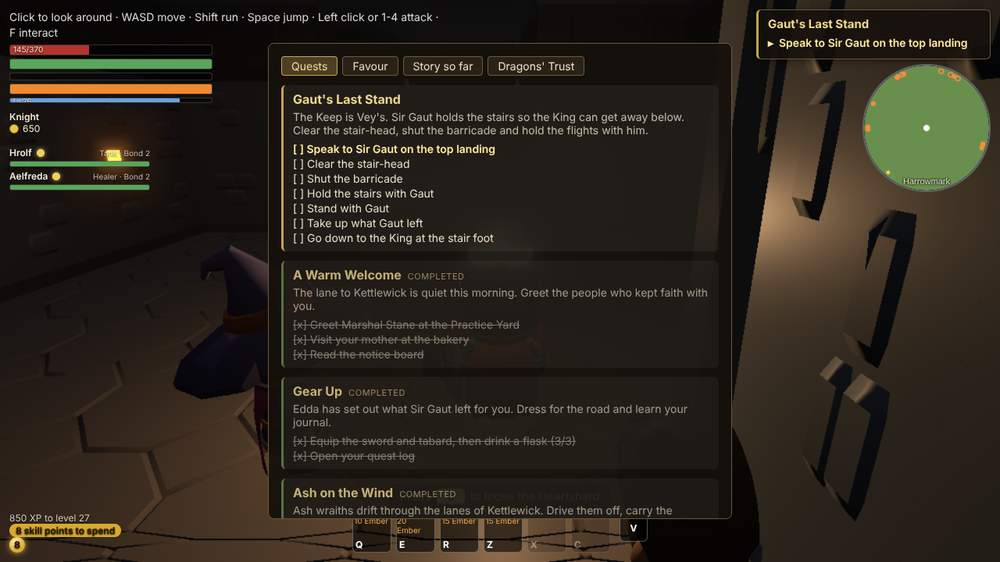

**Steps**
1. Speak to Sir Gaut on the top landing.
2. Clear the stair-head; shut the barricade.
3. Hold the stairs with Gaut (waves).
4. Stand with Gaut (he falls).
5. Take up what Gaut left; go down to the King at the stair foot.

| Waves on the stairs | Gaut falls |
| --- | --- |
| 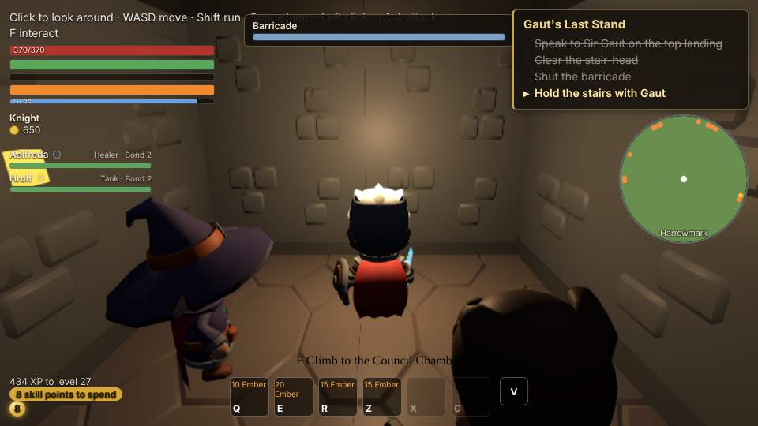 | 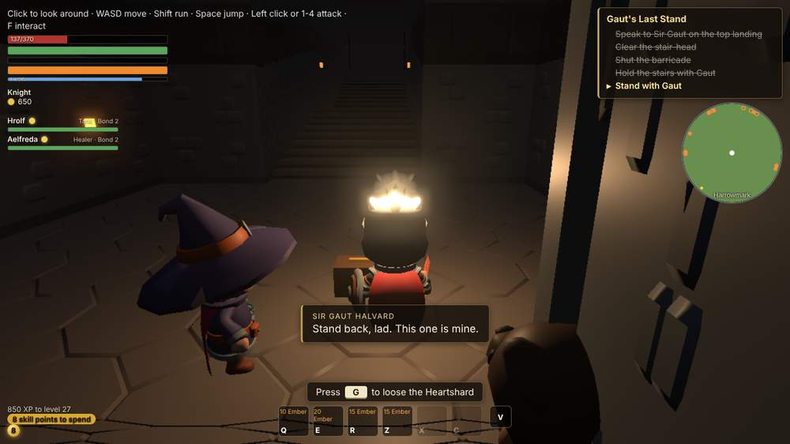 |

**Rewards:** 1300 XP; Gaut's Oathblade (a tier 4 sword for the Knight, a keepsake trinket for other classes, swapped on class change; digest 15).

---

## M40 Flight Through the Underways

**Main** · the deep run · Giver: Captain Rook (at the stair foot) · Opens after M39 · Jump: `?act4=m40&new` · Design time 50 min

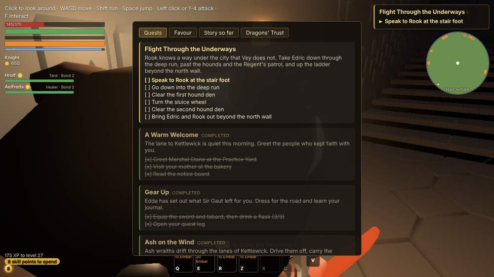

**Steps**
1. Speak to Rook; go down into the deep run.
2. Clear the first hound den; turn the sluice wheel; clear the second den.
3. Bring Edric and Rook out beyond the north wall.

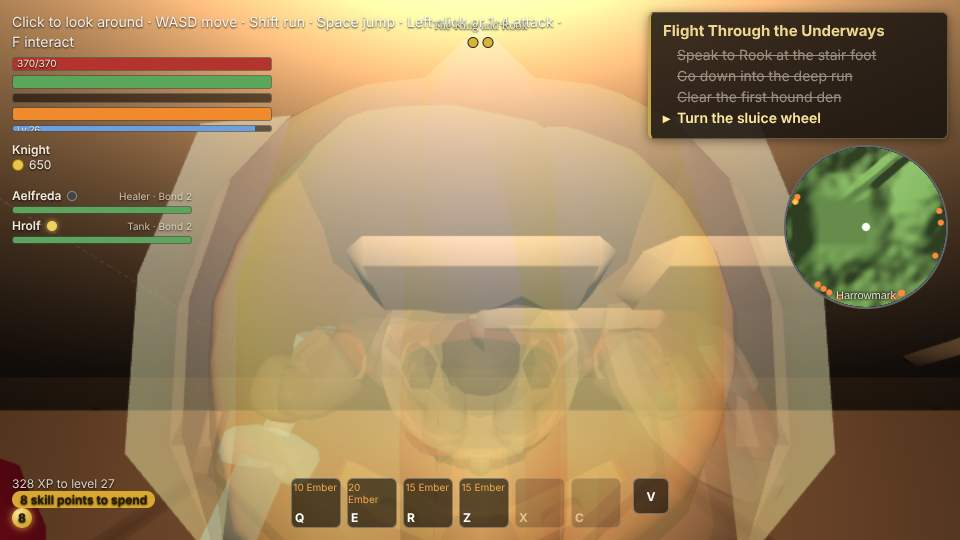

**Rewards:** 1200 XP, Rook's Whistle. Taste call: digest 21, 38.

---

## M41 The Boy King Remembers

**Main** · the camp outside the walls · Starts as M40 ends · Jump: `?act4=m41&new` · Design time 35 min

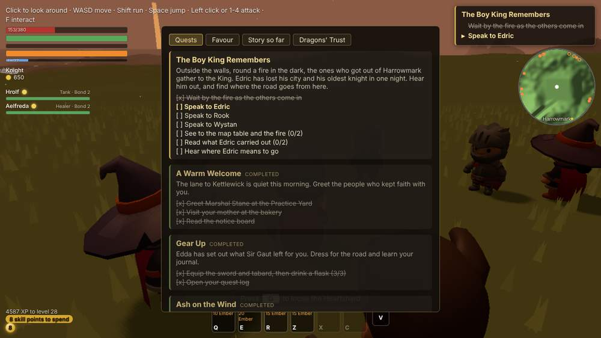

**Steps**
1. Wait by the fire as the others come in.
2. Speak to Edric, Rook and Wystan.
3. See to the map table and the fire; read what Edric carried out (2).
4. Hear where Edric means to go (Ashgate).

| The camp | "The Waste is next" card |
| --- | --- |
| 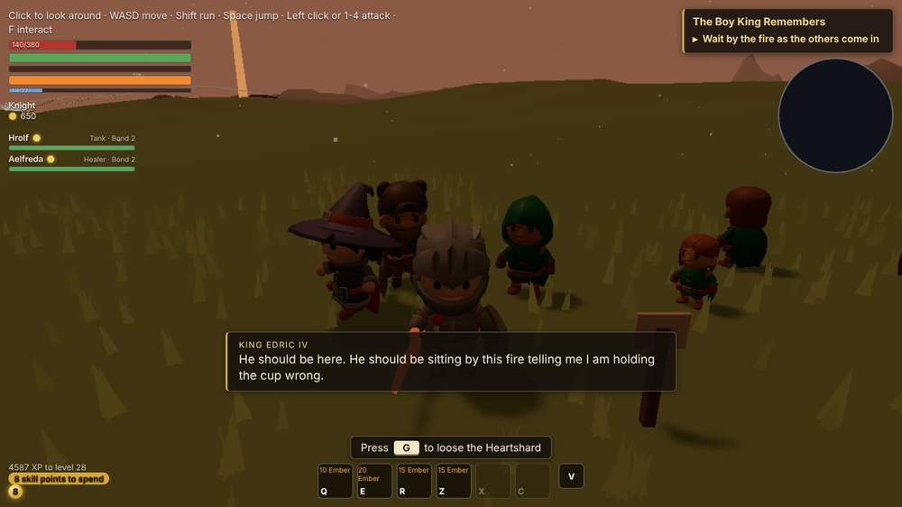 | 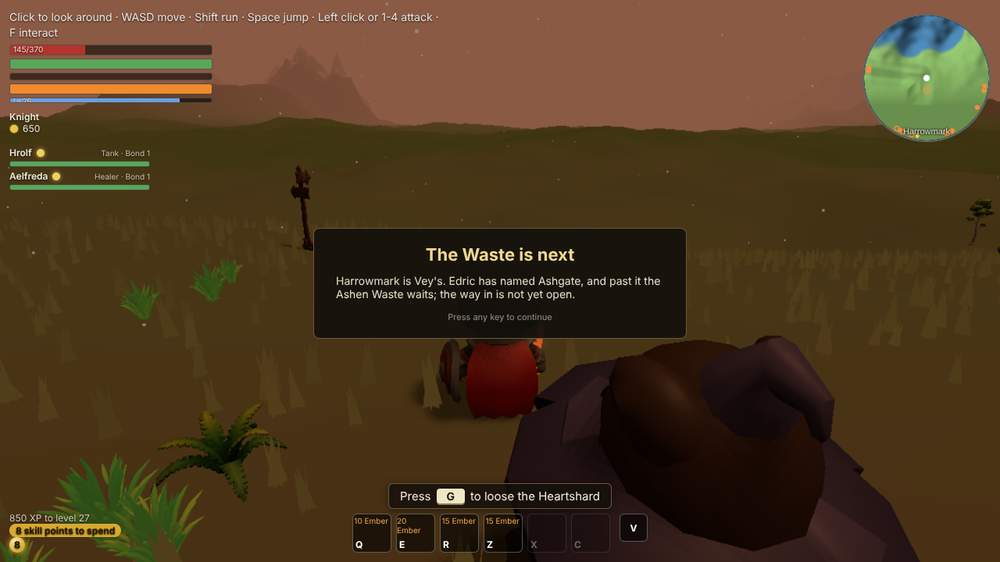 |

**Rewards:** 1000 XP, Edric's Map.

- [ ] Harrowmark is occupied from here: gates shut, waystone dark; allies and vendors move to the Ashgate refuge.

---

# Phase H: the Ashen Waste

## M42 Gate of Ash

**Main** · Ashgate to the Walker Camp · Giver: Wulfhild of the Ashwalkers · Opens after M41 · Jump: `?act4=m42&new` · Design time 50 min

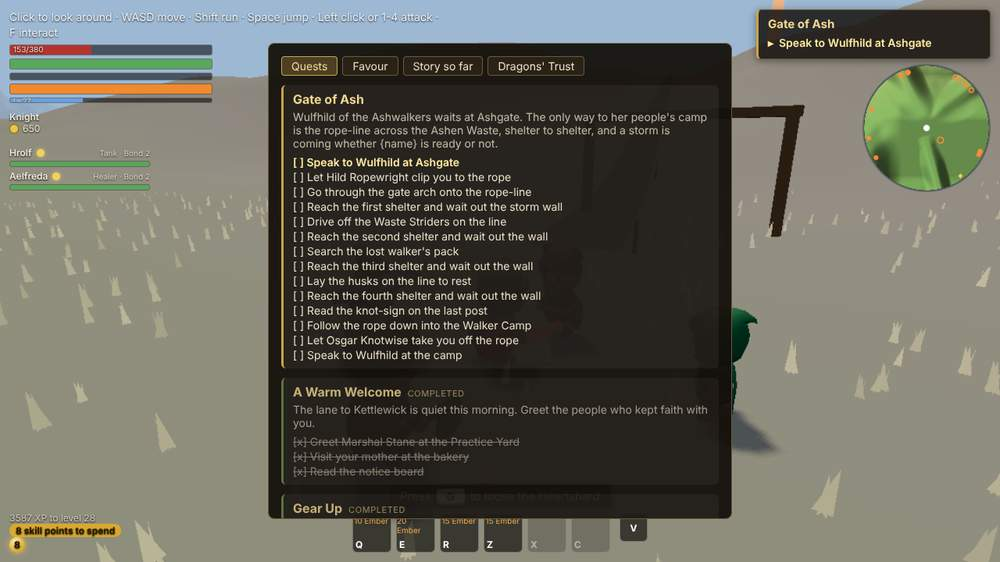

**Steps**
1. Speak to Wulfhild at Ashgate; let Hild Ropewright clip you to the rope.
2. Go through the gate arch onto the rope-line.
3. Reach the first shelter and wait out the storm wall; drive off the Waste Striders on the line.
4. Second shelter; search the lost walker's pack.
5. Third shelter; lay the husks on the line to rest.
6. Fourth shelter; read the knot-sign on the last post.
7. Follow the rope down into the Walker Camp; let Osgar Knotwise unclip you; speak to Wulfhild.

| Ashgate | On the rope-line | Shelter in a storm |
| --- | --- | --- |
| 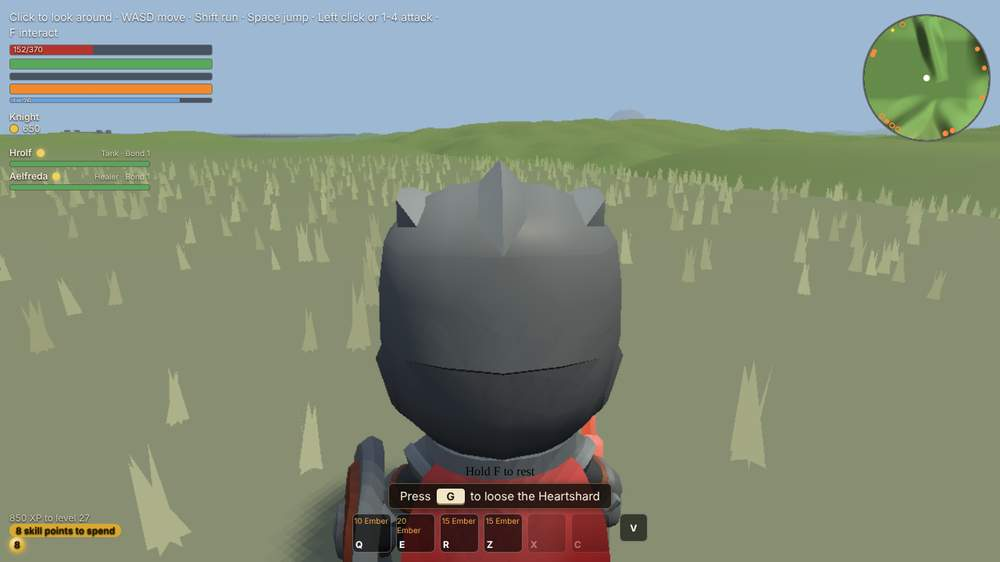 | 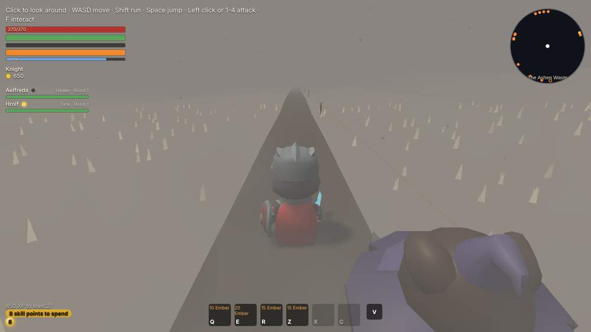 | 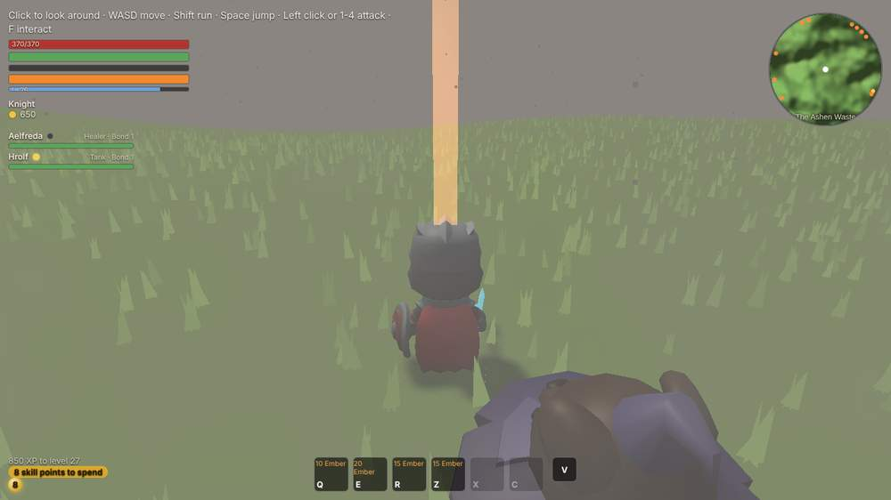 |

**Rewards:** 850 XP, Ash Shroud Mask.

- [ ] Storms are forced during the crossing and held clear while talking (digest 56).
- [ ] Waste Striders are tripped by leg hits and Calmed with a Rain Flask (digest 51).

**Taste calls:** digest 4 to 7, 55, 56.

---

## M43 What the Walkers Know

**Main** · the Walker Camp · Giver: Wulfhild · Opens after M42 · Jump: `?act4=m43&new` · Design time 55 min

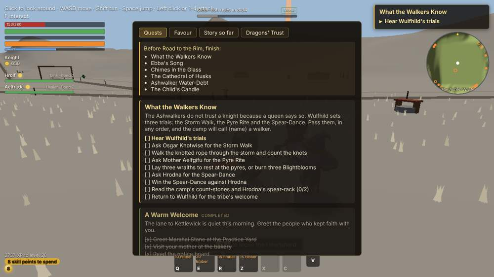

**Steps** (the three trials in any order)
1. Hear Wulfhild's trials.
2. Storm Walk: ask Osgar Knotwise; walk the knotted rope through the storm and count the knots.
3. Pyre Rite: ask Mother Aelfgifu; lay three wraiths to rest at the pyres, or burn three Blightblooms.
4. Spear-Dance: ask Hrodna; win the dance against her.
5. Read the camp's count-stones and Hrodna's spear-rack.
6. Return to Wulfhild for the tribe's welcome.

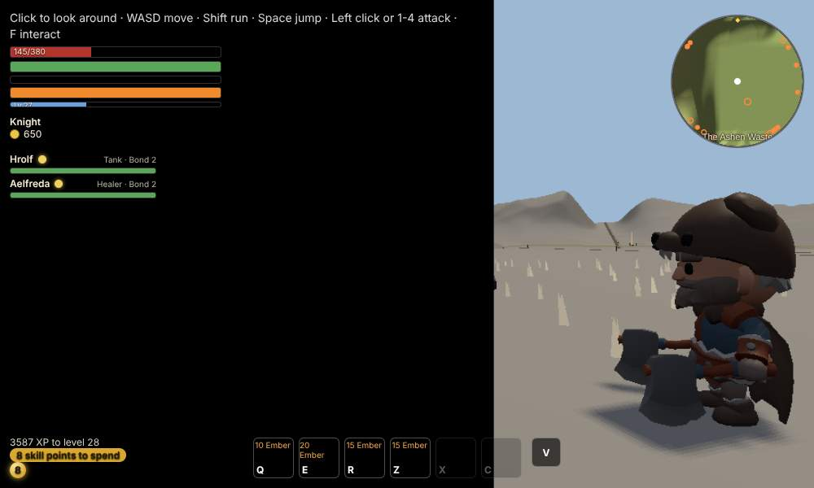

**Rewards:** 900 XP, Walker Tattoo (Release costs 5 Burn on regular undead, digest 16).

- [ ] Pyres re-rise unless guarded; the Storm Walk never fails; the Spear-Dance can be retried (digest 57).

---

## M44 Ebba's Song

**Main** · the Cinder Chapel village · Giver: Little Ebba · Opens after M43 · Jump: `?act4=m44&new` · Design time 40 min

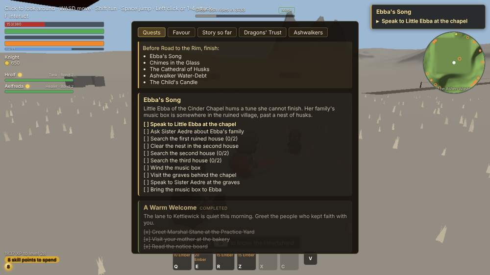

**Steps**
1. Speak to Little Ebba at the chapel; ask Sister Aedre about Ebba's family.
2. Search the first ruined house (2); clear the nest in the second house; search it (2); search the third (2).
3. Wind the music box.
4. Visit the graves behind the chapel; speak to Aedre there.
5. Bring the music box to Ebba.

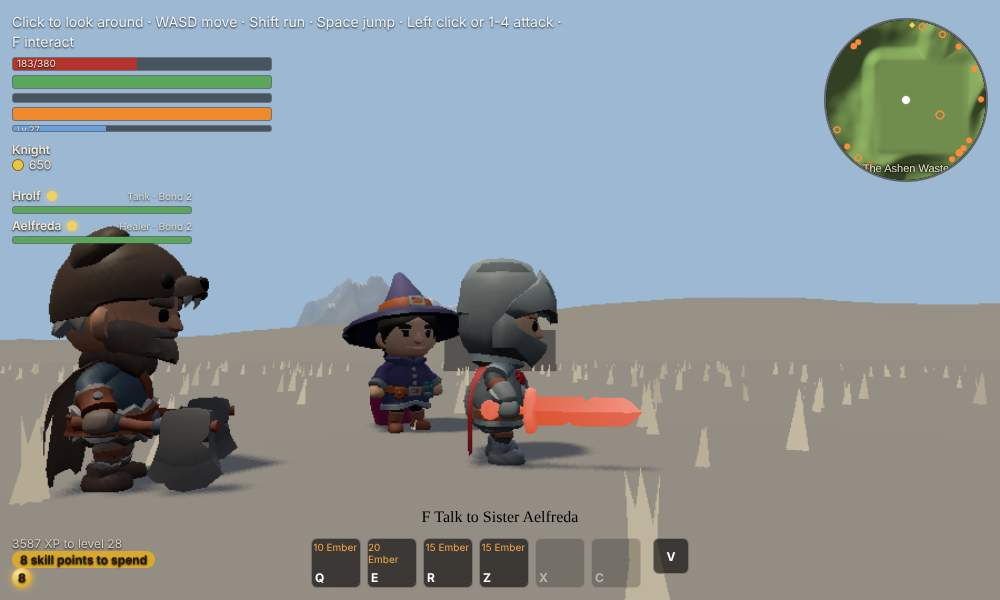

**Rewards:** 800 XP, Music Box. Taste call: digest 13 (Ebba's tune).

---

## R25 The Child's Candle

**Region** · three ruined hearths · Giver: Little Ebba · Opens after M44 · Jump: `?act4=r25&new` · Design time 35 min

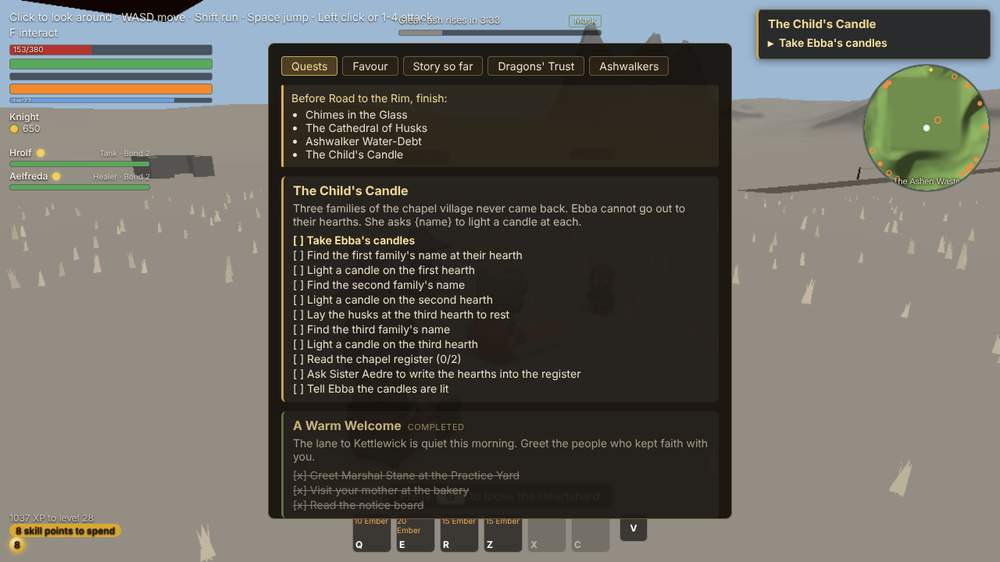

**Steps**
1. Take Ebba's candles.
2. At each hearth: find the family's name, light a candle; lay the husks at the third hearth to rest.
3. Read the chapel register (2); ask Sister Aedre to write the hearths in.
4. Tell Ebba the candles are lit.

**Rewards:** 550 XP, Ebba's Candle. Taste call: digest 59.

---

## R24 Ashwalker Water-Debt

**Region** · the spring to the Walker Camp · Giver: Wulfhild · Opens after M43 · Jump: `?act4=r24&new` · Design time 40 min

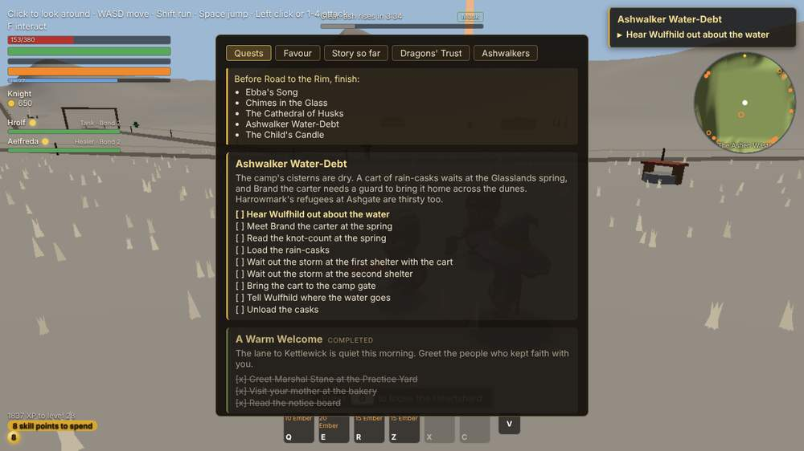

**Steps**
1. Hear Wulfhild out; meet Brand the carter at the spring; read the knot-count.
2. Load the rain-casks.
3. Escort the cart: wait out the storm at the first and second shelters with it.
4. Bring the cart to the camp gate; tell Wulfhild where the water goes; unload.

**Rewards:** 600 XP, Waterskin of Rain.

**Choices (flag F8):** all the casks to the camp (Ashwalkers +10) or half kept for Harrowmark's refugees (Ashwalkers -4, Halvard +3) (digest 58).

- [ ] The cart stops at 0 health and rolls on once the attackers are cleared (digest 26). Taste call: digest 6.

---

## M45 Chimes in the Glass

**Main** · the Glasslands · Giver: Wulfhild · Opens after M44 · Jump: `?act4=m45&new` · Design time 50 min

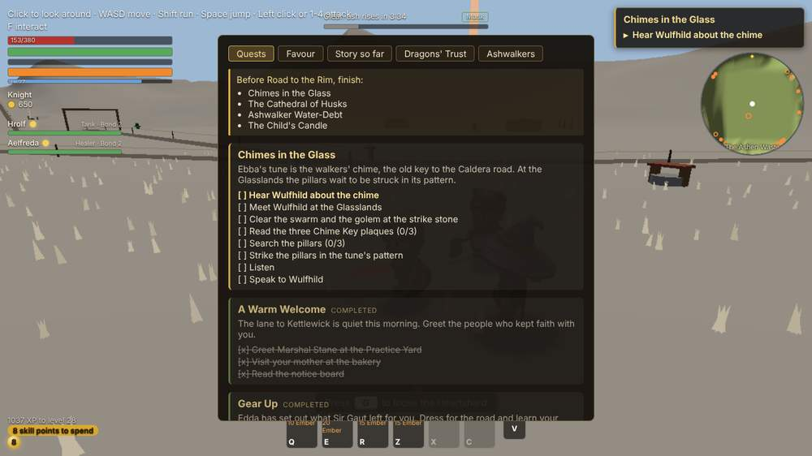

**Steps**
1. Hear Wulfhild about the chime; meet her at the Glasslands.
2. Clear the swarm and the golem at the strike stone.
3. Read the three Chime Key plaques; search the pillars (3).
4. Strike the pillars in the tune's pattern (the right attack key per pillar).
5. Listen; speak to Wulfhild.

| The Glasslands | The voice |
| --- | --- |
| 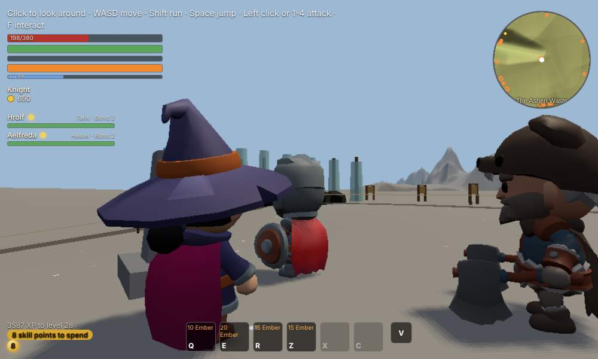 | 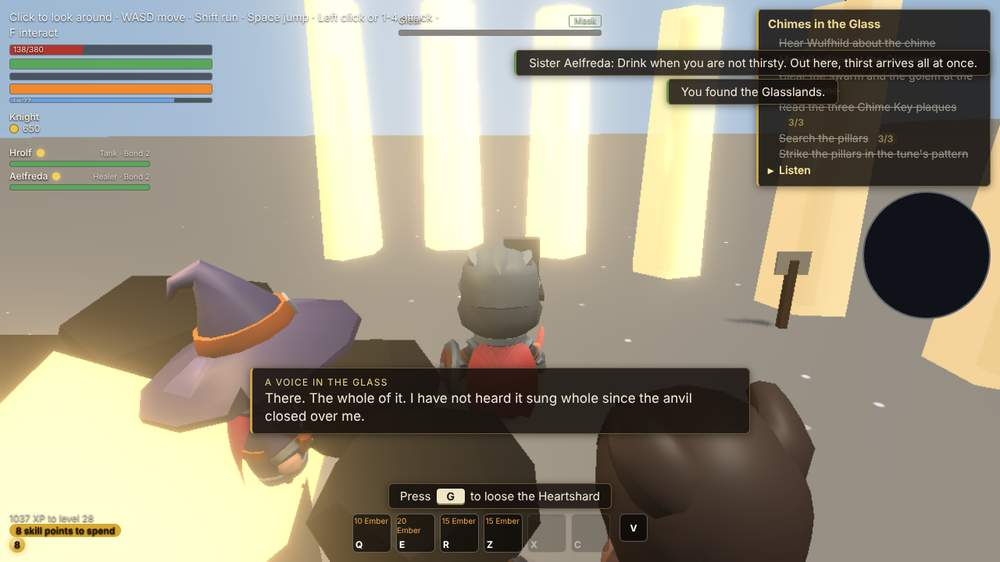 |

**Rewards:** 900 XP, Chime Key.

- [ ] After five fails the assist window widens to 155 ms, then the pillars are struck for you (digest 10).
- [ ] "The road north opens": a glass drift shatters (visual only, digest 9).

---

## D08 The Cathedral of Husks

**Dungeon** · the Husk Cathedral · Giver: Wulfhild · Opens after M43 · Jump: `?act4=d08&new` · Design time 60 min · **Boss: Archwraith Eormen**

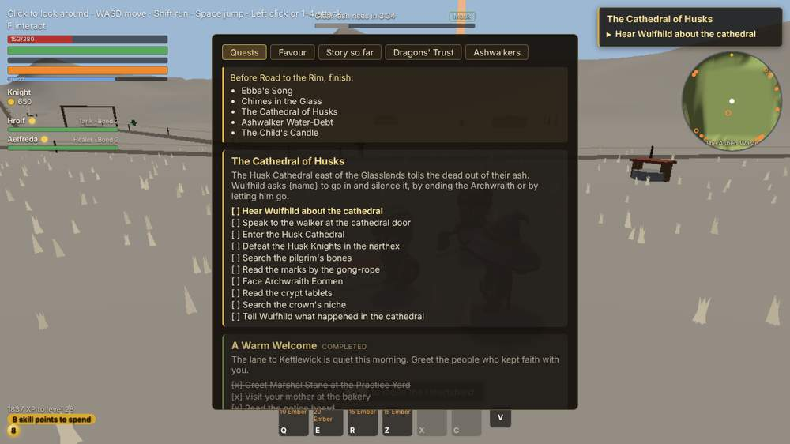

**Steps**
1. Hear Wulfhild; speak to the dying walker, Leofric, at the door; enter.
2. Defeat the Husk Knights in the narthex; search the pilgrim's bones; read the marks by the gong-rope.
3. Face Eormen: only a gong strike within 4 s of his toll, with him at the health floor, breaks a bar. Spirit blades are dodge-only. Three husk adds each phase; the nave goes dark from phase 2.
4. Release him (he glides to Cael for it) or defeat him.
5. Read the crypt tablets; search the crown's niche; tell Wulfhild.

| The fight | Gong open |
| --- | --- |
| 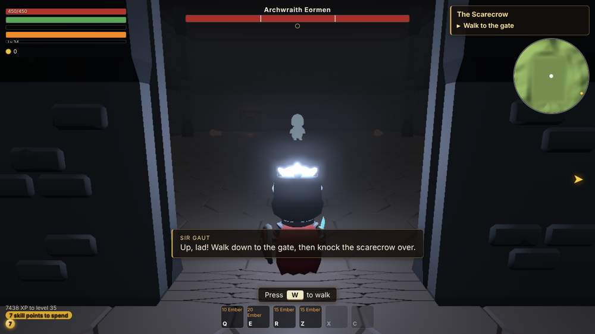 | 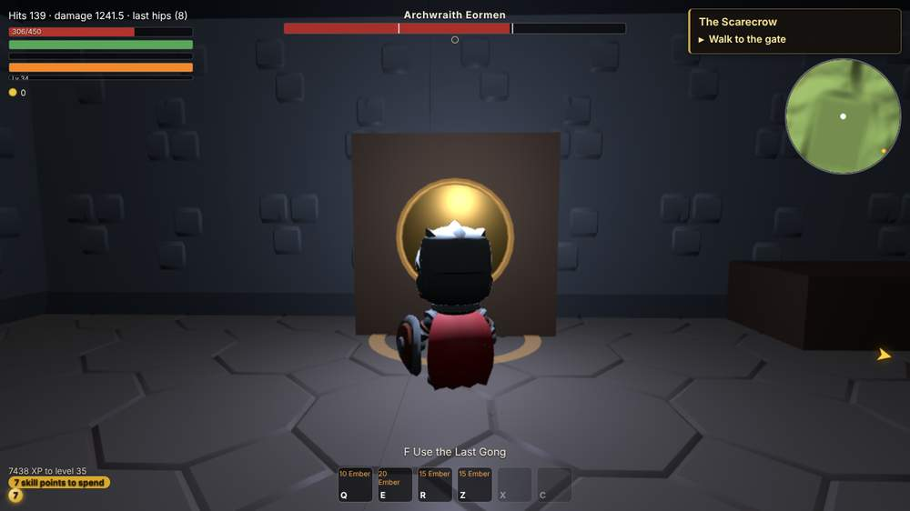 |

**Rewards:** 1100 XP, one shard-gem; Eormen's Crown Shard if defeated.

**Taste calls:** digest 47 to 50, 52 (Husk Knights).

---

## M46 Road to the Rim

**Main** · Cinder Road North to the Rimfoot fire · Giver: Hrolf Ironbrow · Opens after every Phase H quest · Jump: `?act4=m46&new` · Design time 50 min

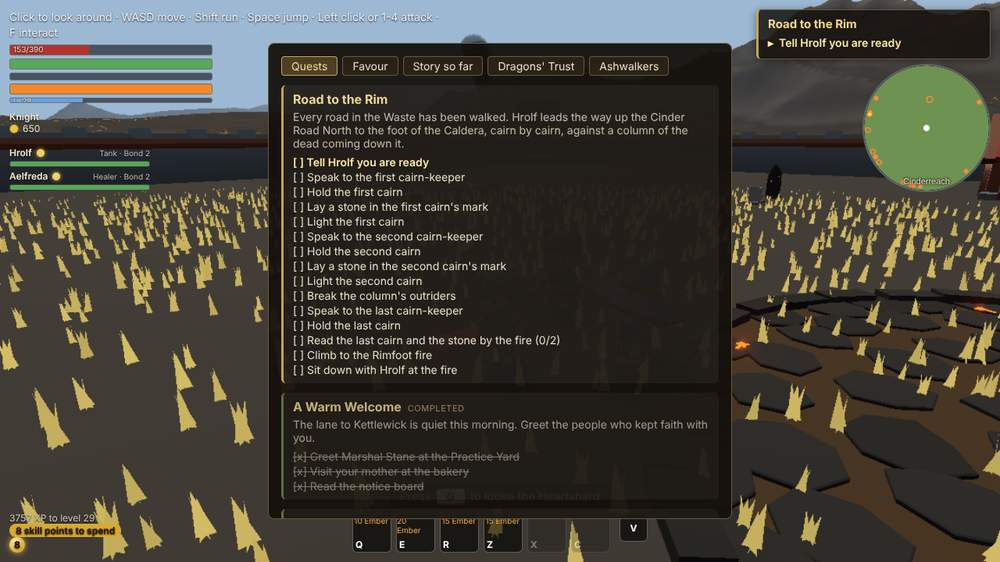

**Steps**
1. Tell Hrolf you are ready (he joins as a guest if benched, digest 59).
2. At each of three cairns: speak to the cairn-keeper (Eadwig, Saewynn, Cuthwine), hold the cairn against the column, lay a stone in its mark, light it. Break the column's outriders between the second and third.
3. Read the last cairn and the stone by the fire.
4. Climb to the Rimfoot fire; sit down with Hrolf.

**Rewards:** 950 XP, Rimward Boots.

---

## Act 4 ending: "The Road to the Rim"

| Card | Camp at the Rimfoot fire |
| --- | --- |
| 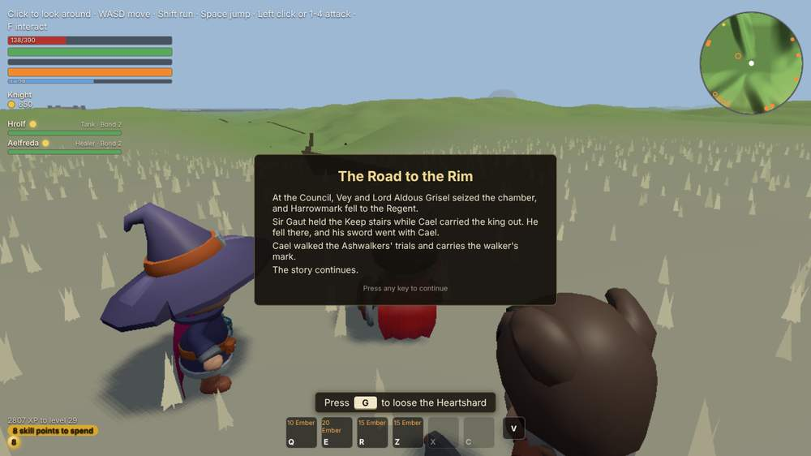 | 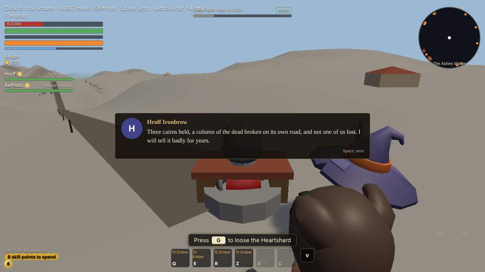 |

- [ ] The card recaps one line per outcome (M38, M39, D07, R24, D08 and others) (digest 44).
- [ ] The camp scene at the Rimfoot fire plays once (digest 42).
- [ ] `story.gate.a5` is set; Act 5 opens at the Rim.
