# Act 5: The Sunforge

The Sunforge Caldera: the Rim (Phase I) and the Foundry down to the Anvil of Ages (Phase J), then the ending choice, both endings, the epilogue, the credits and the after-ending world. Levels 35 to 40 (the census ends the game at 37 to 38, or 36 to 37 for a mercy-heavy run, digest 114). Back to the [index](README.md).

## Bosses and choices at a glance

| What | Options | What it changes |
| --- | --- | --- |
| D09 Morcant Vey | **Spare** (hold T in the 6 s window) or **strike him down** | Spare: Oswin +4, Halvard -4, Vey vanishes for trial. Strike: Halvard +4, Oswin -2 (flag `boss.vey.outcome`) |
| M56 the Anvil | **Rekindle** with the Heartshard or **Let It Die** | Rekindle with fewer than 8 Scars: "The Last Ember". Rekindle with 8 or more: "The Last Ember" and Cael dies ("Cael Brannoc, the last bearer"). Let It Die: "The Long Dawn" (flag `story.m56.choice`) |
| Favour presets (dev jump) | `&favour=marshal` or `&favour=keepers` | Marshal: Halvard-leaning run (M52 snapshot Halvard 71, Oswin 20). Keepers: Oswin and Walker-leaning run (Halvard 21, Oswin 52). Sets the earlier acts' choice flags to match |

Other choices in the act: R26 road (fast or long), R27 far shoring (collapse or keep), R28 how many pyres to light (0 to 4), R30 the ballad's last verse (Gaut, Keepers, Houses or Walkers).

**Act 5 count:** 10 main quests (M47 to M56), 5 region quests (R26 to R30), 2 dungeons (D09, D10). Taste calls are cited by their number in `design/veto-digest-2026-11.md` (Act 5 is 62 to 119).

**Phases.** Phase I is the Rim: M47 to M52, R26, R29. M52 (the siege) waits for M47 to M51 and R26; after it the card "The Rim holds" shows. Phase J is the Foundry: R27, R28, R30, M53, D09, M54, M55, D10, M56. M54 waits only for D09 and R27; R28, R29 and R30 are optional, and a still-running one is quietly withdrawn when M54 starts with a "left on the Rim" note (digest 64, 111). Test that warning.

| Id | Name | Giver | Opens after | Jump |
| --- | --- | --- | --- | --- |
| M47 | Rim of the World | Wulfhild of the Ashwalkers (Rimfoot fire) | Act 4 ending (M46 + D08) | `?act5=m47&new` |
| M48 | The Lava Stair | Alric, last of the stokers | M47 | `?act5=m48&new` |
| M49 | Allies at the Rim | Hrolf Ironbrow | M48 | `?act5=m49&new` |
| R26 | Oswin's Loyalists | Lady Merrin Oswin | M49 | `?act5=r26&new` |
| R29 | The Last Gong | Brother Ansgar | M49 | `?act5=r29&new` |
| M50 | The Cooling Hall | Alric | M49 | `?act5=m50&new` |
| M51 | Dragons Gather | the keeper's horn-stone (scene) | M49 | `?act5=m51&new` |
| M52 | The Siege of the Rim | Lord Wystan Halvard | M47 to M51, R26 | `?act5=m52&new` |
| R27 | Grisel's Redemption | Lady Wenna Grisel | M52 | `?act5=r27&new` |
| R28 | The Ashwalkers' Pyre | Wulfhild | M52 | `?act5=r28&new` |
| R30 | Tobb's Ballad | Tobb Fenwick | M52 | `?act5=r30&new` |
| M53 | Vey's Last Argument | King Edric IV | M52 | `?act5=m53&new` |
| D09 | Iron and Ember | Alric (Foundry door) | M53 | `?act5=d09&new` |
| M54 | Ulthred Wakes | Alric (Rim Camp) | D09, R27 | `?act5=m54&new` |
| M55 | Hammer and Heart | Ulthred, the First Smith | M54 | `?act5=m55&new` |
| D10 | The Last Hammer | Alric (Hammer Hall) | M55 | `?act5=d10&new` |
| M56 | Embers or Dawn | Alric (the Anvil) | D10 | `?act5=m56&new` |

Add `&favour=marshal` or `&favour=keepers` to any jump so the favour tracks and earlier choices match a whole run; without it the tracks start neutral.

**Systems introduced in Act 5** (check once):
- [ ] Spawns are capped at your level plus 3; Caldera kill XP x3.0; Vey is level 38, Ulthred 40 (digest 62). Warhost creatures drop no gold (digest 85), and Act 5 quests pay no gold.
- [ ] Lava never kills: after 0.4 s it throws Cael to the nearest safe edge, never below 10% health (digest 77).
- [ ] Vent wheels cool a crust for 6 s, then recharge for 10 s; Surge Leap (V) gets aim help at marked edges (digest 78).
- [ ] Turning platforms carry Cael, jumps included, and the camera turns with them (digest 70).
- [ ] No interior deals lava damage; the Foundry "lift" is a gated stairwell (digest 75).
- [ ] From M49 the refuge vendors and trainers move to the Rim Camp; tier 5 "Sunforged" gear (eleven pieces) at Alric's rim forge, 550 gold per set (digest 68, 94, 95).
- [ ] The Waste's ash storm stays out of the Caldera; orange sky (digest 74).

| Rimfoot to the rim | Rim stairs hairpin | Rim Gate landing |
| --- | --- | --- |
| 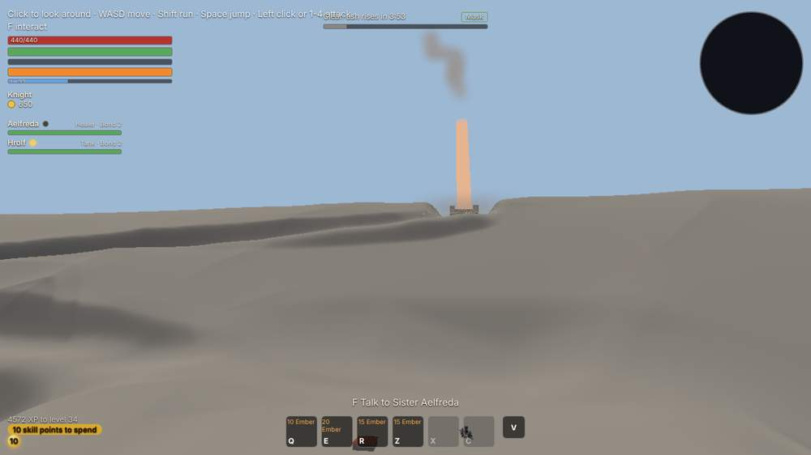 | 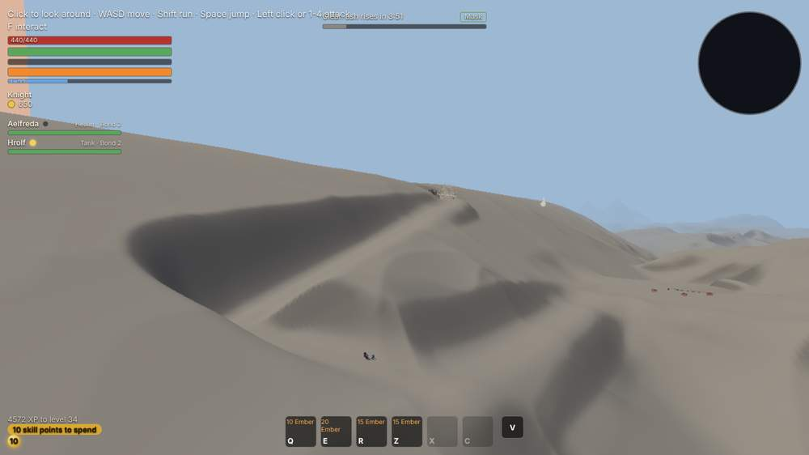 | 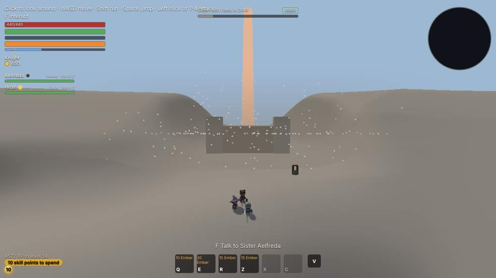 |
| **Rim Camp** | **The bowl from the shelf** | **Warhost camp** |
| 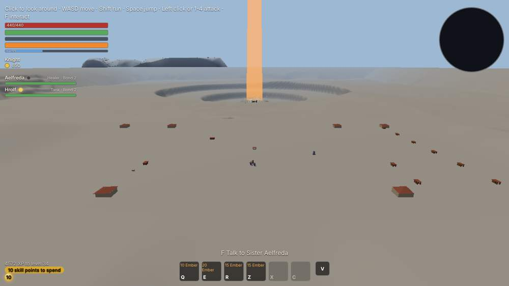 | 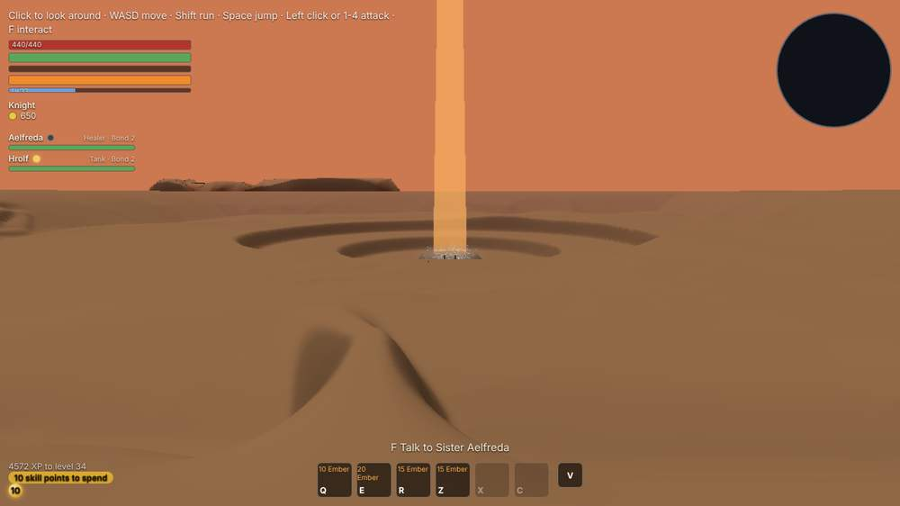 | 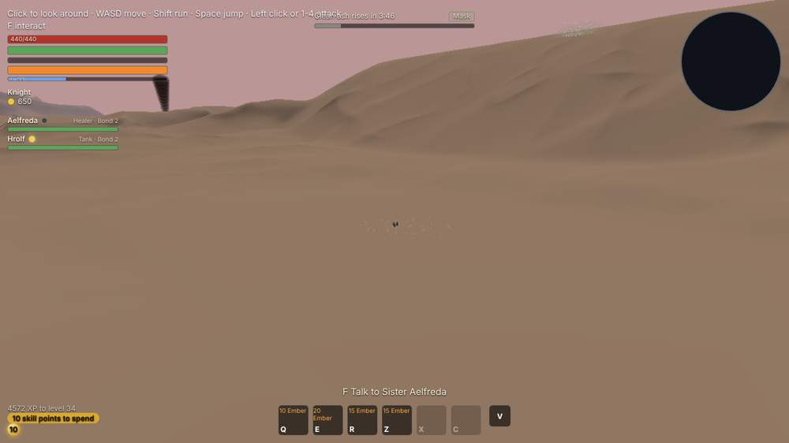 |

---

# Phase I: the Rim

## M47 Rim of the World

**Main** · Rimfoot fire, rim stairs, Rim Gate · Giver: Wulfhild of the Ashwalkers · Opens with Act 5 · Jump: `?act5=m47&new` · Design time 40 min

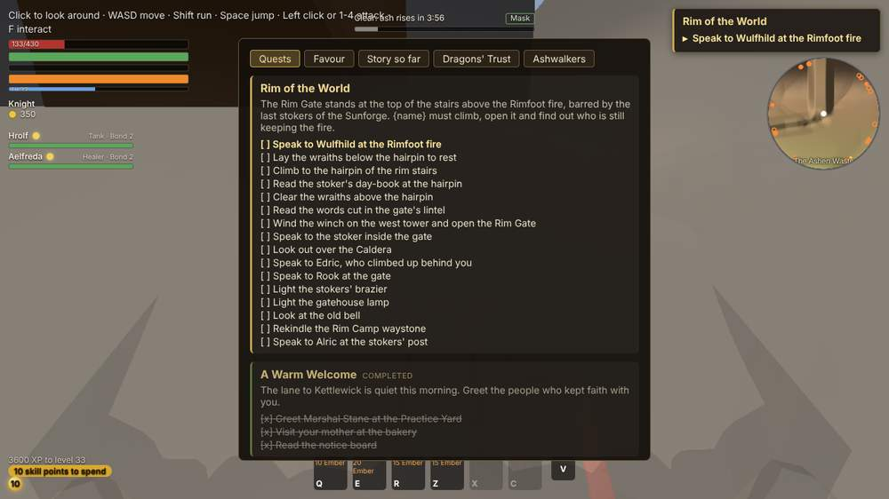

**Steps**
1. Speak to Wulfhild at the Rimfoot fire.
2. Lay the wraiths below the hairpin to rest; climb to the hairpin of the rim stairs; read the stoker's day-book there.
3. Clear the wraiths above the hairpin; read the words cut in the gate's lintel.
4. Wind the winch on the west tower: the Rim Gate opens (flag `story.m47.rimGateOpen`).
5. Speak to the stoker inside the gate (Alric); look out over the Caldera.
6. Speak to Edric, who climbed up behind you; speak to Rook at the gate.
7. Light the stokers' brazier and the gatehouse lamp; look at the old bell.
8. Rekindle the Rim Camp waystone (hold F); speak to Alric at the stokers' post.

**Rewards:** 1,000 XP, Stoker's Gloves.

**Verify**
- [ ] The gate swings inward and stays open after a reload (digest 72).
- [ ] The rim stairs are long (about 910 m); escorts and allies are not needed here.
- [ ] The Rim Camp waystone appears on the map and fast travel works after it is lit.

| Stokers' post | Inner Gate from the camp |
| --- | --- |
| 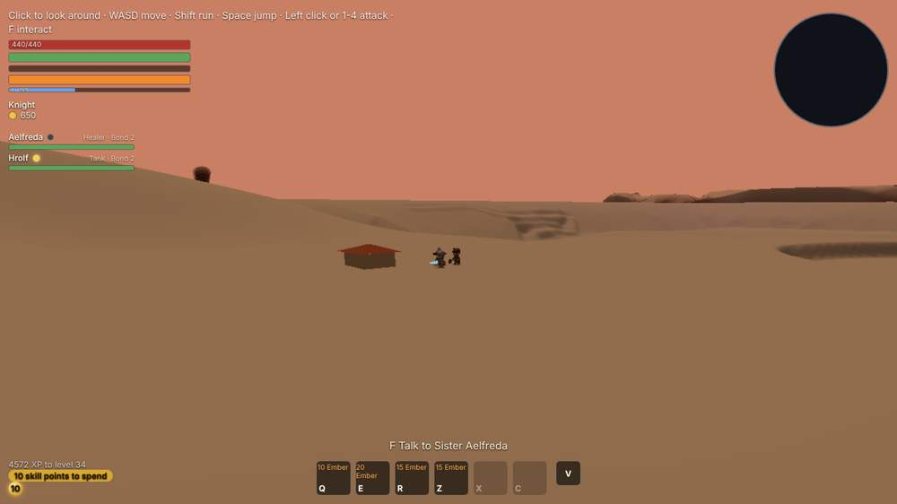 | 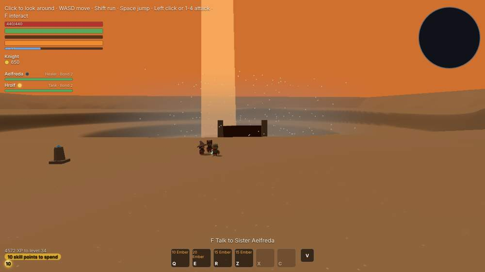 |

**Taste calls:** digest 71 (new toast wording), 72 (gate in a 28 m cutting, stair length), 104 (invented names).

---

## M48 The Lava Stair

**Main** · Lava Stair · Giver: Alric · After M47 · Jump: `?act5=m48&new` · Design time 45 min

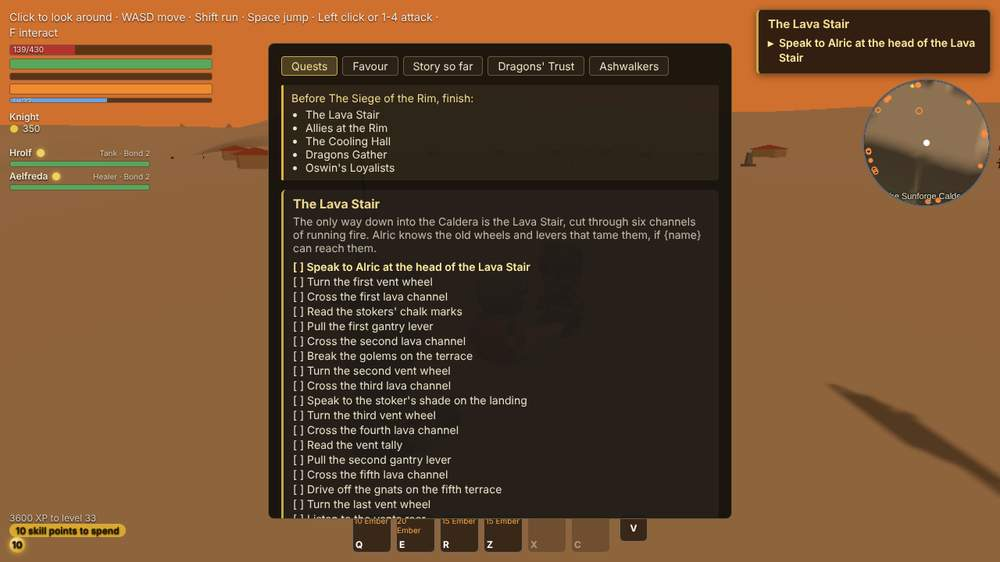

**Steps**
1. Speak to Alric at the head of the Lava Stair.
2. Six channels in order. For each: turn the vent wheel (or pull the gantry lever), then cross while the crust is cool.
   - Channel 1: vent wheel 1; read the stokers' chalk marks.
   - Channel 2: gantry lever 1.
   - Break the golems on the terrace.
   - Channel 3: vent wheel 2; speak to the stoker's shade on the landing.
   - Channel 4: vent wheel 3; read the vent tally.
   - Channel 5: gantry lever 2; drive off the gnats on the fifth terrace.
   - Channel 6: the last vent wheel; listen to the vents roar; cross.
3. Search the stoker's cache at the foot; speak to Alric at the foot of the stair.

**Rewards:** 1,000 XP, Cinderproof Mantle, Forge-Heart Fragment.

**Verify**
- [ ] Stepping in lava throws Cael to a safe edge; it never kills (digest 77).
- [ ] A vent crust lasts 6 s, then the wheel recharges for 10 s; the gantries lower when their levers are pulled.
- [ ] After M48 the channels stay cool (lava is gone from the stair for the rest of the game).

| Stair from the top | Live channel | Vent open, crust |
| --- | --- | --- |
| 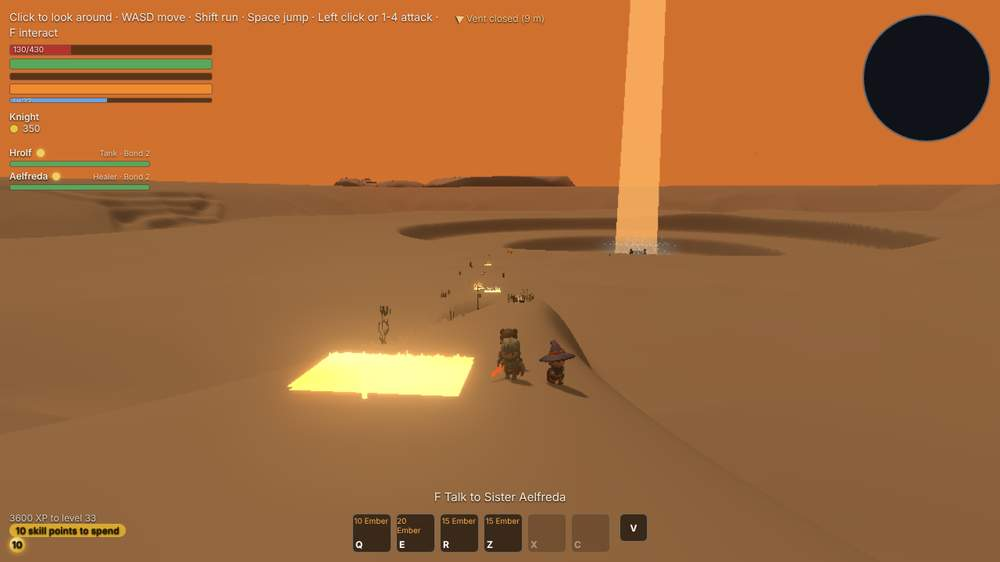 | 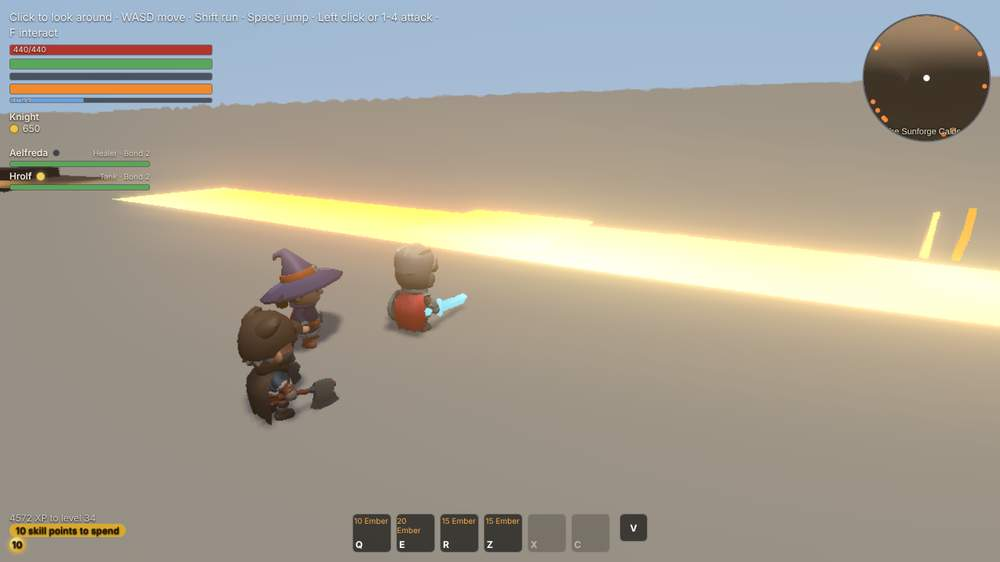 | 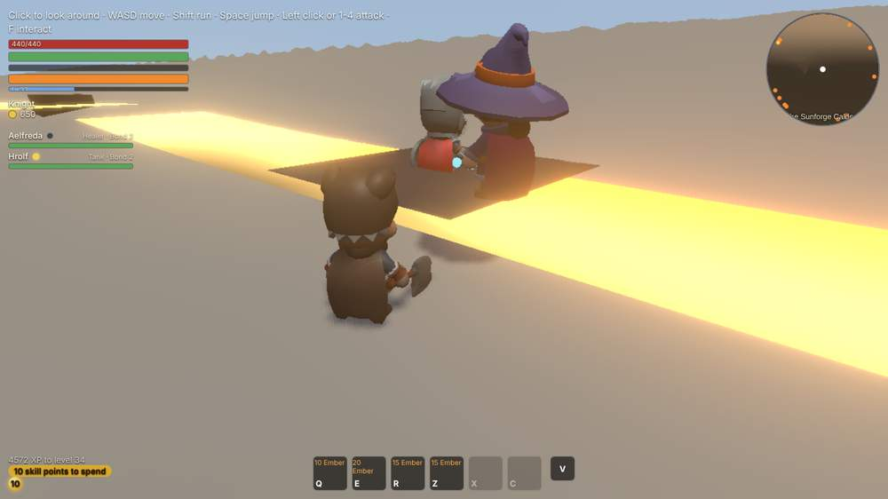 |
| **Gantry raised** | **Gantry lowered** | **Lava Stair head** |
| 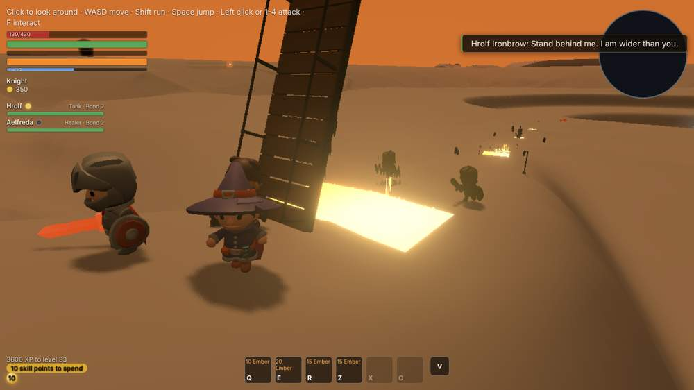 | 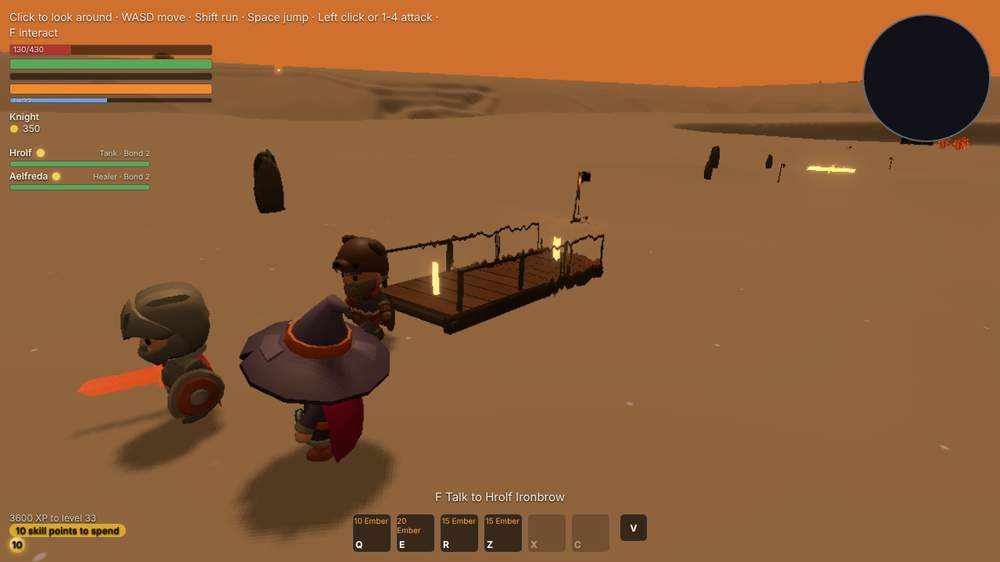 | 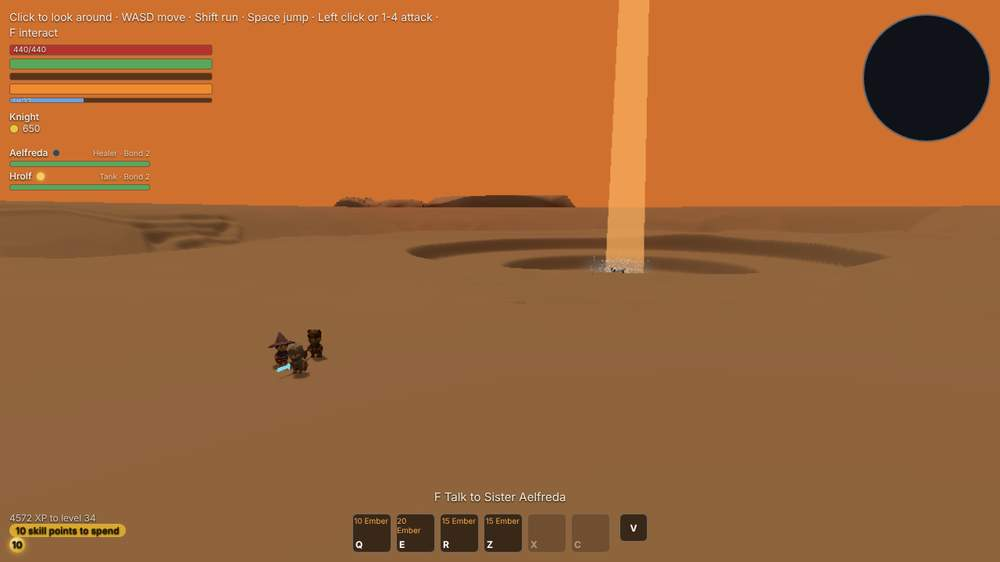 |

**Taste calls:** digest 70, 77, 78, 79 (heat haze, lava with no glow light).

---

## M49 Allies at the Rim

**Main** · Rim Camp · Giver: Hrolf Ironbrow · After M48 · Jump: `?act5=m49&new` · Design time 40 min

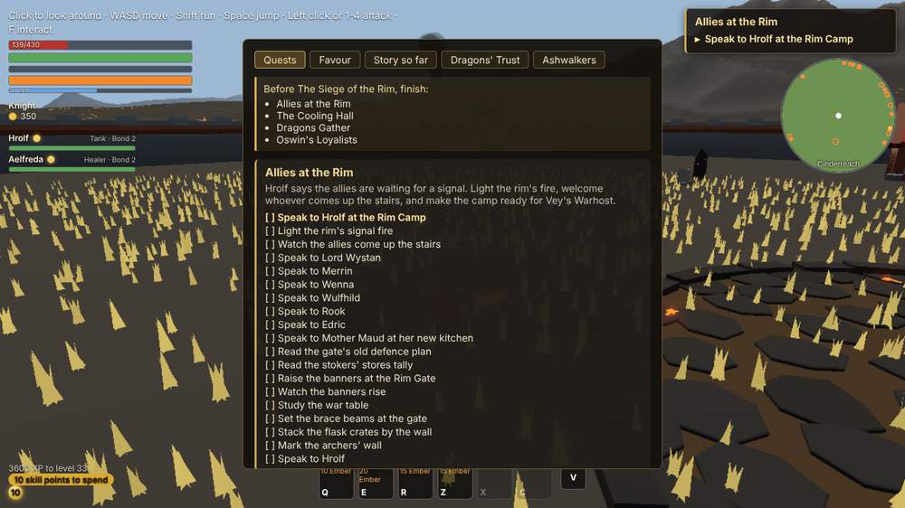

**Steps**
1. Speak to Hrolf at the Rim Camp; light the rim's signal fire; watch the allies come up the stairs.
2. Speak to Lord Wystan, Merrin, Wenna, Wulfhild, Rook, Edric, and Mother Maud at her new kitchen.
3. Read the gate's old defence plan and the stokers' stores tally.
4. Raise the banners at the Rim Gate; watch them rise; study the war table.
5. The three posts: set the brace beams at the gate, stack the flask crates by the wall, mark the archers' wall.
6. Speak to Hrolf.

**Rewards:** 900 XP, Allied Banners. Opens R26, R29, M50 and M51.

**Verify**
- [ ] Vendors and trainers now stand at the Rim Camp (digest 68), "Maud's rim kitchen" toast (digest 71).
- [ ] The Warhost camp is visible on the plain below.

---

## R26 Oswin's Loyalists

**Region** · Rimfoot to the Rim Camp · Giver: Lady Merrin Oswin · After M49 · Jump: `?act5=r26&new` · Design time 40 min

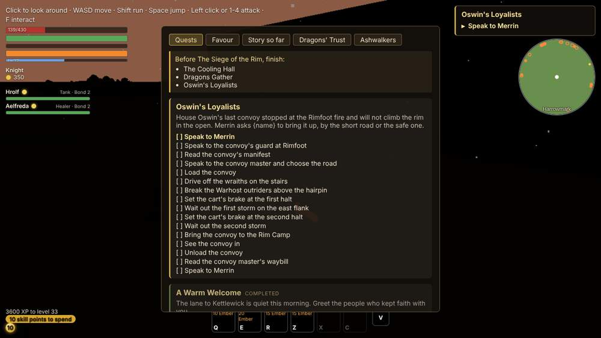

**Steps**
1. Speak to Merrin; speak to Sigeric, the convoy's guard at Rimfoot; read the manifest.
2. Speak to Leodwin, the convoy master, and **choose the road** (fast or long).
3. Load the convoy; drive off the wraiths on the stairs; break the Warhost outriders above the hairpin.
4. Set the cart's brake at the first halt and wait out the first storm on the east flank; again at the second halt.
5. Bring the convoy to the Rim Camp; see it in; unload it; read the waybill; speak to Merrin.

**Rewards:** 700 XP, Oswin Bounty (a note that sells for 450, digest 95).

**Choices:** fast road: Oswin -3, supplies arrive, two guards are carried off wounded. Long road: Oswin +3, two crates are left behind (digest 65, 105).

**Verify**
- [ ] The convoy halts when Cael is far away and waits at the halts; guards kneel and rise, never die.
- [ ] The two outcomes show the right wounded guards or missing crates at the camp.

---

## R29 The Last Gong

**Region** · Rim shelves · Giver: Brother Ansgar · After M49 · Jump: `?act5=r29&new` · Design time 35 min

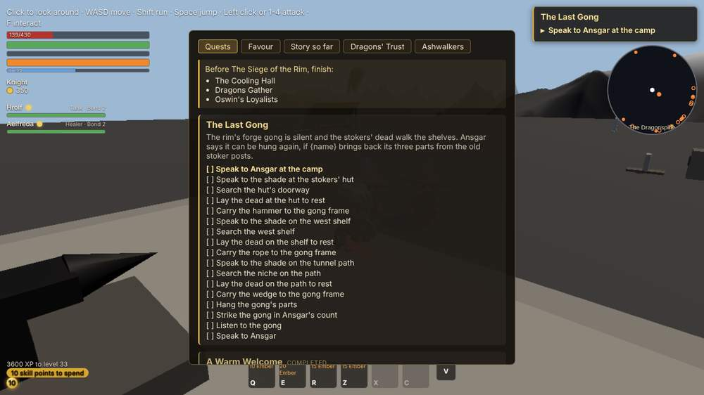

**Steps**
1. Speak to Ansgar at the camp.
2. Three posts, each the same way: speak to the shade, search the spot, lay the dead to rest, carry the part to the gong frame.
   - The stokers' hut: the hammer.
   - The west shelf: the rope.
   - The tunnel path niche: the wedge.
3. Hang the gong's parts; strike the gong in Ansgar's count; listen; speak to Ansgar.

**Rewards:** 650 XP, Ansgar's Gong-Mallet.

**Verify**
- [ ] Carrying a part slows Cael and stops attacks; dropping it leaves it where it fell.
- [ ] If R29 is still running when M54 starts, it is withdrawn with a "left on the Rim" note (digest 111).

---

## M50 The Cooling Hall

**Main** · Cooling Hall below the Lava Stair · Giver: Alric · After M49 · Jump: `?act5=m50&new` · Design time 50 min

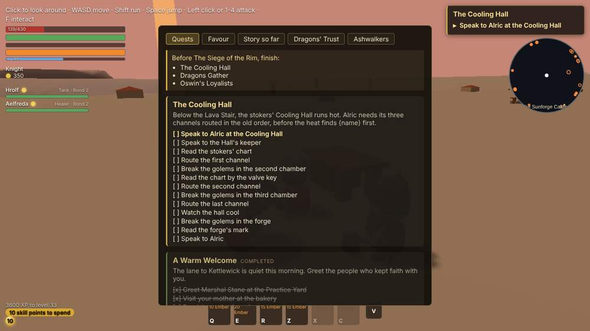

**Steps**
1. Speak to Alric at the Cooling Hall; speak to Hildeburh, the Hall's keeper; read the stokers' chart.
2. Route the first channel.
3. Break the golems in the second chamber; read the chart by the valve key; route the second channel.
4. Break the golems in the third chamber; route the last channel; watch the hall cool.
5. Break the golems in the forge; read the forge's mark; speak to Alric.

**Rewards:** 1,050 XP, Cooling Bead, Forge-Heart Fragment.

**Verify**
- [ ] The heat gauge fills while a channel is wrong; a full gauge vents for 10% health and resets that channel (digest 106).

| Hall entry | Heat gauge | The forge |
| --- | --- | --- |
| 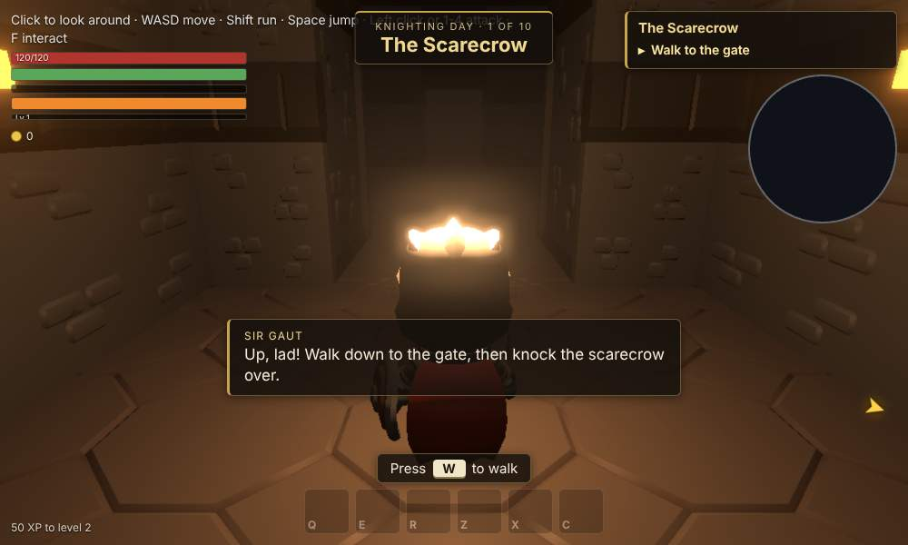 | 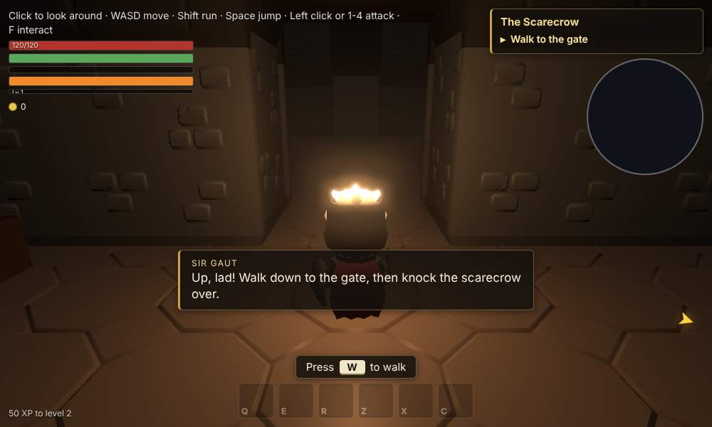 | 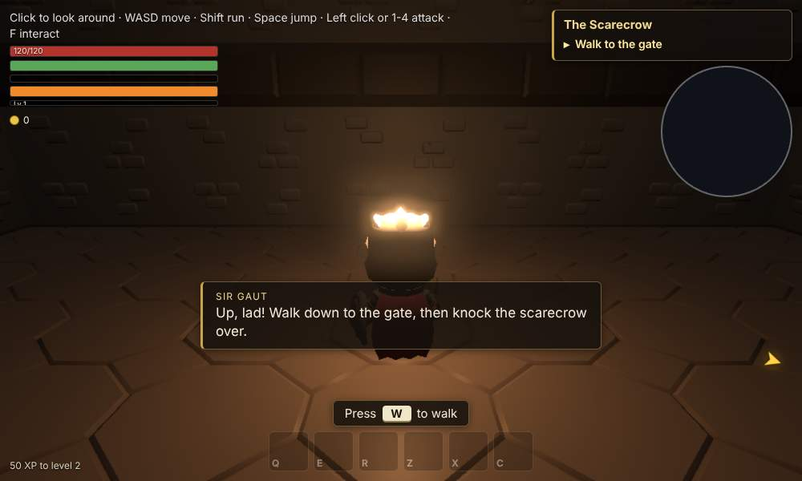 |

---

## M51 Dragons Gather

**Main** · Wyrm Terraces · Starts from the keeper's horn-stone at the camp · After M49 · Jump: `?act5=m51&new` · Design time 45 min

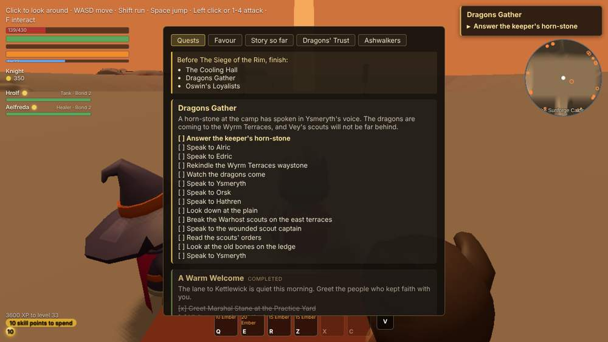

**Steps**
1. Answer the keeper's horn-stone (Ysmeryth's voice); speak to Alric and Edric.
2. Rekindle the Wyrm Terraces waystone; watch the dragons come.
3. Speak to Ysmeryth, Orsk and Hathren; look down at the plain.
4. Break the Warhost scouts on the east terraces; speak to Captain Harl, the wounded scout captain; read the scouts' orders; look at the old bones on the ledge.
5. Speak to Ysmeryth.

**Rewards:** 1,100 XP, Keeper's Call.

**Verify**
- [ ] Which dragons land depends on Act 3 (Orsk, Hathren); Ysmeryth always comes.

---

## M52 The Siege of the Rim

**Main** · Rim Gate · Giver: Lord Wystan Halvard · After M47 to M51 and R26 · Jump: `?act5=m52&new` (or `&siege=m52` to start in the waves) · Design time 55 min

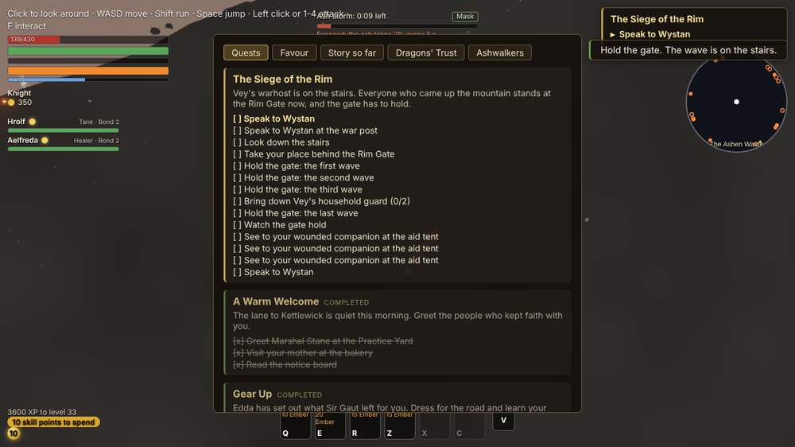

**Steps**
1. Speak to Wystan; speak to him again at the war post; look down the stairs; take your place behind the Rim Gate.
2. Hold the gate through four waves. In wave 3, bring down Vey's two household guards.
3. Watch the gate hold.
4. See to your wounded companion at the aid tent (the companion in your second seat: Hrolf, Aelfreda or Tobb).
5. Speak to Wystan. The card **"The Rim holds"** shows; Alric points you to the anvil.

**Rewards:** 1,200 XP, Siege Medal. Opens R27, R28, R30 and M53.

**Verify**
- [ ] Siege HUD: gate health 1,000, wave count, orders at breaks (hold, brace, loose, flasks, gong) (digest 80, 81, 100).
- [ ] At most 12 foes alive at once, and all 40 still come (digest 69); foes march on the gate whether Cael is in sight or not (digest 84).
- [ ] A breach is not a fail; a load restarts the current wave; allies kneel and rise; XP only for foes Cael hit in the last 8 s (digest 63).
- [ ] Wystan's sally in wave 3; dragons arrive in wave 3, or wave 2 if you yielded to Ysmeryth in M31 (digest 82).
- [ ] A shield-line break kneels the whole line for Spare (T); sparing a household guard gives Halvard +2 (digest 86).
- [ ] The wounded companion is the second-seat one (digest 83).

| Siege HUD | Breach | The Rim holds |
| --- | --- | --- |
| 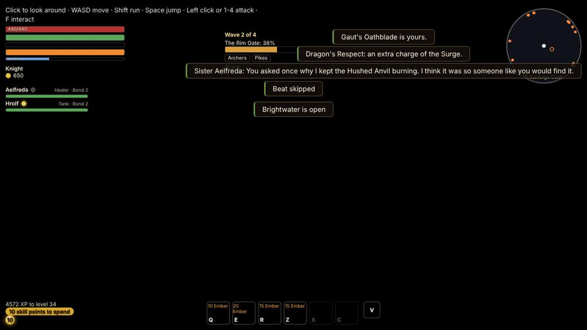 | 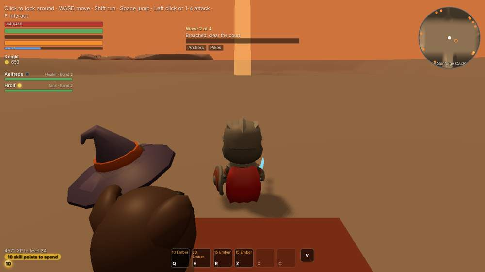 | 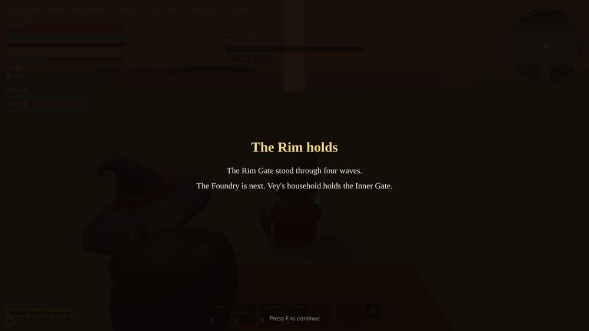 |
| **Marshal preset** | **Keepers preset** | |
|  | 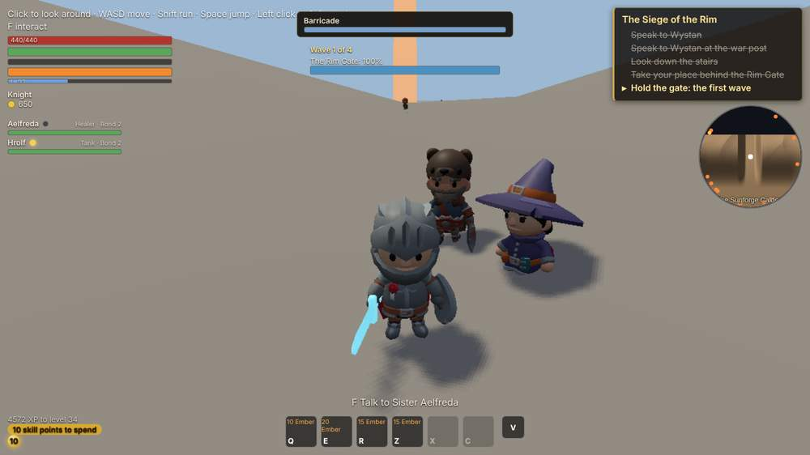 | |

**Taste calls:** digest 63, 69, 80 to 84, 86, 99, 100, 107, 113 ("The Rim holds" wording).

---

# Phase J: the Foundry

## R27 Grisel's Redemption

**Region** · The stokers' tunnel under the rim · Giver: Lady Wenna Grisel · After M52 · Jump: `?act5=r27&new` · Design time 45 min

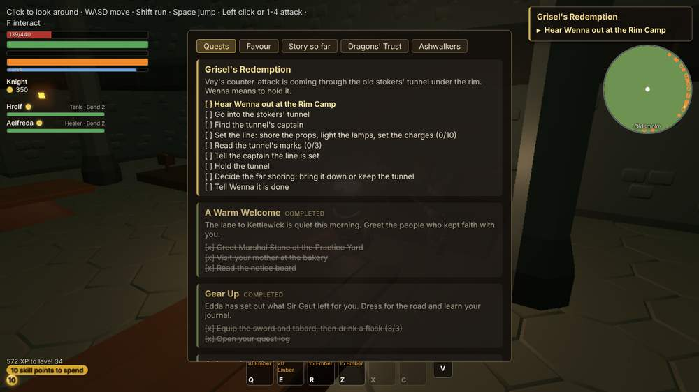

**Steps**
1. Hear Wenna out at the Rim Camp; go into the stokers' tunnel; find Dagna Coalbrow, the tunnel captain.
2. Set the line (10 jobs): shore the props, light the lamps, set the charges. Read the tunnel's three marks.
3. Tell the captain the line is set; hold the tunnel against the counter-attack.
4. **Decide the far shoring:** bring it down (`collapse`) or keep the tunnel (`keep`) (flag `story.r27.choice`).
5. Tell Wenna it is done.

**Rewards:** 700 XP, Miner's Last Pick. Required for M54.

**Verify**
- [ ] The tunnel's garrison follows Act 3 and Act 4 choices (F5, F6); with F6 Leaders the far seal starts open.
- [ ] After `keep` the far seal stays open; after `collapse` it is shut.

| Tunnel entry | Charges set | Far end open |
| --- | --- | --- |
| 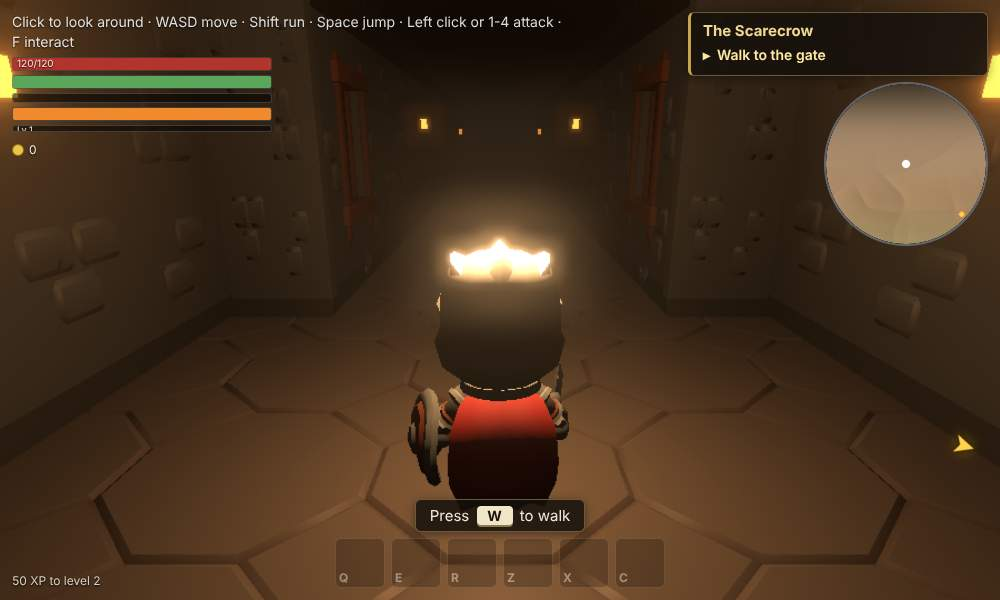 | 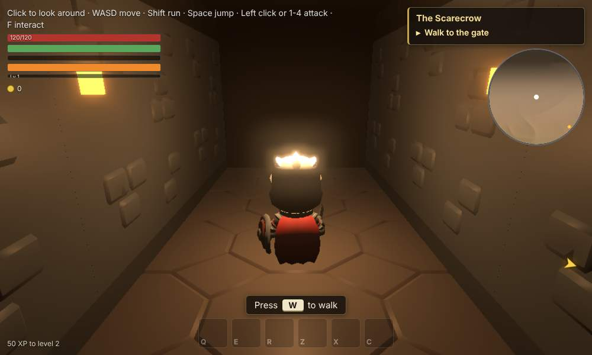 | 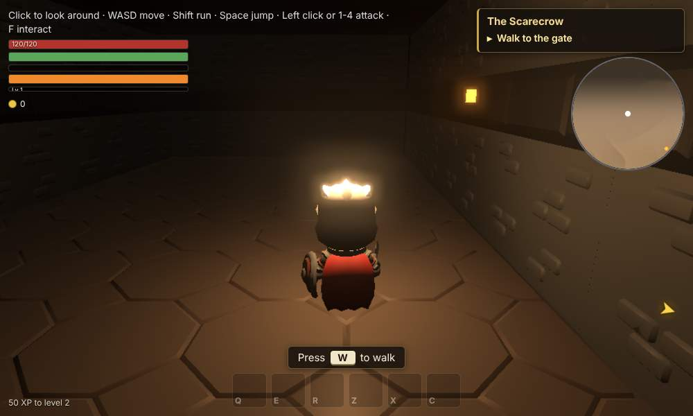 |

**Taste calls:** digest 108 (Dagna Coalbrow and other names).

---

## R28 The Ashwalkers' Pyre

**Region** · Rim Gate court · Giver: Wulfhild · After M52 · Jump: `?act5=r28&new` · Design time 40 min

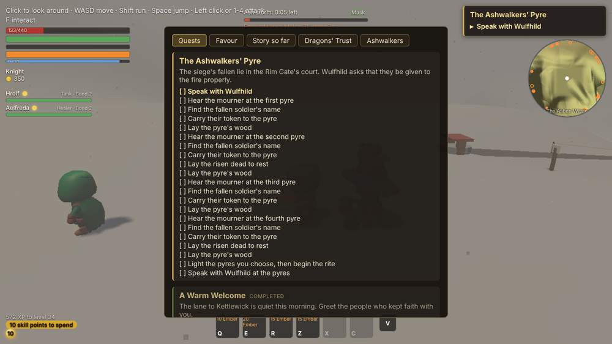

**Steps**
1. Speak with Wulfhild.
2. Four pyres. At each: hear the mourner, find the fallen soldier's name, carry their token to the pyre, lay the pyre's wood.
   - Pyre 1: Aldred, a Halvard archer.
   - Pyre 2: Sabine, an Oswin quartermaster. The dead rise here: lay them to rest.
   - Pyre 3: Holt, a Grisel miner.
   - Pyre 4: Wenyth, an Ashwalker. The dead rise here too.
3. **Light the pyres you choose** (0 to 4), then begin the rite. Speak with Wulfhild at the pyres.

**Rewards:** 700 XP, Walker Pyre-Mask.

**Choices:** each pyre lit costs 10 Burn, is a Heartshard use (can add a Scar) and gives Ashwalkers +2 (digest 109). The count is in `story.r28.pyres`.

**Verify**
- [ ] The Scar line and Rite note appear in the journal (digest 101).
- [ ] Scars from pyres count toward the M56 limit of 8.

---

## R30 Tobb's Ballad

**Region** · Rim Camp · Giver: Tobb Fenwick · After M52 · Jump: `?act5=r30&new` · Design time 40 min

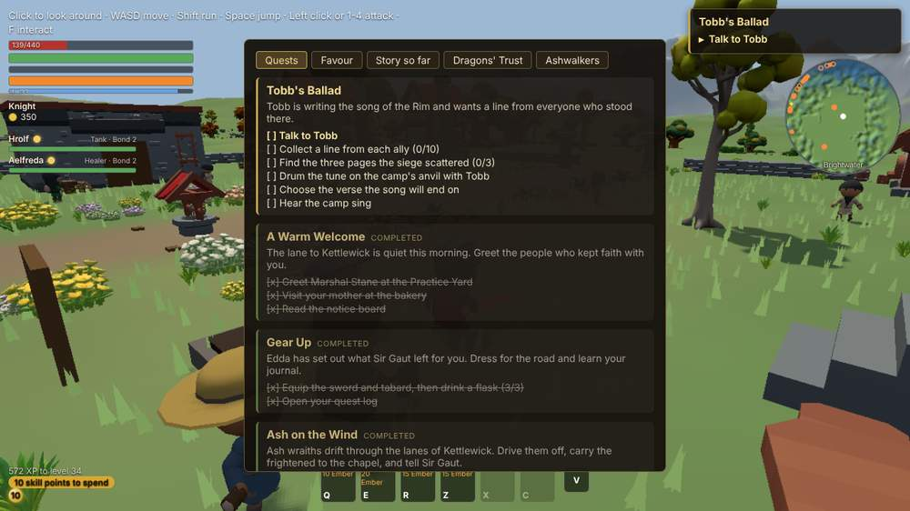

**Steps**
1. Talk to Tobb.
2. Collect a line from each ally (10).
3. Find the three pages the siege scattered.
4. Drum the tune on the camp's anvil with Tobb (a rhythm run that never hard-fails).
5. **Choose the verse** the song will end on: Gaut, Keepers, Houses or Walkers (flag `story.r30.verse`).
6. Hear the camp sing.

**Rewards:** 700 XP, Ballad of Cael (cosmetic).

**Verify**
- [ ] The chosen verse plays in the credits ballad (digest 98).

---

## M53 Vey's Last Argument

**Main** · Inner Gate · Giver: King Edric IV · After M52 · Jump: `?act5=m53&new` · Design time 45 min

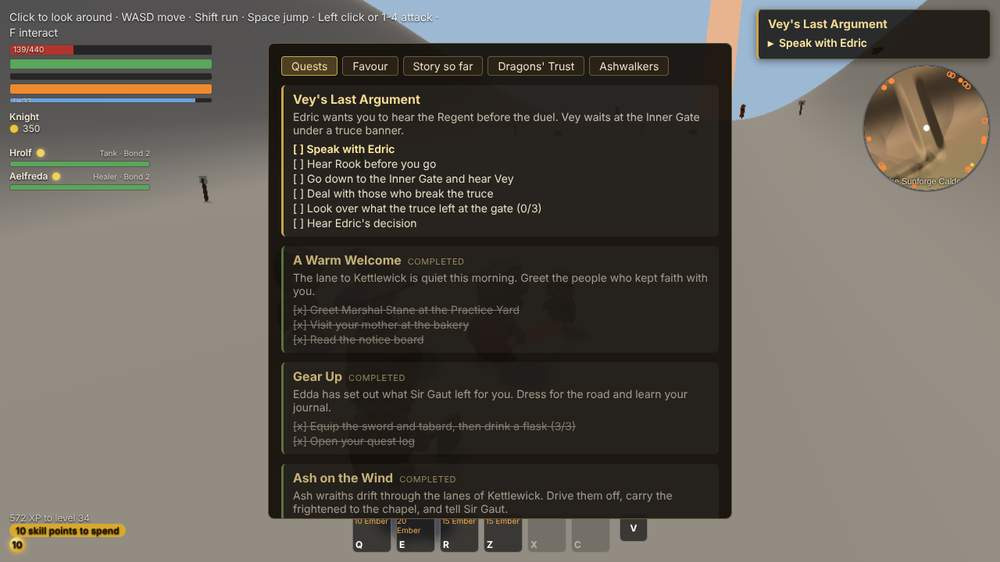

**Steps**
1. Speak with Edric; hear Rook before you go.
2. Go down to the Inner Gate and hear Vey under the truce banner.
3. Deal with those who break the truce.
4. Look over what the truce left at the gate (3).
5. Hear Edric's decision.

**Rewards:** 1,000 XP, Edric's Seal. The Inner Gate opens (`story.m53.complete`).

**Verify**
- [ ] Vey's questions are answered from your own history; the outcome never changes (digest 110).

---

## D09 Iron and Ember (boss: Morcant Vey)

**Dungeon** · The Foundry · Giver: Alric at the Foundry door · After M53 · Jump: `?act5=d09&new` · Design time 70 min

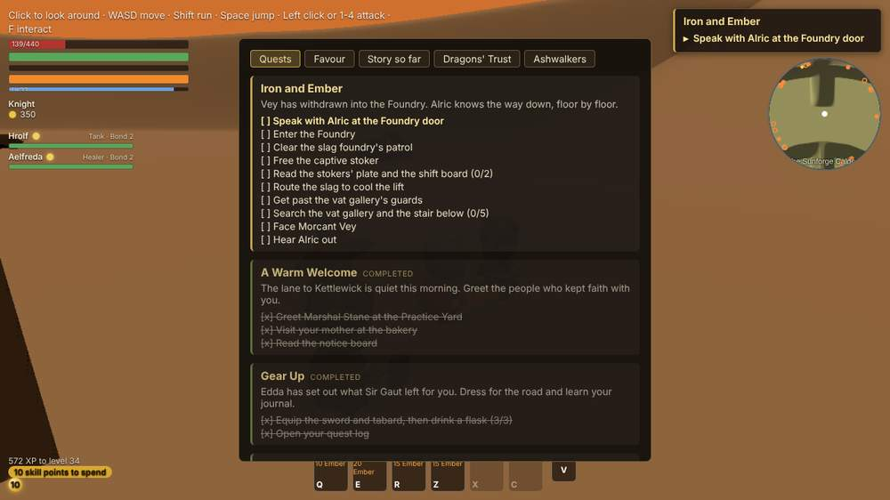

**Steps**
1. Speak with Alric at the Foundry door; enter the Foundry.
2. Clear the slag foundry's patrol; free Old Tam, the captive stoker.
3. Read the stokers' plate and the shift board (2).
4. Route the slag to cool the lift. Sluice order is **1, 3, 2**; after two wrong tries Old Tam shouts the next wheel.
5. Get past the vat gallery's guards (Wenna waits in the gallery on the Confront road; Vey's two household guards join this fight). Search the vat gallery and the stair below (5).
6. **Face Morcant Vey.**
7. Hear Alric out.

**Rewards:** 1,500 XP, Regent's Gauntlet, two Forge-Heart Fragments.

**Boss: Morcant Vey, the Regent Reforged** (level 38)
- Four bar floors at 75, 50, 25 and 4%; a break counts only at a floor. Poise 60; heavy hits count x2, light hits x0.5 (digest 87).
- His combo, a shockwave and surges; black forge-iron look (digest 88).
- At the last floor a **6 s Spare window** opens (the music hushes). Hold T to spare him; any hit strikes him down, with 0.4 s grace (digest 89, 99).
- Under F7, four household guards join the fight; on the Spy road (M21) the guards stand down.

**Choices:** Spare: Oswin +4, Halvard -4; he disappears at once. Strike: Halvard +4, Oswin -2.

**Verify**
- [ ] Hitting him between floors never breaks a bar early.
- [ ] Both outcomes save (`boss.vey.outcome`) and the favour changes show in the party screen (P).
- [ ] The D09 favour snapshot is taken on first Foundry entry.

| Foundry entry | Slag floor | Vat gallery | Arena |
| --- | --- | --- | --- |
| 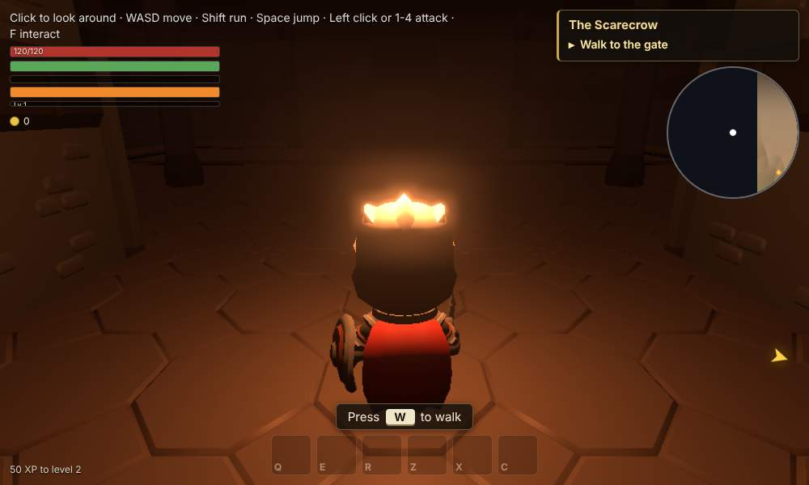 | 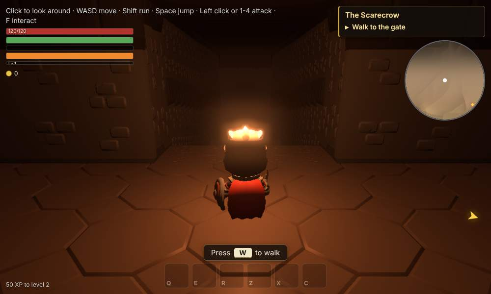 | 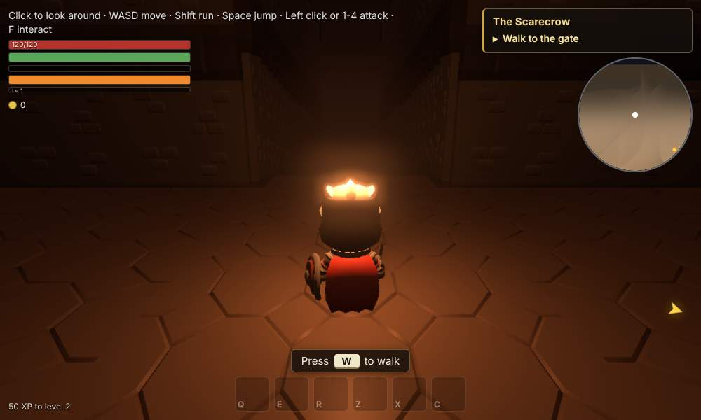 | 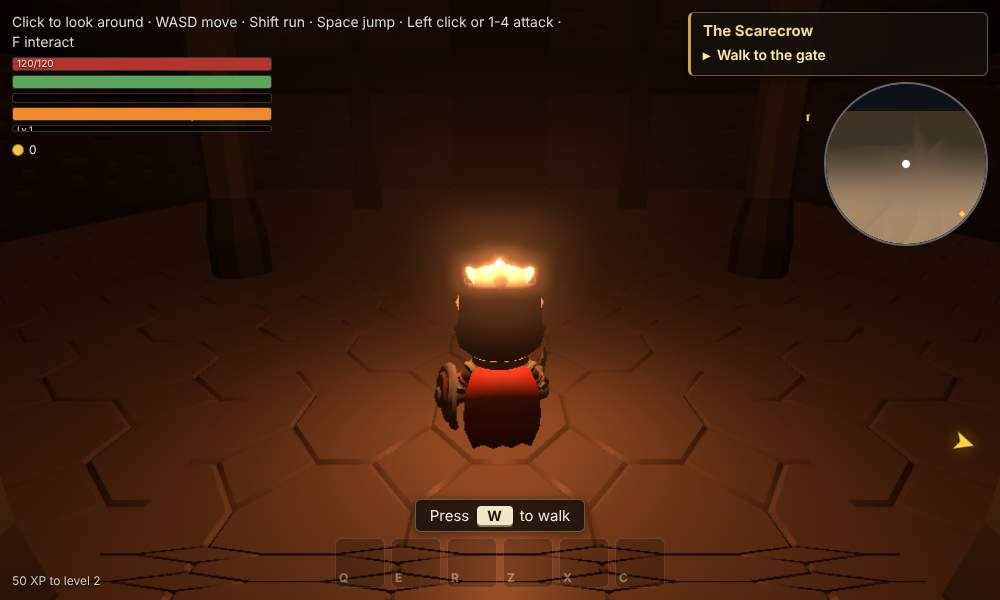 |
| **Vey intro** | **First break** | **Spare window** | **Spared** |
| 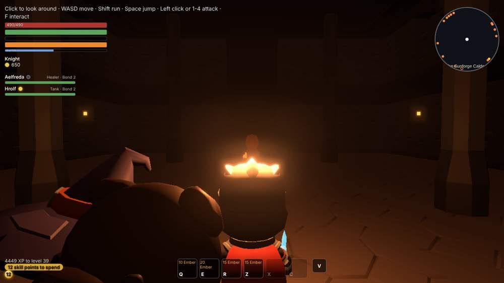 | 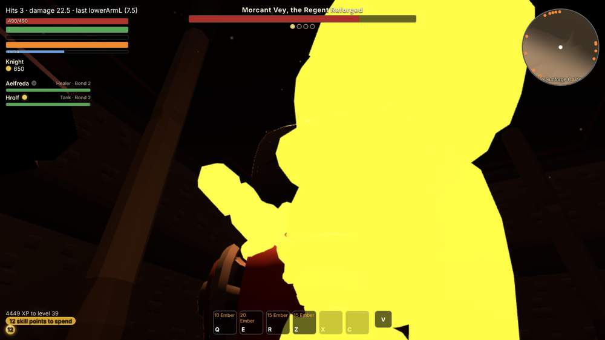 | 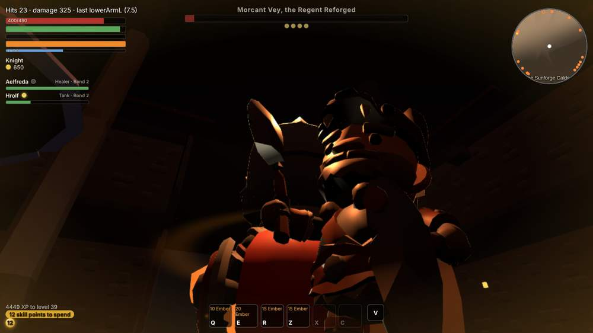 | 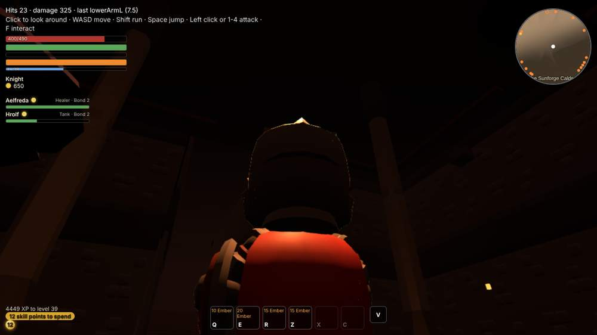 |
| **Struck down (Pathfinder)** | **After** | | |
| 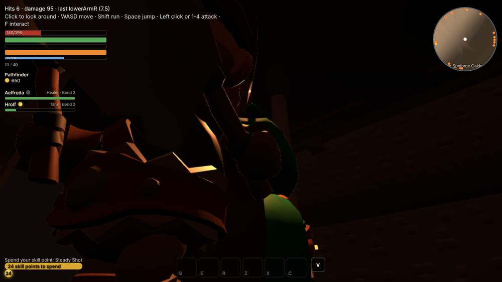 |  | | |

**Taste calls:** digest 76 (square ring arena), 87 to 89, 96 (Regent's Gauntlet), 108 (Old Tam), 110 (sluice order).

---

## M54 Ulthred Wakes

**Main** · Foundry to the Hammer Hall · Giver: Alric at the Rim Camp · After D09 and R27 · Jump: `?act5=m54&new` · Design time 45 min

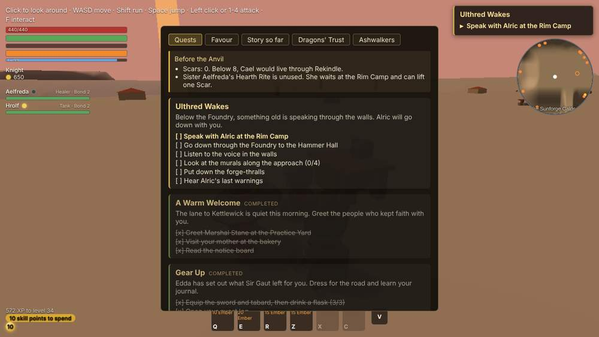

**Steps**
1. Speak with Alric at the Rim Camp. If R28, R29 or R30 is still open, the offer warns this is the last chance on the rim (digest 64).
2. Go down through the Foundry to the Hammer Hall; listen to the voice in the walls.
3. Look at the murals along the approach (4).
4. Put down the forge-thralls.
5. Hear Alric's last warnings.

**Rewards:** 1,000 XP, Stoker's Key.

**Verify**
- [ ] Starting M54 withdraws any running R28, R29 or R30 with "left on the Rim" (digest 111).

| Hammer Hall mouth | Mural |
| --- | --- |
| 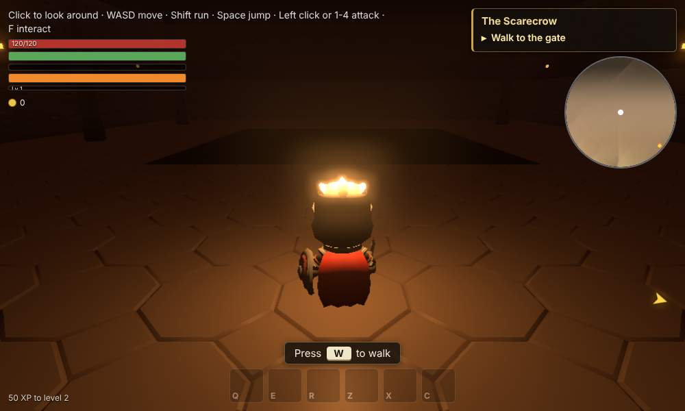 | 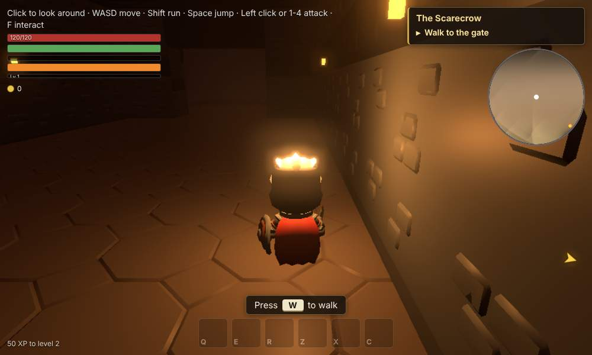 |

---

## M55 Hammer and Heart

**Main** · Hammer Hall · Giver: Ulthred, the First Smith · After M54 · Jump: `?act5=m55&new` · Design time 40 min

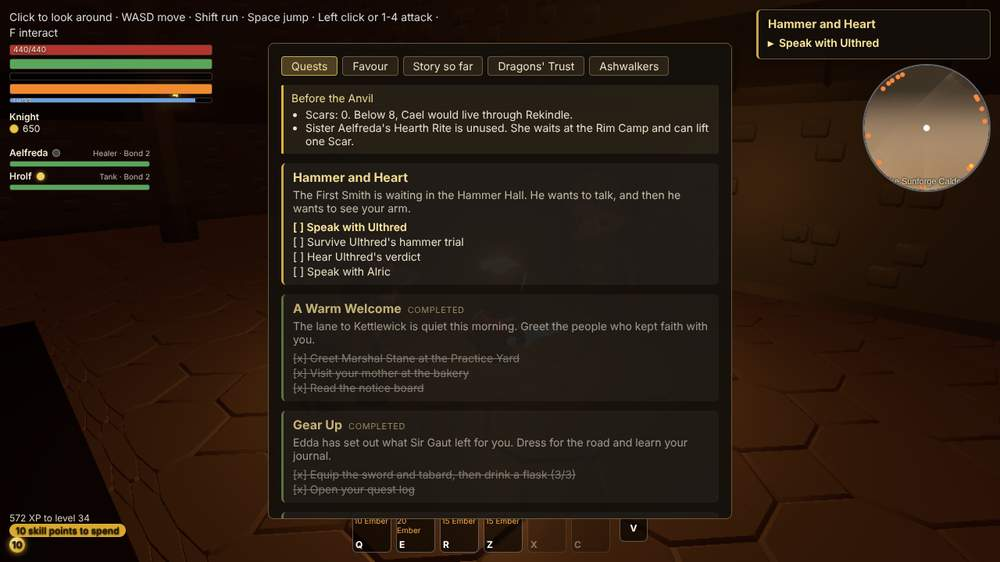

**Steps**
1. Speak with Ulthred (parley).
2. **Survive Ulthred's hammer trial:** three rounds of five slams. A slam counts only if it was aimed at Cael and avoided. Cael never drops below 1 health.
3. Hear Ulthred's verdict; speak with Alric.

**Rewards:** 1,100 XP, Hammer-Rune.

**Verify**
- [ ] Slams that were not aimed at Cael do not count; the round counter only rises on avoided slams (digest 93).

---

## D10 The Last Hammer (boss: Ulthred, the Ash King)

**Dungeon** · Hammer Hall and the Anvil of Ages · Giver: Alric in the Hammer Hall · After M55 · Jump: `?act5=d10&new` · Design time 80 min

**Steps**
1. Speak with Alric in the Hammer Hall.
2. Break the thralls and the forge-fire before the last door (three more fire hounds since the pacing pass).
3. Douse the forge vents by the last door (4); read the stokers' marks there (4).
4. **Defeat Ulthred, the Ash King.**
5. Find Alric on the Anvil.

**Rewards:** 2,000 XP, Ember Crown.

**Boss: Ulthred** (level 40, 6,000 health, nine bar floors; 8 to 11 min per class, digest 91)
- **Phase 1, Hammer Hall:** bars break only while his hammer is stuck in the floor (2.2 s). At 66% the floor breaks and the fight drops to the Anvil island (digest 66).
- **Phase 2, the Anvil:** bars break only on crack-anvils. A Surge Leap (V) landing within 2.5 m primes one, or hold F for 2 s beside it; then a swing cracks it. Forge-fire adds Burn. The music is a medley of all seven regions' voices (digest 97).
- **Phase 3:** a chain barrage; he wears Vey's plate (digest 90). At 12 or more Scars a Scar tax applies (digest 92).
- **The ninth break** needs a hold-F Heartshard finish for 1.5 s.
- Spirit-flames from earlier choices give +2% damage each.

**Verify**
- [ ] Damage outside the stuck window or crack-anvils never breaks a bar.
- [ ] The floor break moves Cael safely to the island (lava throws, never kills).
- [ ] The finish prompt shows only at the ninth floor.

| Floor cracking | Floor broken | Anvil of Ages |
| --- | --- | --- |
|  |  |  |

**Taste calls:** digest 66, 90 to 92, 96 (Ember Crown), 97.

---

## M56 Embers or Dawn

**Main** · The Anvil of Ages · Starts at Alric after D10 · Jump: `?act5=m56&new` · Design time 45 min

**Steps**
1. Hear what Alric has to say.
2. Speak with Ysmeryth at the Anvil's edge.
3. Speak with your companions.
4. **Choose: rekindle the Anvil, or let it die.** The choice writes only on confirm, and there is a "back" option (digest 112).
5. Stand at the Anvil. The ending plays.

**Rewards:** 1,500 XP.

**The ending, in order**
1. **Cutscene:** Rekindle 12 s, Let It Die 14 s.
2. **Title card:** "The Last Ember" (Rekindle), with "Cael Brannoc, the last bearer" if Scars were 8 or more (Cael dies); or "The Long Dawn" (Let It Die). Scars are counted at the moment of choice (`story.m56.scars`).
3. **Epilogue:** eight slides, narrated by the ally with the highest favour (Tobb sings on a tie).
4. **Credits:** heading, five DLC cards, "Made with" block, Tobb's ballad with your R30 verse. Hold Esc 1.5 s to skip (digest 102).
5. **After-ending world** (below).

| Cutscene | Title card | Epilogue | Credits |
| --- | --- | --- | --- |
|  |  |  |  |

**Verify (do the ending at least three times, from a save or the M56 jump)**
- [ ] Rekindle with fewer than 8 Scars: "The Last Ember", Cael lives.
- [ ] Rekindle with 8 or more Scars: "The Last Ember" plus "Cael Brannoc, the last bearer"; Cael is gone in the after-world.
- [ ] Let It Die: "The Long Dawn".
- [ ] The epilogue narrator matches the highest favour track; the ballad plays the R30 verse.
- [ ] Ending screens are solid black between beats (digest 102).
- [ ] The autosave is held during the ending and released only after the after-ending world loads.
- [ ] The "Made with" credits block lists three.js, Rapier, howler.js, Vite and TypeScript (digest 103, wording open).

**Taste calls:** digest 67 (ending names, eight slides, five DLC cards), 98 (ending themes), 102, 103 ⚑, 112, 114 ⚑.

---

# After the ending

You wake at the **Rim Camp fire** with a toast:
- Rekindle: "The Forge burns again. The Rim Camp wakes to a warmer dawn."
- Let It Die: "The Forge is dark. Somewhere above the camp, dragons are calling."
- If Cael died: "The ballad remembers Cael walking these roads still."

Jump straight here: `?act5=m56&new&afterEnding=rekindle` or `&afterEnding=let-it-die`, add `&caelDied` for the death variant.

**Verify**
- [ ] The map shows "Harrowmark (retaken)"; Act 4's city cast stays gone (digest 115).
- [ ] Rekindle warms the light everywhere outside the Caldera (digest 116).
- [ ] Let It Die: Ysmeryth flies loops over Harrowmark, Hathren over the Dragonspine, Orsk over the Waste (digest 117); half of Act 4's ash and dusk stays over Harrowmark and the Waste is darker (digest 119 ⚑).
- [ ] Alric and Maud stay at the Rim Camp, Hild at Ashgate, Wulfhild at the Walker Camp; Rook keeps the Knight desk at Gaut's Bastion post (digest 118).
- [ ] Dunstan's Ashgate forge is closed after the ending.
- [ ] Withdrawn rim quests do not reopen; the world is free to roam; a waystone save and Continue return you to the after-world, not the ending.

| | Rim Camp | Rim Gate | Harrowmark inside | Harrowmark fountain |
| --- | --- | --- | --- | --- |
| **Rekindle** |  |  |  |  |
| **Let It Die, Cael died** |  |  |  |  |

**Taste calls:** digest 115 to 119.
